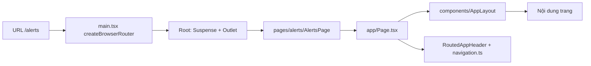
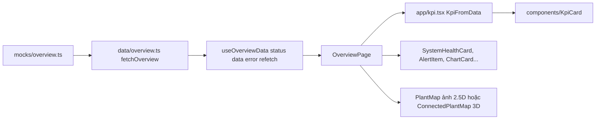
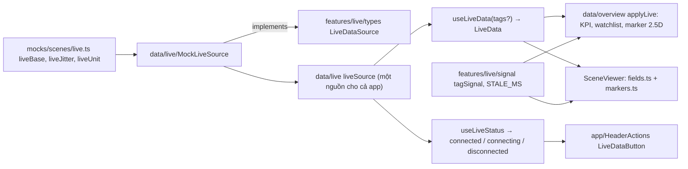
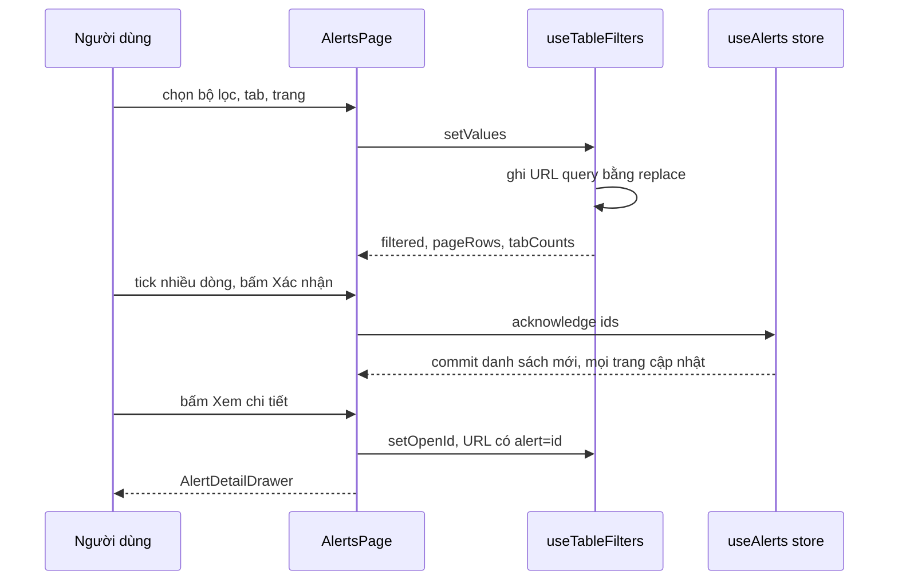
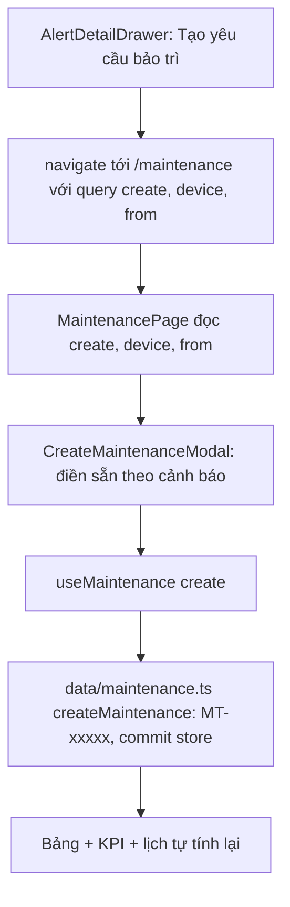
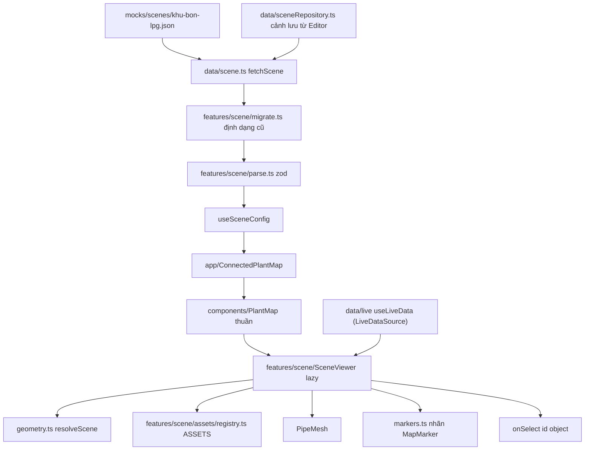
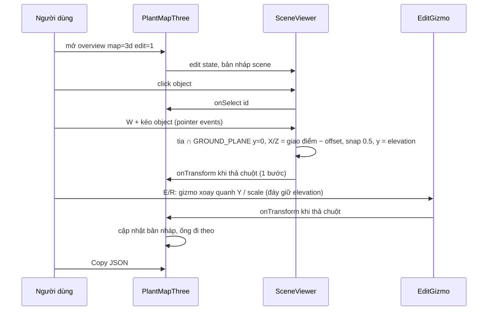
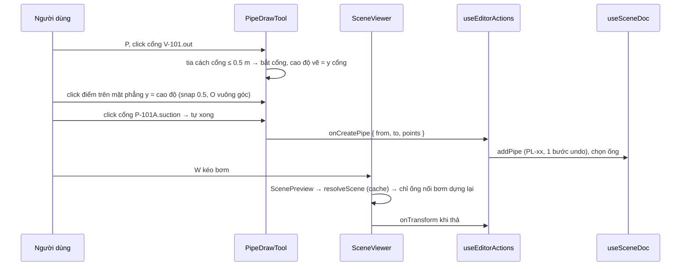
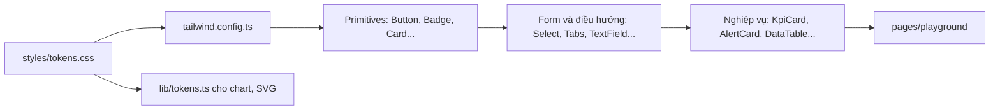
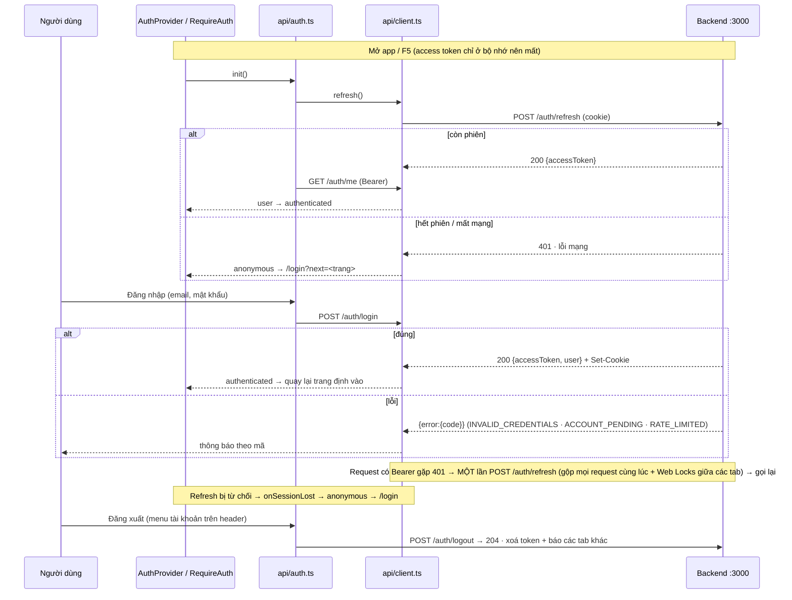

# GUIDE – Đọc code demo-lpg theo luồng

Tài liệu cho người mới: đọc theo **luồng** (URL → dữ liệu → màn hình) thay vì mở file ngẫu nhiên.
Quy ước chi tiết, quyết định kiến trúc và log sai khác Figma nằm ở [`CLAUDE.md`](CLAUDE.md).

---

## 1. Dự án làm gì

- Dashboard giám sát hệ thống LPG "Digital Twin 2026 – Plant Control": **Tổng quan**, **Cảnh báo**, **Bảo trì**, **Chi tiết tài sản** (`/map/:assetId` – tab "Bản đồ nội khu", hiện có V-101).
- Dựng theo Figma (file `stJtcbE3XGzA4WFrJFE1un`); ảnh tham chiếu trong `public/figma-ref/`.
- Dữ liệu hiện là **mock** (`src/mocks/`), đi qua lớp `src/data/` để sau thay bằng API mà không sửa UI.
- Bản đồ nhà máy có 2 kiểu: ảnh 2.5D (mặc định) và cảnh 3D (three.js) dựng từ JSON `SceneConfig`.
- Có **Scene Editor** (`/editor`) để dựng/sửa cảnh 3D, lưu tạm trong localStorage.

**Chạy**

| Lệnh / URL | Tác dụng |
|---|---|
| `npm run dev` | Dev server Vite (mặc định http://localhost:5173); gọi backend thẳng ở `VITE_API_URL` (`.env.development`: http://localhost:3000) qua CORS |
| Backend | Repo riêng `../demo-lpg-server` (`npm run db:up` + `npm run dev` ở đó) – mục 9 |
| `/login` · `/register` · `/pending` | Đăng nhập · đăng ký · "đang chờ duyệt" (mọi trang khác cần đăng nhập; `VITE_AUTH=off` = bỏ đăng nhập, phiên giả admin) |
| `npm run build` · `npm run typecheck` | Build production (gồm `tsc -b`) · chỉ kiểm tra kiểu |
| `/overview?map=3d` | Bản đồ 3D thay cho ảnh 2.5D |
| `/overview?map=3d&edit=1` | Chế độ sửa nhanh trên bản đồ (kéo/xoay, Copy JSON) – chỉ engineer/admin |
| `/overview?map=3d&quality=low` | Ép preset 3D `low` / `medium` / `high` (mặc định tự chọn theo FPS) |
| `/overview?scene=tram-chiet-nap` | Mở cảnh 3D khác (cảnh mẫu hoặc cảnh lưu từ Editor), luôn ở 3D |
| `/overview?map=3d&focus=V-101` | Mở 3D và bay tới object (thêm chế độ xem "<nhãn object>") – nút "Xem trên bản đồ" của trang chi tiết |
| `/map` · `/map/V-101` | Tab "Bản đồ nội khu": `/map` mở thẳng chi tiết "Bồn LPG V-101" (như ảnh 5D). `/map/v-101` → `/map/V-101`; mã lạ → "Không tìm thấy tài sản"; `/operations/V-101` (link cũ) → `/map/V-101`; `?hide=alert,sensor` ẩn loại sự kiện; `?create=1` mở modal tạo yêu cầu bảo trì |
| `/editor` | Scene Editor – chỉ engineer/admin (vai trò khác → `/overview`); khi `VITE_AUTH=off` vẫn cần `?edit=1` |
| `/playground` | Xem mọi component và biến thể, đặt cạnh ảnh Figma |

- Deploy (Netlify): `netlify.toml` (build `npm run build`, publish `dist`, Node 20, chuyển `/*` → `/index.html` status 200) – không thêm file `_redirects` vào `public/` để tránh 2 nguồn cấu hình.
- Lý do: app là SPA dùng history router (`createBrowserRouter` trong `src/main.tsx`), host tĩnh không có file `/alerts` nên gõ thẳng URL hoặc F5 sẽ 404 nếu thiếu luật trả `index.html` cho React Router xử lý; vì vậy `base` trong `vite.config.ts` phải để mặc định `/`.

---

## 2. Bản đồ thư mục

```
src/
├─ main.tsx            khai báo route (createBrowserRouter)
├─ app/                "keo" nối router + dữ liệu vào component
├─ pages/              mỗi màn một thư mục (overview, alerts, maintenance, asset, editor, playground)
├─ components/         component THUẦN (không import router/data), barrel index.ts
├─ data/               hook + hàm dữ liệu theo màn (bọc mock, chỗ thay API)
├─ mocks/              dữ liệu giả từ Figma; mocks/scenes/*.json = cảnh 3D
├─ features/scene/     engine 3D: kiểu SceneConfig, validate, Viewer, asset
├─ features/scene-editor/  logic Editor (store, ops, validate, nháp)
├─ features/live/      kiểu số liệu trực tiếp, quy tắc mất tín hiệu, tags.ts (tên tag giả định – một chỗ)
├─ features/tank/      volume.ts (mức → % thể tích), layers.ts (3 lớp trong bồn)
├─ lib/                tiện ích chung (cn, store, dialog, focus…)
├─ assets/digital-twin/    SVG/PNG từ Figma + sổ đăng ký icon
└─ styles/             tokens.css (màu, bo góc…) + global.css

packages/shared/       kiểu + schema zod dùng chung FE/BE (scene, live, alerts, maintenance, roles, auth)
```

| Thư mục | Chứa gì | Khi nào cần vào |
|---|---|---|
| `src/main.tsx` | Danh sách route, lazy-load trang | Thêm trang / đổi đường dẫn |
| `src/app/` | `Page.tsx` (layout + header có router), `navigation.ts` (menu), `useTableFilters.ts`, `kpi.tsx`, `HeaderActions.tsx`, `ConnectedPlantMap.tsx`, `AssetModelPanel.tsx` (mô hình 3D tài sản + ảnh dự phòng), `editorAccess.ts`, `Placeholder.tsx` | Nối component với URL/dữ liệu; thêm tab menu |
| `src/pages/` | Trang ghép component: `src/pages/overview/`, `src/pages/alerts/`, `src/pages/maintenance/`, `src/pages/asset/` (`AssetDetailPage`), `src/pages/editor/`, `src/pages/playground/`, `src/pages/SimplePage.tsx` | Sửa bố cục/hành vi một màn |
| `src/components/` | 40+ component thuần, mỗi cái một thư mục `<Tên>/` | Sửa giao diện dùng chung |
| `src/data/` | `src/data/overview.ts`, `src/data/alerts.ts`, `src/data/maintenance.ts`, `src/data/assetDetail.ts`, `src/data/scene.ts`, `src/data/sceneRepository.ts` | Đổi nguồn dữ liệu, bộ lọc, số liệu suy dẫn |
| `src/mocks/` | `src/mocks/overview.ts`, `src/mocks/alerts.ts`, `src/mocks/maintenance.ts`, `src/mocks/assets.ts` (thông số tĩnh tài sản + sự kiện), `src/mocks/types.ts`, `src/mocks/scenes/` (cảnh 3D + số liệu giả `live.ts`) | Sửa/thêm dữ liệu giả |
| `src/features/scene/` | Viewer 3D + asset + validate zod | Mọi thứ về bản đồ 3D |
| `src/features/scene-editor/` | Store undo/redo, thao tác thuần, kiểm tra, nháp | Logic của `/editor` |
| `src/lib/` | `cn`, `createCollectionStore`, `useDialog`, `useRovingFocus`, `tokens`, `useNow`, `useElementSize`, `useFullscreen` | Viết hook/tiện ích dùng lại |
| `src/assets/digital-twin/` | Icon + ảnh bản đồ, đăng ký trong `src/assets/digital-twin/index.ts` | Thêm icon từ Figma |
| `src/styles/` | `tokens.css`, `global.css` | Đổi màu/token |
| `public/figma-ref/` | Ảnh chụp Figma để so; ảnh người dùng gửi không có node: `mt-create-modal-design.png`, `asset-v101-design.png` | Đối chiếu thiết kế |
| `packages/shared/src/` | Hợp đồng dữ liệu FE/BE: `scene/` (SceneConfig, specs, migrate, parse), `live.ts`, `alerts.ts`, `maintenance.ts`, `roles.ts`, `auth.ts`. FE dùng mã nguồn (alias), backend (repo riêng) dùng bản build `dist/` | Đổi kiểu dữ liệu dùng chung, thêm quyền |
| `src/api/` | Gọi backend: `client.ts` (fetch wrapper, lỗi có kiểu, refresh khi 401), `types.ts` (types + zod của hợp đồng API), `auth.ts` (phiên đăng nhập) | Thêm endpoint, đổi hợp đồng API |
| `src/app/auth/`, `src/features/auth/`, `src/pages/login/` | `AuthProvider`/`useAuth`/`useCan`, `RequireAuth`; logic thuần (phiên, quyền, thông báo lỗi); trang `/login`, `/register`, `/pending` | Đổi luồng/giao diện đăng nhập |

---

## 3. Quy ước cần biết trước khi đọc

| Chủ đề | Quy ước | File |
|---|---|---|
| Màu, bo góc, font | **Không hardcode màu.** Token là CSS var dạng kênh RGB, map sang Tailwind (`bg-surface`, `text-fg-muted`, `border-line/30`…). Palette mặc định của Tailwind đã tắt. Chart/SVG/3D đọc màu bằng `tokenColor` / `useTokenColors` / `sceneColor` | `src/styles/tokens.css`, `tailwind.config.ts`, `src/lib/tokens.ts`, `src/features/scene/colors.ts` |
| Component thuần | `src/components/*` không import router, không import `src/data`/`src/mocks` (ngoại lệ: `PageHeader` dùng `<Link>`). Nhận dữ liệu qua props, báo sự kiện qua callback | `src/components/index.ts` |
| Component nối dữ liệu | Nằm ở `src/app/` hoặc trong trang: `Page` (header gắn router), `KpiFromData`, `ConnectedPlantMap` (nạp cảnh 3D) | `src/app/` |
| Hook dữ liệu | Trang chỉ đọc qua `useOverviewData()`, `useAlerts()`, `useMaintenance()`, `useSceneConfig()`, `useLiveData()`. Không import `src/mocks` trong trang | `src/data/*.ts` |
| 3 trạng thái | Mỗi trang xử lý `loading` (Placeholder) · `error` (Card danger + "Thử lại") · `success` | `src/app/Placeholder.tsx` |
| Số liệu suy dẫn | KPI, số đếm tab, thẻ ưu tiên, lịch… tính bằng hàm `derive*` từ cùng một danh sách (Cảnh báo, Bảo trì). KPI Tổng quan hiện là mock tĩnh | `src/data/alerts.ts`, `src/data/maintenance.ts` |
| Mock | Nội dung lấy nguyên văn từ Figma | `src/mocks/` |
| Kiểu dữ liệu chính | `OverviewData`, `QueryState` · `AlertRecord` · `MaintenanceRecord` · `KpiMock` · `SceneConfig`/`SceneObject`/`Pipe`/`AssetType`/`LiveData` | `src/data/overview.ts`, `src/mocks/alerts.ts`, `src/mocks/maintenance.ts`, `src/mocks/types.ts`, `src/features/scene/types.ts` |
| Đặt tên | Thư mục `src/components/<PascalCase>/` + `<PascalCase>/index.ts`. Prop thống nhất: `variant`, `tone`, `size: sm\|md`, `label` (aria), `className`. Giá trị domain tiếng Anh kebab-case, nhãn hiển thị tiếng Việt | — |
| Alias | `@/` → `src/` | `vite.config.ts` |

---

## 4. Đi theo luồng

### 4a. Từ URL đến màn hình



| Thứ tự đọc | File | Vai trò |
|---|---|---|
| 1 | `src/main.tsx` | Khai báo route; trang có chart/3D lazy-load; `/editor` đi qua `EditorRoute` (kiểm quyền) |
| 2 | `src/app/auth/RequireAuth.tsx` | Route bảo vệ: chưa đăng nhập → `/login?next=…` |
| 2b | `src/app/editorAccess.ts` | `canUseEditor(search, role)` – có quyền `scene:write` (engineer/admin); `VITE_AUTH=off` → `?edit=1` như cũ |
| 3 | `src/app/Page.tsx` | `Page` = `AppLayout` + `RoutedAppHeader` (tab active theo URL) |
| 4 | `src/app/navigation.ts` | `NAV_ROUTES` – thứ tự, nhãn, icon, đường dẫn menu |
| 5 | `src/components/AppLayout/AppLayout.tsx` | 3 biến thể: `full`, `sidebar` (326px), `workspace` (cao 1 màn hình) |
| 6 | `src/components/AppHeader/AppHeader.tsx` | Header 60px + `NavTabs` |
| 7 | `src/pages/<màn>/…Page.tsx` | Ghép component cho từng màn |

| Muốn sửa | Sửa ở |
|---|---|
| Thêm/đổi đường dẫn | `src/main.tsx` |
| Tab menu (nhãn, thứ tự, icon) | `src/app/navigation.ts` |
| Khung trang, padding, cột sidebar | `src/components/AppLayout/AppLayout.tsx` |
| Nút góc phải header trang (Hôm nay, Xuất, Làm mới, Dữ liệu trực tiếp, đồng hồ) | `src/app/HeaderActions.tsx` |

### 4b. Dữ liệu chảy thế nào (ví dụ: Tổng quan)



| Thứ tự đọc | File | Vai trò |
|---|---|---|
| 1 | `src/mocks/overview.ts` | Mock nguyên văn Figma: `overviewKpis`, `priorityAlarms`, `watchlist`, chart… |
| 2 | `src/mocks/types.ts` | `KpiMock` – dạng KPI thuần (icon là tên, không phải ReactNode) |
| 3 | `src/data/overview.ts` | `OverviewData` (hợp đồng UI–dữ liệu), `fetchOverview()` (chỗ thay API), `useOverviewData()` |
| 4 | `src/pages/overview/OverviewPage.tsx` | 3 trạng thái; KPI → bản đồ → 4 chart; sidebar 4 card |
| 5 | `src/app/kpi.tsx` | `KpiFromData`: `KpiMock` → `<KpiCard>` (tên icon → `<Icon>`) |

Đoạn chính của hook (mọi hook dữ liệu đều theo mẫu này):

```ts
export async function fetchOverview(): Promise<OverviewData> {
  return { systemStatus: mock.systemStatus, kpis: mock.overviewKpis, /* … */ };
}
export function useOverviewData() { /* → { status, data, error, refetch } */ }
```

| Muốn sửa | Sửa ở |
|---|---|
| Nối API thật cho Tổng quan | Thân `fetchOverview()` trong `src/data/overview.ts` |
| Nội dung KPI/thẻ/chart | `src/mocks/overview.ts` |
| Thứ tự/bố cục khối | `src/pages/overview/OverviewPage.tsx` |

**Số liệu trực tiếp (live) – một luồng chung cho KPI, danh sách theo dõi, bản đồ 2.5D, cảnh 3D và header:**



- Kiểu: `TagValue = { value: number | string; unit?; ts; quality: 'good' | 'uncertain' | 'bad' }`, `LiveData = Record<tag, TagValue>` (`src/features/live/types.ts`, thuần).
- Nguồn: interface `LiveDataSource { subscribe(tags, cb) → huỷ; getSnapshot(tags); status; onStatusChange(cb) }`. Bản hiện tại `MockLiveSource` (đổi số mỗi 2 s, kết nối khi có người nghe). **Nối WebSocket/SCADA = viết class mới cùng interface và đổi `liveSource` trong `src/data/live/index.ts`** – UI không sửa.
- Quy tắc hiển thị (`src/features/live/signal.ts`): **mất tín hiệu** = quality `bad`, hoặc ≥ 10 s (`STALE_MS`) không cập nhật, hoặc không có tag → "Mất tín hiệu" (xám + `SignalLostIcon`), KHÔNG hiện số cũ; `uncertain` vẫn hiện số. `useLiveData` tự hẹn giờ vẽ lại đúng mốc 10 s (`nextExpiry`) kể cả khi nguồn im lặng. Chưa nhận ảnh chụp đầu → "—" (không báo mất tín hiệu).
- Áp dụng: KPI (`signalLost` → "—" + "Mất tín hiệu"), dòng theo dõi (`signalLost`, tone offline), marker 2.5D (tone neutral + icon), nhãn 3D (`objectMarker`), màu thiết bị 3D (`objectStatus`: một binding mất tín hiệu → offline nếu không có cảnh báo/sự cố nào khác), tooltip 3D, vệt chảy ống (mất tín hiệu → không chảy).
- Header "Dữ liệu trực tiếp" (`LiveDataButton`, mọi trang): connected = chấm live · connecting = "Đang kết nối lại…" vàng nhấp nháy · disconnected = "Mất kết nối" đỏ.
- Trình đọc màn hình: `src/app/LiveAnnouncer.tsx` (một vùng `aria-live="polite"` trong `Page`) đọc khi đổi trạng thái nguồn, khi số cảnh báo chưa xác nhận tăng, và mọi `announce()` (`src/lib/announce.ts`; Tổng quan dùng `useAnnounceChange` báo số điểm đo mất tín hiệu).
- Giả lập sự cố: `?live=disconnect`, `?live=bad:LT-101,TT-201`, `?live=stale:FT-101` (ghép bằng `;`), thanh "Giả lập nguồn dữ liệu" ở `/playground#scene`, hoặc `window.__liveSimulator` (dev).
- Mức bồn: tag `LT-xxx` = mức theo **chiều cao** (% đường kính); KPI "Mức bồn V-101" = **% thể tích** quy đổi bằng `levelPercentToVolumePercent` (`src/features/tank/volume.ts`, bồn trụ nằm, bỏ qua đáy elip; test `npm test`). TODO: bảng dung tích thật từ khách → `strappingVolume`.

| Muốn sửa | Sửa ở |
|---|---|
| Gắn KPI với tag | `live: { tag, digits?, transform? }` trong `overviewKpis` (`src/mocks/overview.ts`) |
| Gắn dòng theo dõi / marker 2.5D với tag | `live: { tag, field }` trong `watchlist` / `mapMarkers` |
| Thời gian coi là mất tín hiệu | `STALE_MS` (`src/features/live/signal.ts`) |
| Nối nguồn thật | `liveSource` trong `src/data/live/index.ts` (+ class mới implements `LiveDataSource`) |

### 4c. Cảnh báo: lọc, chọn nhiều, xác nhận, drawer, URL



| Thứ tự đọc | File | Vai trò |
|---|---|---|
| 1 | `src/mocks/alerts.ts` | `AlertRecord`, `alertRecords`, `ALERT_ASSIGNEES` |
| 2 | `src/lib/createCollectionStore.ts` | Store danh sách dùng chung giữa trang; `commit` = cập nhật optimistic |
| 3 | `src/data/alerts.ts` | `ALERT_PARAMS` (tham số URL), `matchAlert`, `derive*`, `fetchAlerts`, `acknowledgeAlerts`/`assignAlerts`/`completeAlerts`, `useAlerts()` |
| 4 | `src/app/useTableFilters.ts` | Bộ lọc ↔ URL (`replace`), phân trang, số đếm tab, bản ghi đang mở, chọn dòng |
| 5 | `src/pages/alerts/AlertsPage.tsx` | Thẻ ưu tiên, KPI, Tabs, FilterBar, thao tác hàng loạt, `DataTable`, drawer, xuất CSV |
| 6 | `src/components/AlertDetailDrawer/AlertDetailDrawer.tsx` | Drawer chi tiết (Xác nhận / Hoàn thành / Tạo yêu cầu bảo trì) |

Tham số URL: `?tab=&q=&severity=&area=&device=&shift=&range=&page=&alert=` – giá trị mặc định không ghi lên URL.

| Muốn sửa | Sửa ở |
|---|---|
| Thêm bộ lọc | `ALERT_PARAMS` + `AlertFilters` + `matchAlert` (`src/data/alerts.ts`), `filterDefs` (`AlertsPage.tsx`) |
| Cột bảng | Mảng `columns` trong `AlertsPage.tsx` (+ `exportCsv` nếu cần xuất) |
| Hành vi Xác nhận/Phân công | `acknowledgeAlerts`, `assignAlerts` trong `src/data/alerts.ts` |
| KPI / thẻ ưu tiên | `deriveAlertKpis`, `derivePriorityCards` trong `src/data/alerts.ts` |

### 4d. Bảo trì: model, quá hạn, modal tạo, liên kết từ cảnh báo



**Ngày và quá hạn:** "hôm nay" tính theo giờ nhà máy `Asia/Bangkok` (`src/lib/plantTime.ts`: `plantDayKey`, `daysFromToday`, `plantMonthKey`, `plantDateTimeKey`, `parsePlantDateTime`), không theo múi giờ máy người xem. Mọi hàm ngày trong `src/data/maintenance.ts` (`isOverdue`, `dueLabel`, `matchMaintenance`, `derive*`) nhận `now` từ nơi gọi (trang dùng `useNow(60_000)`), không tự gọi `Date.now()` – test được bằng `now` cố định.

**Quá hạn theo GIỜ (một quy tắc cho danh sách, KPI, thẻ ưu tiên, lịch, trang chi tiết, tóm tắt ở trang tài sản):** còn mở (không `done`/`cancelled`) và `now ≥ giờ hạn` (`isPastDue` trong `src/features/maintenance/deadline.ts`). Hạn chỉ có ngày = cờ `dueHasTime: false` (vẫn lưu `…T23:59` cho khớp hợp đồng) → quá hạn tại 23:59:59, hiển thị "Cuối ngày"; hạn thật 23:59 vẫn là 23:59:00 – phân biệt bằng cờ, không so chuỗi. Nhãn: "Quá hạn N ngày" · "Quá hạn từ 16:00" · "Hết hạn hôm nay" (chưa tới giờ).

**Dời giờ để thử (`?now=`, `src/lib/demoNow.ts`):** chỉ ở dev hoặc `VITE_DEMO=true`; `?now=2026-10-26T11:45` (giờ nhà máy) hoặc ISO có `Z`. Đọc một lần lúc nạp app; dùng cho `useNow` và ngày tương đối của mock. Không ảnh hưởng quy tắc mất tín hiệu.

**Ghim giờ lúc build (`VITE_FIXED_NOW`, demo nội bộ):** `VITE_FIXED_NOW=2026-10-26T11:45 npm run build` → app khởi động ở mốc đó (đồng hồ vẫn chạy tiếp), KPI "Quá hạn"/đồng hồ hạn ổn định khi trình bày. Không đọc từ URL, mặc định tắt; `?now=` (khi được phép) thắng. ⚠ Không đặt trên bản công khai (Netlify) trừ khi thật sự cần – người dùng thật sẽ thấy giờ, hạn và KPI sai.

| Thứ tự đọc | File | Vai trò |
|---|---|---|
| 1 | `src/mocks/maintenance.ts` | `MaintenanceRecord` (gồm trường của form), `maintenanceRecords`, danh mục `PEOPLE`, `DEPARTMENTS`, `SHIFTS`, `CHECKLIST_TEMPLATES` |
| 2 | `src/data/maintenance.ts` | `daysUntilDue`, `isOverdue`, `dueLabel`; `MAINTENANCE_PARAMS`, `matchMaintenance`, `sortMaintenance`; `derive*`; `createMaintenance`, `advanceMaintenance`; `useMaintenance()`; gợi ý AI mock `suggestForRequest`; nháp form |
| 3 | `src/pages/maintenance/MaintenancePage.tsx` | KPI, việc ưu tiên, bảng 7 tab (gồm "Quá hạn"), lịch, mở modal theo URL; mã/nút "Xem chi tiết"/dòng/thẻ ưu tiên/lịch → `/maintenance/:id` (mục 4i). `?open=<id>` cũ → chuyển hướng (drawer đã bỏ) |
| 4 | `src/pages/maintenance/CreateMaintenanceModal.tsx` | Form tạo yêu cầu: `blank()` / `fromAlert()` khởi tạo, `validate()`, lưu nháp |
| 5 | `src/features/maintenance/*` | Thuần, có test: `workflow.ts` (bước, không nhảy bước, hủy, phân công, ghi chú, lịch sử) · `checklist.ts` (tiến độ bỏ mục N/A, khoá theo trạng thái) · `deadline.ts` (giờ hạn, đếm ngược) |

Quá hạn **không lưu** – tính mỗi lần:

```ts
export const isOverdue = (r: MaintenanceRecord, now = new Date()) =>
  r.status !== 'done' && daysUntilDue(r, now) < 0;
```

| Muốn sửa | Sửa ở |
|---|---|
| Quy tắc quá hạn / nhãn hạn | `isOverdue`, `dueLabel` (`src/data/maintenance.ts`) |
| Các bước trạng thái | `NEXT_STATUS`, `NEXT_ACTION_LABEL`, `advanceRecord`, `cancelRecord` (`src/features/maintenance/workflow.ts`); nhãn `STATUS_LABEL` (`src/data/maintenance.ts`) |
| Quy tắc quá hạn / giờ hạn | `isPastDue`, `dueInstant`, `deadlineCountdown` (`src/features/maintenance/deadline.ts`); `isOverdue`, `dueLabel` (`src/data/maintenance.ts`) |
| Trường của form tạo | `MaintenanceRecord` (`src/mocks/maintenance.ts`), `NewMaintenanceInput` + `createMaintenance` (`src/data/maintenance.ts`), `CreateMaintenanceModal.tsx` |
| Liên kết từ cảnh báo | `onCreateMaintenance` trong `AlertsPage.tsx`; đọc `from` trong `MaintenancePage.tsx` |

### 4e. Bản đồ 3D



**Quy ước mặt sàn:** mọi asset có gốc tại **tâm đáy** (y = 0 cục bộ là sàn, không phần nào dưới 0). Độ cao của object = `elevation` (mặc định 0, `position[1]` luôn bằng nó). Chỉ asset lắp trên ống (`inline`: van, đồng hồ) mới nên nâng; Editor cảnh báo phần còn lại.

**Ranh giới quan trọng:** `src/components/PlantMap/PlantMap.tsx` là component **thuần** – nhận `scene` đã nạp, không gọi hook dữ liệu.
Nạp cảnh nằm ở `src/app/ConnectedPlantMap.tsx` (`useSceneConfig(sceneId)` + 3 trạng thái). Trang Tổng quan truyền `liveData` từ `useLiveData()`.

| Thứ tự đọc | File | Vai trò |
|---|---|---|
| 1 | `src/features/scene/types.ts` | Hợp đồng dữ liệu `SceneConfig`, `SceneObject` (gồm `elevation`), `Pipe`, `ASSET_TYPES`, `LiveData`, `SCENE_SCHEMA_VERSION` (không phụ thuộc three) |
| 2 | `src/mocks/scenes/khu-bon-lpg.json` | Ví dụ cảnh thật: camera, views, thresholds, objects, pipes |
| 3 | `src/data/scene.ts` + `src/data/live/` | `fetchScene` (mock → kho), `useSceneConfig`, `SCENE_IDS`; số liệu: `useLiveData`, `useLiveStatus`, `SENSOR_TAGS` (xem 4b) |
| 4 | `src/features/scene/migrate.ts` → `parse.ts` | `migrateScene` (v1 → v2: position[1] → `elevation`, van/đồng hồ dời pivot, version + 1) rồi validate zod: cấu trúc + tham chiếu (asset, id trùng, cổng ống, params, position[1] = elevation…) |
| 5 | `src/app/ConnectedPlantMap.tsx` | Nạp theo `sceneId` → `PlantMap renderer="three"` |
| 6 | `src/components/PlantMap/PlantMap.tsx` | Khung chung (nút view, zoom, toàn màn hình, 2.5D/3D); lazy-load SceneViewer |
| 7 | `src/features/scene/SceneViewer.tsx` | Canvas R3F: camera, đèn, sàn, object, ống, nhãn, tooltip, preset chất lượng |
| 8 | `src/features/scene/geometry.ts` | `resolveScene`: đặt object (X/Z + `elevation` = đáy), dựng đường cong ống (cổng theo transform thế giới, gồm elevation), object gắn ống (`attach`, đáy = tâm ống − `inline.axisY`) |
| 8b | `src/features/scene/ground.ts` | Thuần: độ cao đáy thế giới (`worldBaseY`, hộp bao spec sau xoay + scale), `mayFloat` (asset lắp trên ống) – dùng cho cảnh báo mặt sàn, Properties, vạch chân |
| 9 | `src/features/scene/assets/specs.ts` → `registry.ts` → `tanks.tsx`/`equipment.tsx`/`structures.tsx` | Spec thuần (tham số, cổng, hộp bao) + component hình học |
| 10 | `src/features/scene/PipeMesh.tsx` | Ống: lõi sáng, vỏ trong mờ, vệt chảy theo `flowTag` (`selected` → vỏ màu primary trong Editor) |
| 10b | `src/features/scene/pipes.ts` | Thuần: cổng thế giới (`portWorld`, bí danh), đường đi ống (`pipePath`), điểm gần nhất/`pointAtT`, vuông góc (`orthoSegment`), `nextPipeId`, va chạm đoạn–hộp bao |
| 11 | `src/features/scene/fields.ts` + `markers.ts` | Bindings → trạng thái (ngưỡng) → nhãn tự sinh `MapMarker` |
| 12 | `src/features/scene/look.ts`, `quality.ts`, `PostEffects.tsx` | Ánh sáng/exposure, preset high/medium/low, bloom + outline |

| Muốn sửa | Sửa ở |
|---|---|
| Vị trí/nhãn/binding của object | `src/mocks/scenes/<id>.json` (hoặc dùng `/editor`) – độ cao đặt bằng `elevation` và giữ `position[1]` bằng nó |
| Gốc/đáy của asset (lún, lơ lửng) | Component trong `src/features/scene/assets/*.tsx` (bọc `<group position-y>`) + `bounds` trong `specs.ts`; đo bằng `diagnose.mjs` |
| Ngưỡng cảnh báo | `thresholds` trong JSON cảnh, hoặc ngưỡng riêng trong binding |
| Ống (đường đi, cổng nối, tag lưu lượng) | `/editor` (công cụ Vẽ ống P + Thuộc tính ống) hoặc `pipes` trong JSON (`from/to` = `"objectId.port"`) |
| Cổng nối của asset | `layout().ports` + `portAliases` trong `specs.ts` (kèm họng/bích trong component) |
| Hình dáng thiết bị | `src/features/scene/assets/*.tsx` |
| Ánh sáng, màu nét viền, bloom | `src/features/scene/look.ts` |
| Nhãn hiển thị thế nào | `src/features/scene/markers.ts`, `src/components/PlantMap/MapMarker.tsx` |
| Xử lý khi bấm object | Prop `onSelect` của `PlantMap` (Tổng quan hiện chưa truyền; ví dụ có ở `src/pages/playground/SceneSection.tsx`) |

### 4f. Chế độ sửa nhanh (`?edit=1` trên bản đồ) và Scene Editor



| File | Vai trò |
|---|---|
| `src/pages/overview/OverviewPage.tsx` | Đọc `?edit=1` → `editable` |
| `src/components/PlantMap/PlantMap.tsx` | `PlantMapThree`: bản nháp, thanh sửa (Di chuyển/Xoay), `copyJson` |
| `src/features/scene/EditTools.tsx` | `SceneEditState`, `GROUND_PLANE` + `groundHit` (bỏ tia gần song song/quá xa), `startGroundDrag` (kéo trên sàn: X/Z, giữ elevation, snap 0.5 m, Alt tắt snap, Esc huỷ, nhóm cùng delta, tắt OrbitControls), `EditGizmo` (chỉ xoay quanh Y / scale giữ đáy), `SelectionFootprints` (vạch chân + "đáy ±x m"), chọn bằng tia/vùng, viền sàn |
| `src/features/scene/editConstants.ts` | Hằng thuần: snap (0.5 m, 15°, 0.1, độ cao 0.25 m), vùng sàn ±60 m, ngưỡng tia sàn (`GROUND_GRAZING_DOT` 0.05, `GROUND_WORK_LIMIT` 120 m), MIME kéo thả |
| `src/features/scene/SceneViewer.tsx` | `onPointerDownCapture`: chế độ Di chuyển → nắm object dưới con trỏ → `startGroundDrag`; Shift+kéo → chọn vùng; `onDrop` → `groundHit` + snap |

Scene Editor đầy đủ (`/editor?edit=1`) dùng cùng SceneViewer:

| File | Vai trò |
|---|---|
| `src/pages/editor/EditorPage.tsx` | Bố cục, thanh tệp, phím tắt, nạp/lưu, nháp, chặn rời trang |
| `src/pages/editor/useEditorActions.ts` | Thêm/xoá/nhân bản/copy/dán/đổi id |
| `src/features/scene-editor/store.ts` | `useSceneDoc` (zustand + zundo, undo/redo) và `useEditorUi` (chọn, công cụ, ẩn/khoá) |
| `src/features/scene-editor/ops.ts` | Biến đổi thuần trên `SceneConfig`, sinh id theo `idPrefix`; `setElevation`, `alignObjects`, `cleanObject` (giữ position[1] = elevation) |
| `src/features/scene-editor/validate.ts` | Lỗi zod + cảnh báo (tag lạ, ngoài sàn, lún dưới sàn, đáy ≠ elevation, lơ lửng) |
| `src/data/sceneRepository.ts` | `SceneRepository` + `LocalStorageRepository` |
| `src/pages/editor/PropertiesPanel.tsx` | Vị trí X/Z, `ElevationField` (snap 0.25 + "Đặt xuống sàn"), góc quanh Y, `GroupPlacement` (Căn hàng X/Z, elevation nhóm) |
| `Outliner.tsx`, `AssetLibrary.tsx`, `ViewsPanel.tsx`, `ValidationPanel.tsx`, `dialogs.tsx` | Các bảng của Editor |

Vẽ và sửa ống trong Editor (3D-4):



| File | Vai trò |
|---|---|
| `src/features/scene/pipes.ts` | Hình học ống thuần dùng chung (Editor, validate, ops) |
| `src/features/scene/PipeTools.tsx` | `PipeDrawTool` (vẽ), `PortMarkers`, `PipeHandles` + `startPointDrag` (kéo điểm gập) |
| `src/features/scene/EditTools.tsx` | `planeHit` (mặt phẳng ngang bất kỳ), `startAttachDrag` (kéo van/đồng hồ dọc ống), callback ống trong `SceneEditState` |
| `src/features/scene/geometry.ts` | `CurveCache`, `ScenePreview` + `applyPreview` |
| `src/features/scene/SceneViewer.tsx` | Chọn ống, click đoạn = thêm điểm, Delete điểm, bắt tay nắm trong `onPointerDownCapture` |
| `src/features/scene-editor/ops.ts` | `addPipe`, `updatePipe`, `removePipes`, `renamePipe`, `insertPipePoint`, `reversePipe`, `attachToPipe`, `detachFromPipe`, `removeObjects(…, 'keep' \| 'delete')` |
| `src/pages/editor/PropertiesPanel.tsx` | `PipeProperties`, "Gắn lên ống" / "Tháo khỏi ống" |
| `src/pages/editor/EditorPage.tsx` | Phím P/O, hộp "Xoá – còn ống liên quan" |

Phím tắt Editor: xem bảng trong `CLAUDE.md` mục 6b. Đặc biệt: **W** rồi kéo thẳng object (không còn gizmo trục, không có trục Y), giữ **Alt** để tắt snap, **Esc** huỷ khi đang kéo; **G** bật/tắt lưới + vạch chân và nhãn khoảng cách đáy–sàn của object đang chọn.

Vì sao không dùng TransformControls để di chuyển: gizmo kéo theo mặt phẳng hướng về camera (tay nắm giữa/mặt XY, YZ) nên khi đổi góc nhìn trục Y bị lẫn vào → object lơ lửng/lún. Kéo bằng tia ∩ mặt sàn y = 0 cố định không phụ thuộc camera; frame có tia gần song song sàn (|dot| < 0.05) bị bỏ để object không vọt ra xa.

### 4h. Chi tiết tài sản `/map/:assetId` (GĐ 5D)

Theo ảnh người dùng gửi `public/figma-ref/asset-v101-design.png` (chưa có node Figma). Menu "Bản đồ nội khu" (`path: '/map'`) sáng cho mọi đường dẫn bắt đầu bằng `/map` (`navIdFromPath` so tiền tố).

| URL | Kết quả |
|---|---|
| `/map` | `<Navigate>` → `/map/V-101` (`DEFAULT_ASSET_ID` trong `src/app/assetRoutes.ts`) – chưa có bản đồ toàn nhà máy |
| `/map/V-101` | Trang chi tiết |
| `/map/v-101?…` | → `/map/V-101?…` (`resolveAssetId` không phân biệt hoa thường, giữ query) |
| `/map/XYZ` | "Không tìm thấy tài sản" (`NotFoundPage`), URL giữ nguyên, tab vẫn sáng, nút "Mở V-101" |
| `/operations/:id` | Link cũ → `/map/:id` (giữ query) |
| route lạ (`*`) | "Không tìm thấy trang" (`src/pages/NotFoundPage.tsx`), không tự về Tổng quan |

Link tới trang chi tiết: dùng `assetPath(id)` (`src/app/assetRoutes.ts`, file nhẹ để router trong bundle chính import không kéo mock); kiểm tra có trang bằng `resolveAssetId` (`src/data/assetDetail.ts`). Đang có: Tổng quan – click object trên bản đồ 3D (`PlantMap onSelect`) và dòng "Theo dõi thiết bị" (`AssetWatchlist onAssetClick` + `canOpen`: chỉ dòng có trang mới là nút).

```
URL /map/V-101
  → AssetDetailRoute (chuẩn hoá mã / không tìm thấy) → AssetDetailPage (src/pages/asset/AssetDetailPage.tsx)
      useAssetDetail('V-101')            src/data/assetDetail.ts
        ├─ fetchAssetDetail → mocks/assets.ts (kích thước bồn, định mức, ngưỡng, tag, số tạm) + sự kiện
        ├─ useLiveData(4 tag của V-101)  → TagValue
        └─ deriveAssetLive(detail, live, now)   thuần, có test
             ├─ reading(): pending / lost (Mất tín hiệu) / ok + trạng thái theo ngưỡng
             └─ tankLayers(LT-101, LT-101W, kích thước)  features/tank/layers.ts
                  → % + m³ của LPG lỏng / pha hơi / nước đáy (làm tròn sao cho tổng = 100.0)
      useAlerts → deriveRelatedAlerts (thiết bị liên quan: V-101, PSV-101, các tag của bồn)
      useMaintenance → deriveMaintenanceSummary (việc chưa xong hạn sớm nhất · hoàn thành gần nhất, `now`)
      useTableFilters(EVENT_PARAMS) → bảng sự kiện, `?hide=` = loại đang ẩn (chú thích là nút bật/tắt)
```

| Vùng | Component | Ghi chú |
|---|---|---|
| Trái | `AssetModelPanel` (src/app) | Cảnh riêng `mocks/scenes/v-101.json`; nhãn "V-101 DOME / Temp" từ TT-101; nút toàn màn hình (`useFullscreen`); WebGL lỗi / cảnh lỗi → `assetV101Image` (WebP chụp từ chính cảnh) |
| Giữa | 6 `KpiCard dense` + Card "Trạng thái tồn chứa" (`TankCutawayDiagram`, `TankLayerList`) | "Mức bồn" = % thể tích toàn bộ chất lỏng (LPG + nước) – có tooltip ⓘ; khác dòng "LPG lỏng" |
| Phải | `DonutGauge center`, `AlertItem layout="inline"`, `MaintenanceSummaryCard` | "Xem tất cả" / "Lịch sử cảnh báo" → `/alerts?q=V-101&range=30d` |
| Dưới | `DataTable` 5 dòng + chú thích lọc | "Xem toàn bộ nhật ký" tắt (chưa có trang) |

- **Một nguồn thông số**: tên tag giả định ở `src/features/live/tags.ts` (`SYSTEM_TAGS`, `V101_TAGS`, `VAPORIZER_TAGS`); kích thước bồn, áp suất **định mức thiết kế** (12.0 bar – thông số chế tạo) và **ngưỡng cảnh báo** (áp suất 10.5 / 12, nhiệt độ 40 / 50, mức 85/95/15/5, nước đáy 3 / 5 %) ở `src/mocks/assets.ts`. Cảnh 3D là JSON nên vẫn ghi chuỗi tag/ngưỡng → `src/mocks/assets.test.ts` so JSON với hai file trên (đổi một bên mà quên bên kia → test đỏ).
- **Số tạm** (`placeholders` trong `mocks/assets.ts`, mỗi mục `{ value, isPlaceholder: true, note }`): xu hướng thể tích 1 h, tồn kho Nm³, số ngày dự kiến, sức khỏe thiết bị, tình trạng hồ sơ. UI hiện như ảnh, ghi chú nằm ở tooltip/aria của thẻ.
- **Tạo yêu cầu bảo trì**: `?create=1` → `CreateMaintenanceModal` (dùng lại của /maintenance), thiết bị = tài sản; tạo xong: thông báo + link "Xem trong Bảo trì" (`/maintenance/<id>`), `announce()`.
- **Thêm tài sản khác**: thêm mục vào `assetMocks` (+ tag vào `tags.ts`, cảnh `mocks/scenes/<id>.json`, ảnh dự phòng trong `FALLBACK_IMAGE` của trang). Mã lạ → Card lỗi liệt kê mã có.
- Chụp lại ảnh dự phòng khi đổi cảnh: script `e2e/fallback.mjs` trong scratchpad (vùng 3D ở dpr 2 → PIL WebP q78, ~17 KB).

### 4i. Chi tiết yêu cầu bảo trì `/maintenance/:id`

Theo ảnh `public/figma-ref/mt-detail-design.png` (MT-00128, chưa có node Figma; số đo là **ước lượng**, gom ở `src/styles/tokens.css` khối "Layout chi tiết yêu cầu bảo trì" – sửa một chỗ).

| URL | Kết quả |
|---|---|
| `/maintenance/MT-00128` | Trang chi tiết (chờ danh sách tải xong rồi mới chuẩn hoá mã) |
| `/maintenance/mt-00128?…` | → mã chuẩn (giữ query + state) – `resolveMaintenanceId` |
| `/maintenance/MT-99999` | "Không tìm thấy yêu cầu" (`NotFoundPage`), URL giữ nguyên, nút "Về danh sách bảo trì" |
| `/maintenance?…&open=<id>` | Link cũ (drawer) → `/maintenance/<id>`, `state.from` = danh sách bỏ `open` |

```
URL /maintenance/:id
  → MaintenanceDetailRoute (src/pages/maintenance/MaintenanceDetailPage.tsx)
      useMaintenance()                    src/data/maintenance.ts  (store chung với danh sách)
        ├─ advance(id, actor)  → advanceRecord   (pending → assigned → in-progress → review → done, một bước, + lịch sử)
        ├─ cancel(id, reason)  → cancelRecord    (khi chưa xong; cancelledFrom = bước đã tới)
        ├─ assign(ids, {assignee, department, shift}) → assignRecord
        ├─ toggleChecklist(id, item) → toggleChecklistItem + progress = checklistProgress (bỏ N/A)
        └─ addNote(id, text, actor) → addNoteRecord
      useAlerts → cảnh báo gốc (sourceAlertId) → AlertCard compact ("Lúc cảnh báo" = giá trị lúc phát sinh)
      useRelatedDevice(device)            src/data/maintenanceDetail.ts → useAssetDetail → useLiveData (Mất tín hiệu khi stale)
      LiveDeadline: useNow(1000) chỉ trong ô hạn chót (không vẽ lại cả trang mỗi giây)
```

| Vùng | Component | Ghi chú |
|---|---|---|
| Header | `PageHeader` (breadcrumb "Bảo trì / Quản lý bảo trì / MT-…", nút "← Quay lại danh sách" – thêm ngoài Figma), `Badge` severity `chip` + icon · status md · tag md "Bảo trì khẩn cấp" (= ưu tiên Nghiêm trọng) – cùng cỡ 14px thường | "Quản lý bảo trì" và nút quay lại → URL danh sách cũ: `location.state.from` → `sessionStorage` (`rememberListSearch`, bỏ `open/create/device/from`) → `/maintenance` |
| Dưới header | `WorkflowStepper` | Bước xong = ✓ + primary; `aria-current="step"` ở bước đang chờ; hủy → dừng ở bước đã tới, không còn bước chờ |
| Trái (7fr) | `InfoGrid` · mô tả + mục tiêu · `Checklist` · `NotesThread` · `AttachmentCard` · `EventTimeline variant="history"` · kết quả | Checklist chỉ tick khi assigned/in-progress; pending khoá + gợi ý "Tiếp nhận yêu cầu trước…"; review/done/cancelled chỉ đọc; N/A luôn khoá. Xem tệp = modal giữ chỗ "Dữ liệu mẫu"; Tải xuống = Blob `<tên>-mau.txt` (revokeObjectURL) |
| Phải (3fr; ≥ wide = `--mt-aside-width`) | `DeadlineCountdownCard` · `AssigneeCard` (+ modal phân công tối giản) · `AlertCard variant="compact"` · `KpiCard size="sm"` | Đồng hồ: số lớn `aria-hidden`, câu theo phút trong `role="timer"`, báo một lần khi chuyển quá hạn. Thiết bị: chấm theo tag xấu nhất |
| Đáy | `StickyActionBar` | "Hủy yêu cầu" (hộp xác nhận + lý do, ghi lịch sử) · nút bước kế tiếp. Ẩn khi done/cancelled hoặc không có quyền `maintenance:write`. Chèn đệm + `scroll-padding-bottom` → Tab không bị che |

- Dưới `xl` (1280): xếp một cột theo thứ tự **Hạn chót → cột trái → Phân công/Cảnh báo/Thiết bị**. Làm bằng thứ tự DOM + đặt ô lưới ở ≥ xl (Hạn chót cột phải hàng 1, cột trái trải 2 hàng), KHÔNG dùng CSS `order` → thứ tự Tab luôn khớp thứ tự nhìn thấy (ô hạn chót không có phần tử nhận focus).
- Người thao tác (`actor`) = `useAuth().user.name`, không có → `'Admin'`. Quyền chi tiết theo vai trò: TODO khi có backend.
- Thêm loại lịch sử: `MaintenanceHistoryKind` (`src/mocks/maintenance.ts`) + màu `HISTORY_TONE` (`src/data/maintenanceDetail.ts`).

### 4g. Design system: tokens → primitives → nghiệp vụ



| Bước | File |
|---|---|
| Token | `src/styles/tokens.css` (nhóm Background, Border, Text, Brand, Status, `scene-*`). Đỏ: xem bảng "Bốn token đỏ" ngay dưới |
| Map sang class | `tailwind.config.ts` (`v('…')` → `rgb(var(--color-…) / alpha)`) |
| Dùng trong JS | `src/lib/tokens.ts` (`tokenColor`, `useTokenColors`), 3D: `src/features/scene/colors.ts` |
| Xem trực quan | `/playground` – `src/pages/playground/PlaygroundPage.tsx`, mỗi mục một file `*Section.tsx` |

**Bốn token đỏ – dùng cho gì** (duyệt 26/10/2026; mẫu sống ở `/playground` mục 1). ESLint (`DANGER_TEXT_RULES` trong `eslint.config.js`, test `src/test/colorRules.test.ts`) chặn `text-danger` trần, `text-danger-strong` cho chữ thường và mọi độ mờ trên chữ đỏ `text-danger*/NN`; ngoại lệ ghi `// eslint-disable-next-line no-restricted-syntax -- icon` hoặc `-- chữ lớn 28px đậm`.

| Token | Hex | Dùng cho | Không dùng cho | Tương phản |
|---|---|---|---|---|
| `danger` | #D34957 | viền, nền có độ mờ (`bg-danger/10`), chấm, icon | chữ | chữ chỉ 3.3–4.4:1 |
| `danger-text` | #DC6D79 | **mọi chữ đỏ cỡ thường**: nhãn, mã cảnh báo, lỗi form, link "Xem chi tiết →", số nhỏ, nhãn 3D | viền/nền | ≥ 4.8:1 trên mọi nền tối/đỏ mờ đang dùng |
| `danger-strong` | #FA2439 | viền/vòng sáng cảnh báo, icon, **số lớn** WCAG (≥ 24px thường / ≥ 18.66px đậm: số KPI `text-kpi`/`text-2xl`, đồng hồ quá hạn) | chữ thường, chữ có độ mờ | 4.54:1 – chỉ đạt cho chữ lớn (chuẩn 3:1); test `KpiCard.test.tsx` kiểm cỡ chữ |
| `danger-solid` | #B42034 | **nền đặc có chữ trắng** (ô "Nghiêm trọng" của SegmentedControl field) | chữ, viền | chữ `fg` 5.07:1 (nền `danger` cũ 3.34:1) |

Thứ bậc thay cho độ mờ: phần phụ dùng cỡ nhỏ hơn / chữ thường (vd "Active" 16px cạnh số 28px đậm); link đỏ luôn gạch chân + "→" (không chỉ dựa vào màu).

Mục playground: `#tokens` (1), `#primitives` (2), `#navigation` (3), `#layout` (4), `#business` (5), `#charts` (6), `#forms` (7), `#scene` (8), `#editor` (9).

---

## 5. Cách làm các việc hay gặp

**Thêm KPI vào Tổng quan**
1. Thêm phần tử `KpiMock` vào `overviewKpis` trong `src/mocks/overview.ts` (`id`, `label`, `value`, `unit`, `icon` là tên trong `src/assets/digital-twin/index.ts`).
2. Nếu cần biến thể (danger, with-progress, compact): xem `KpiCardProps` trong `src/components/KpiCard/KpiCard.tsx`.
3. Lưới đang 6 cột (`grid-cols-3 … min-[1520px]:grid-cols-6`) trong `src/pages/overview/OverviewPage.tsx` – chỉnh nếu số KPI đổi.
4. KPI của Cảnh báo/Bảo trì **không** sửa mock: sửa `deriveAlertKpis` (`src/data/alerts.ts`) hoặc `deriveMaintenanceKpis` (`src/data/maintenance.ts`).

**Thêm cột vào bảng (ví dụ bảng Cảnh báo)**
1. Nếu là dữ liệu mới: thêm trường vào `AlertRecord` (`src/mocks/alerts.ts`) và điền giá trị cho mọi phần tử `alertRecords` (TypeScript báo lỗi nếu sót). Không muốn điền hết → khai báo tuỳ chọn (`sensor?: string`), ô trống sẽ hiện rỗng.
2. Thêm cột vào mảng `columns` trong `src/pages/alerts/AlertsPage.tsx`: `{ id, header, width?, align?, className?, cell? }` (kiểu `DataTableColumn` trong `src/components/DataTable/DataTable.tsx`). Không có `cell` → hiển thị `row[id]`, nên `id` phải trùng tên trường.
3. Màu chữ dùng token (`text-info`, `text-fg-muted`…), không hardcode.
4. Muốn cột đó có trong file CSV: thêm vào `head` và mảng giá trị trong `exportCsv` (cùng file).
5. Muốn tìm kiếm theo cột đó: thêm trường vào mảng trong `matchAlert` (`src/data/alerts.ts`).
6. Muốn hiện trong drawer chi tiết: thêm vào `toDetail()` (cùng file `AlertsPage.tsx`, kiểu `AlertDetailData` của `src/components/AlertDetailDrawer/AlertDetailDrawer.tsx`).
7. Kiểm tra: `npm run typecheck`, mở `/alerts?range=30d`, gõ giá trị của cột vào ô tìm kiếm.
8. Bảng Bảo trì làm tương tự ở `src/pages/maintenance/MaintenancePage.tsx` + `src/mocks/maintenance.ts`.

**Nối nguồn dữ liệu trực tiếp thật (WebSocket/SCADA)**
1. Tạo file mới `WebSocketLiveSource.ts` trong `src/data/live/` (`implements LiveDataSource`) (`src/features/live/types.ts`): mở socket khi có người nghe (`subscribe`/`onStatusChange`), gửi danh sách tag cần nghe, đổi `status` + gọi listener khi kết nối/mất/thử lại.
2. Mỗi bản tin → `TagValue` (`value`, `unit`, `ts` = thời điểm đo từ SCADA, `quality` map từ OPC: Good/Uncertain/Bad) → gọi `cb(snapshot)` với ảnh chụp mới (đối tượng mới).
3. `getSnapshot(tags)` → REST đọc giá trị hiện tại (nạp ban đầu/xuất báo cáo).
4. Đổi `export const liveSource = new WebSocketLiveSource(url)` trong `src/data/live/index.ts`; giữ `MockLiveSource` cho demo/test (giả lập sự cố chỉ có ở mock).
5. Kiểm tra: header đổi trạng thái khi rút mạng; tag không cập nhật 10 s → "Mất tín hiệu".

**Đổi cách quy đổi mức bồn → thể tích**
1. Hàm ở `src/features/tank/volume.ts` (thuần); KPI dùng qua `transform: 'tank-volume'` trong `applyLive` (`src/data/overview.ts`).
2. Có bảng dung tích của khách: thêm dữ liệu bảng (vd file mới `tanks.ts` trong `src/mocks/`), dùng `strappingVolume(table, chiều cao)`, thêm transform mới.
3. Chạy `npm test` (node:test, `*.test.ts` cạnh module).

**Thêm loại asset 3D**
1. Thêm tên vào `ASSET_TYPES` trong `src/features/scene/types.ts` (đúng nhóm equipment/environment).
2. Thêm spec vào `ASSET_SPECS` trong `src/features/scene/assets/specs.ts`: `label`, `category`, `idPrefix` (tiền tố id khi Editor tự sinh), `paramsSchema`, `dataFields` (trường cho bindings, nhãn/đơn vị lấy từ `FIELD_META`), `layout(params)` trả `{ ports, bounds, labelAnchor? }`.
   - `ports`: tên cổng → toạ độ cục bộ; ống nối bằng `"id.tênCổng"` (`from`/`to`), zod báo lỗi nếu sai tên.
   - `bounds`: hộp bao cục bộ (dùng helper `box(min, max)` có sẵn trong file) – quyết định khung camera khi bay tới và vị trí nhãn (đỉnh hộp nếu không có `labelAnchor`).
   - Tham số đọc trong `layout` bằng `params.ten!` (đã gộp mặc định).
3. Viết component trong `src/features/scene/assets/` (vd `equipment.tsx`): nhận `AssetComponentProps` (`{ params, path }`), lấy vật liệu bằng `useAssetMaterials()`, chi tiết dùng lại từ `parts.tsx` (`Flange`, `Ladder`, `Railing`…).
   - **Gốc toạ độ tại tâm đáy, Y lên, không phần nào dưới y = 0** (`bounds.min[1] = 0`). Hình dựng quanh tâm (vd van quanh trục ống) → bọc trong `<group position-y={…}>` dịch lên; asset lắp trên ống khai báo `inline: { axisY }` trong spec.
   - Kiểm tra: đo hộp bao three (script `diagnose.mjs` trong scratchpad e2e, dùng `window.__sceneThree` ở dev) – min.y phải = 0.
4. Trong `src/features/scene/assets/registry.ts`: import component ở đầu file, rồi thêm `'ten-asset': TenComponent` vào `COMPONENTS`.
5. Thêm hình vẽ vào `PATHS` trong `src/pages/editor/AssetGlyph.tsx` (TypeScript báo lỗi nếu thiếu). Thư viện asset của Editor tự liệt kê theo `ASSET_TYPES`.
6. Kiểm tra: `npm run typecheck`, rồi thêm object vào cảnh (JSON trong `src/mocks/scenes/` hoặc `/editor`) và mở `/overview?scene=<id>`. Validate zod tự nhận loại mới (params ngoài min–max, cổng sai… hiện thành Card lỗi).

**Vẽ một ống nối 2 thiết bị (Editor)**
1. `/editor?edit=1` → **P** (Vẽ ống). Chấm xám = cổng của các object.
2. Click gần cổng đầu (≤ 0.5 m, chấm sáng lên) → cao độ vẽ lấy theo cổng; ô "Cao độ vẽ" / PageUp/PageDown để đổi.
3. Click các điểm gập (snap 0.5 m; **O** bật vuông góc tự chèn góc; giữ **Alt** để đặt tự do, không bắt cổng).
4. Click cổng cuối → ống tự xong (hoặc Enter/double-click để kết thúc ở điểm tự do). Esc huỷ, Backspace xoá điểm cuối.
5. Thuộc tính ống: đặt flowTag, bán kính, đổi id. Kéo chấm để dời điểm, click vào đoạn để thêm điểm, chọn chấm + Delete để xoá.
6. Van/đồng hồ trên ống: thêm asset → Thuộc tính "Gắn lên ống" → W kéo dọc ống.
7. Bảng Kiểm tra: đầu hở, xuyên thiết bị, điểm trùng.

**Thêm cổng cho asset**
1. Thêm tên → toạ độ cục bộ vào `ports` trong `layout()` của asset (`src/features/scene/assets/specs.ts`); mở rộng `bounds` nếu cổng nằm ngoài.
2. Vẽ họng + `Flange` tại đúng toạ độ trong component (`tanks.tsx`/`equipment.tsx`/`structures.tsx`).
3. Muốn tên chung (in/out) mà giữ tên cũ trong dữ liệu: thêm `portAliases: { in: 'tênCũ' }` – zod và `resolveScene` nhận cả hai, Editor lưu tên thật.
4. Kiểm tra: script `ports.mjs` (scratchpad) in bảng cổng; công cụ P hiển thị chấm cổng mới.

**Nâng object khỏi sàn / hạ xuống sàn**
1. `/editor`: chọn object → Thuộc tính → ô **Elevation** (snap 0.25 m) hoặc **Đặt xuống sàn**; nhiều object: mục "Căn chỉnh".
2. JSON: thêm `"elevation": 1.2` và sửa `position[1]` = 1.2 (zod báo lỗi nếu hai số khác nhau).
3. Chỉ van/đồng hồ (`inline` trong spec) nên nâng; loại khác bảng Kiểm tra báo "lơ lửng". Bật G để xem vạch chân và khoảng cách đáy.

**Đổi định dạng cảnh (migration)**
1. Tăng `SCENE_SCHEMA_VERSION` (`src/features/scene/types.ts`) và mô tả khác biệt trong JSDoc.
2. Thêm bước chuyển trong `migrateScene` (`src/features/scene/migrate.ts`, thuần, không zod) – giữ nguyên hình ảnh của cảnh cũ, tăng `version`.
3. Sửa schema zod (`parse.ts`): `schemaVersion: z.literal(SCENE_SCHEMA_VERSION)` + trường mới.
4. Chuyển các file `src/mocks/scenes/*.json` (version + 1); `compare.mjs` (scratchpad) so trước/sau.
5. Mọi đường nạp đã gọi `migrateScene`: `parseSceneConfig`/`validateSceneConfig` (mock, kho, API), Import JSON (`EditorPage`), bản nháp (`draft.ts`).

**Thêm scene mới**
1. Cách nhanh: `/editor?edit=1` → dựng → "Lưu thành bản mới" (lưu localStorage) → mở `/overview?scene=<id>`.
2. Cách cố định (cảnh mẫu): tạo `src/mocks/scenes/<id>.json` theo `SceneConfig` (`src/features/scene/types.ts`, có `"schemaVersion": 2`; thiếu thì được coi là định dạng cũ và migrate); `import.meta.glob` trong `src/data/scene.ts` tự nhận, `SCENE_IDS` tự thêm.
3. Mở `/overview?scene=<id>`; JSON sai → Card lỗi liệt kê từng lỗi zod.
4. Đổi cảnh mặc định của Tổng quan: `DEFAULT_SCENE_ID` trong `src/pages/overview/OverviewPage.tsx`.

**Thêm trang mới + tab menu**
1. Tạo `src/pages/<ten>/<Ten>Page.tsx`, bọc bằng `Page` (`src/app/Page.tsx`) + `PageHeader`; trang chưa có thiết kế dùng `src/pages/SimplePage.tsx`.
2. Thêm route vào mảng `children` trong `src/main.tsx` (trang nặng: `lazy(() => import(…))`).
3. Thêm mục vào `NAV_ROUTES` trong `src/app/navigation.ts` (`id`, `label`, `path`, `icon`, `activeIcon?`); icon phải có trong `icons` của `src/assets/digital-twin/index.ts`.
4. Dữ liệu: tạo `src/data/<ten>.ts` theo mẫu `fetchX` + `useX` (xem 4b), mock ở `src/mocks/`.

**Đổi màu / token**
1. Đổi giá trị kênh RGB trong `src/styles/tokens.css` (vd `--color-primary: 34 211 238;`).
2. Token mới: thêm biến vào `tokens.css`, map trong `tailwind.config.ts`, nếu chart/3D cần thì thêm tên vào `ColorToken` (`src/lib/tokens.ts`).
3. 3D đọc màu một lần khi mount qua `readScenePalette()` (`src/features/scene/colors.ts`).
4. Xem kết quả ở `/playground#tokens`.

**Thêm tag cảm biến**
1. Thêm giá trị nền vào `liveBase` trong `src/mocks/scenes/live.ts` (số hoặc chuỗi trạng thái như `running`, `fault`); đơn vị theo tiền tố tag trong `liveUnit` (thêm nhánh nếu tiền tố mới).
2. Muốn giá trị dao động: thêm biên độ vào `liveJitter` (cùng file).
3. Tag tự có trong `SENSOR_TAGS` (`src/data/live/index.ts`) → Editor cho chọn trong ô binding.
4. Gắn vào object: `bindings` trong JSON cảnh (vd `"level": "LT-401"` hoặc `{ "tag": "PT-401", "warn": 5, "danger": 6 }`) hoặc qua Properties của `/editor`.
5. Trường mới (ngoài level/pressure/temperature/flow/position/state): thêm vào `FIELD_META` (`src/features/scene/fields.ts`) và `dataFields` của asset trong `specs.ts`.

---

## 6. Bảng component

Tất cả export từ `src/components/index.ts`. Cột "Dùng ở" chỉ tính trang/`src/app` (không tính playground).

**GĐ1 – Primitives**

| Tên | File | Props chính | Dùng ở | Playground |
|---|---|---|---|---|
| Button | `src/components/Button/Button.tsx` | `variant` (primary/ghost/outline/subtle/icon/toolbar/overlay/link), `size`, `icon`, `pressed` | mọi trang | `#primitives`, `#maintenance-detail` |
| Badge | `src/components/Badge/Badge.tsx` | `variant` (severity – `withIcon` md, `outline` sm · status – `size` sm/md, `cancelled` · count · tag – `tone` neutral/primary/muted, `size`), `value` | Cảnh báo, Bảo trì | `#primitives`, `#maintenance-detail` |
| StatusDot | `src/components/StatusDot/StatusDot.tsx` | `status`, `shape`, `pulse`, `label` | `src/app/HeaderActions.tsx` | `#primitives` |
| StatusPill | `src/components/StatusPill/StatusPill.tsx` | `tone` (+ `neutral`), `size` (md 36px / sm badge), `pulse`, `children` | Tổng quan, Chi tiết tài sản | `#layout`, `#asset` |
| Card | `src/components/Card/Card.tsx` | `title`, `icon`, `action`, `headerEnd` (phần tử tuỳ ý bên phải header), `headerVariant` (bar/plain/divided), `tone`, `padding`, `bodyClassName`; header tự xuống dòng khi hẹp | mọi trang | `#primitives` |
| Divider | `src/components/Divider/Divider.tsx` | `orientation`, `tone` | trong AppHeader, DetailDrawer | `#primitives` |
| ProgressBar | `src/components/ProgressBar/ProgressBar.tsx` | `value`, `max`, `tone` (+ `primary`), `size`, `label` (bắt buộc – tên truy cập) | Bảo trì, trong KpiCard/CategoryBarList | `#primitives` |
| Icon (+ TempIcons, EditorIcons) | `src/components/Icon/Icon.tsx` | `name` (IconName), `box`, `label` | mọi trang | `#primitives`, `#editor` |

**GĐ2 – Form & điều hướng**

| Tên | File | Props chính | Dùng ở | Playground |
|---|---|---|---|---|
| NavTabs, NavMenu | `src/components/NavTabs/NavTabs.tsx` | `items`, `value`, `onChange` · NavTabs: đủ chữ ≥ `wide`, chỉ icon 1280–1519 · NavMenu: nút xổ danh sách < `xl` | trong AppHeader | `#navigation` |
| Tabs | `src/components/Tabs/Tabs.tsx` | `items` (count, countTone), `value`, `onChange`, `panelId` | Cảnh báo, Bảo trì, Editor | `#navigation` |
| SegmentedControl | `src/components/SegmentedControl/SegmentedControl.tsx` | `options`, `value`, `onChange`, `variant`, `size` | form Bảo trì, PlantMap | `#navigation` |
| SearchInput | `src/components/SearchInput/SearchInput.tsx` | `value`, `onChange`, `onClear`, `label` | Editor; trong FilterBar | `#navigation` |
| Select | `src/components/Select/Select.tsx` | `options`, `value`, `onChange`, `variant` (filter/button/field), `allLabel` | Cảnh báo, Bảo trì, Editor | `#navigation`, `#forms` |
| Combobox | `src/components/Combobox/Combobox.tsx` | `options`, `value`, `onChange`, `multiple`, `clearable`, `showAvatar` | form Bảo trì, Editor | `#forms` |
| FormField + TextField, Textarea, DatePicker | `src/components/FormField/FormField.tsx`, `src/components/FormField/TextField.tsx` | `label`, `value`, `onChange`, `required`, `hint`, `error` | form Bảo trì, Editor | `#forms` |
| NumberField, Vec3Field | `src/components/FormField/NumberField.tsx` | `value`, `onChange` (chốt khi Enter/blur), `min`, `max`, `integer`, `unit`, `onClear` | Editor | `#editor` |
| Checkbox | `src/components/Checkbox/Checkbox.tsx` | `checked`, `onChange`, `indeterminate`, `label`, `showLabel` | trong DataTable, form Bảo trì, Editor | `#editor` |
| ChecklistEditor | `src/components/ChecklistEditor/ChecklistEditor.tsx` | `items`, `onChange`, `templates` | form Bảo trì | `#forms` |
| FileDropzone | `src/components/FileDropzone/FileDropzone.tsx` | `files`, `onChange`, `accept`, `maxSizeMB` | form Bảo trì | `#forms` |
| TreeView | `src/components/TreeView/TreeView.tsx` | `items`, `selected`, `onSelectionChange`, `onRename`, `renderActions` | Editor | `#editor` |

**GĐ3 – Layout**

| Tên | File | Props chính | Dùng ở | Playground |
|---|---|---|---|---|
| AppHeader | `src/components/AppHeader/AppHeader.tsx` | `navItems`, `navValue`, `onNavChange`, `user` (`detail` hiện trong menu), `userMenu` + `onUserMenuSelect` (menu tài khoản – Đăng xuất) | `src/app/Page.tsx` | `#layout` (bản gắn router) |
| PageHeader | `src/components/PageHeader/PageHeader.tsx` | `breadcrumb`, `title`, `description`, `actions` | mọi trang | `#layout` |
| AppLayout | `src/components/AppLayout/AppLayout.tsx` | `header`, `variant` (full/sidebar/workspace), `pageHeader`, `sidebar`; nội dung tối đa `max-w-content` (1920px) | `src/app/Page.tsx` | không (mọi trang dùng) |

**GĐ4A – Nghiệp vụ**

| Tên | File | Props chính | Dùng ở | Playground |
|---|---|---|---|---|
| KpiCard | `src/components/KpiCard/KpiCard.tsx` | `label`, `value`, `unit`, `sub`, `variant`, `tone`, `progress`, `action`, `signalLost`, `dense` (thẻ ~102px, dòng phụ 11px), `hint` + `hintIcon` (định nghĩa: tooltip + đọc kèm nhãn), `size="sm"` (ô số liệu nhỏ) | qua `src/app/kpi.tsx`; Chi tiết tài sản, Chi tiết bảo trì | `#business`, `#asset`, `#maintenance-detail` |
| SystemHealthCard | `src/components/SystemHealthCard/SystemHealthCard.tsx` | `value`, `caption`, `stats` | Tổng quan | `#business` |
| AlertItem | `src/components/AlertItem/AlertItem.tsx` | dữ liệu `AlertItemData` + `highlighted`, `onClick`, `layout` (stacked / inline = icon + nội dung + giờ một dòng), `tone` (danger/warning/success) | Tổng quan, Chi tiết tài sản | `#business`, `#asset` |
| AlertCard | `src/components/AlertCard/AlertCard.tsx` | dữ liệu `AlertCardData` + `onClick(id)`; `variant="compact"` + `valueLabel` + `footer` (link) | Cảnh báo, Chi tiết bảo trì | `#business`, `#maintenance-detail` |
| PriorityTaskCard | `src/components/PriorityTaskCard/PriorityTaskCard.tsx` | dữ liệu `PriorityTaskData` + `onDetail` | Bảo trì | `#forms` |
| AssetRow, AssetWatchlist | `src/components/AssetRow/AssetRow.tsx` | `assets`, `onAssetClick`, `canOpen` (dòng nào bấm được), dòng `signalLost` | Tổng quan | `#business` |
| EventTimeline, RecentEventsCard | `src/components/EventTimeline/EventTimeline.tsx` | `events` (+ `tone`), `variant` (event/schedule/history) | Bảo trì, Tổng quan, Chi tiết bảo trì | `#forms`, `#business`, `#maintenance-detail` |
| DetailDrawer | `src/components/DetailDrawer/DetailDrawer.tsx` | `open`, `title`, `badges`, `fields`, `actions` | (Bảo trì đã chuyển sang trang riêng – còn dùng làm khung chung) | `#forms` |
| AlertDetailDrawer | `src/components/AlertDetailDrawer/AlertDetailDrawer.tsx` | `alert`, `onAcknowledge`, `onComplete`, `onCreateMaintenance` | Cảnh báo | `#business` (mục Trạng thái) |
| Modal | `src/components/Modal/Modal.tsx` | `open`, `onClose`, `title`, `footer`, `onSubmit`, `size` | form Bảo trì, Editor | `#forms` |
| PlantMap, MapMarker | `src/components/PlantMap/PlantMap.tsx`, `src/components/PlantMap/MapMarker.tsx` | ảnh: `image`, `markers`, `views` · 3D: `scene`, `liveData`, `editable`, `quality`, `onFallback`, `focus` (id object → thêm view bay tới, chọn sẵn); chung `onSelect`, `onRendererChange`, `notice` | Tổng quan, `src/app/ConnectedPlantMap.tsx` | `#scene` (qua ConnectedPlantMap) |

**GĐ4B – Chart & bảng**

| Tên | File | Props chính | Dùng ở | Playground |
|---|---|---|---|---|
| ChartCard (+ ChartTooltip) | `src/components/ChartCard/ChartCard.tsx` | `title`, `description`, `height`, `action` | Tổng quan | `#charts` |
| AreaTrendChart, LineTrendChart | `src/components/TrendChart/TrendChart.tsx` | `data` (TrendPoint[]), `domain`, `unit`, `format` | Tổng quan | `#charts` |
| CategoryBarList | `src/components/CategoryBarList/CategoryBarList.tsx` | `items`, `max`, `unit` | Tổng quan | `#charts` |
| DonutGauge | `src/components/DonutGauge/DonutGauge.tsx` | `segments`, `total`, `totalLabel`, `center` ({ value, caption, tone } thay chữ giữa), `ringWidth`, `label` (aria) | Tổng quan, Chi tiết tài sản | `#charts`, `#asset` |
| FilterBar | `src/components/FilterBar/FilterBar.tsx` | `search`, `filters`, `values`, `onValuesChange`, `onAdvancedFilter` | Cảnh báo, Bảo trì | `#navigation` |
| DataTable (+ TableActionButton) | `src/components/DataTable/DataTable.tsx` | `columns`, `rows`, `getRowId`, `label` (→ `<caption>`), `selectable`, `selectedIds`, `rowActions`, `pagination`, `minWidth` (cuộn ngang trong khung), `stickyFirst`, `stickyActions`, `onRowClick` (chuột – bỏ qua nút/link/ô chọn trong hàng) | Cảnh báo, Bảo trì | `#charts` |
| Pagination | `src/components/Pagination/Pagination.tsx` | `page`, `pageCount`, `onPageChange` | trong DataTable | `#charts` (qua DataTable) |

**GĐ5D – Chi tiết tài sản** (ảnh `public/figma-ref/asset-v101-design.png`, chưa có node Figma)

| Tên | File | Props chính | Dùng ở | Playground |
|---|---|---|---|---|
| TankCutawayDiagram | `src/components/TankCutawayDiagram/TankCutawayDiagram.tsx` | `layers` (`levelPct`, `waterPct` theo chiều cao để vẽ + 3 `%` thể tích cho nhãn; null = không vẽ), `state` (pending/lost), `length`, `diameter` (giữ tỉ lệ), `label` (→ `<title>`) | Chi tiết tài sản | `#asset` |
| TankLayerList | `src/components/TankLayerList/TankLayerList.tsx` | `items` ({ id, label, value, tone }), `title` – `<dl>` | Chi tiết tài sản | `#asset` |
| MaintenanceSummaryCard | `src/components/MaintenanceSummaryCard/MaintenanceSummaryCard.tsx` | `next` ({ date, note, overdue }), `last`, `records` ({ value, status, hint }) – ngày đã định dạng sẵn | Chi tiết tài sản | `#asset` |
| AssetModelPanel (src/app) | `src/app/AssetModelPanel.tsx` | `sceneId`, `assetName`, `liveData`, `tag`, `description` (văn bản thay canvas), `fallbackImage` | Chi tiết tài sản | – |

**Chi tiết yêu cầu bảo trì** (ảnh `public/figma-ref/mt-detail-design.png`, chưa có node Figma; số đo ước lượng ở `tokens.css`)

| Tên | File | Props chính | Dùng ở | Playground |
|---|---|---|---|---|
| WorkflowStepper | `src/components/WorkflowStepper/WorkflowStepper.tsx` | `steps`, `completed`, `current` (aria-current="step"; null = không còn bước chờ), `label` | Chi tiết bảo trì | `#maintenance-detail` |
| InfoGrid | `src/components/InfoGrid/InfoGrid.tsx` | `items` ({ id, label, value, tone default/danger/warning/link, newRow }) – `<dl>` 4/2/1 cột | Chi tiết bảo trì | `#maintenance-detail` |
| Checklist | `src/components/Checklist/Checklist.tsx` | `items` ({ done, na, active, time }), `progress` (tính sẵn), `onToggle`, `lockHint`; `checklistSummary()` | Chi tiết bảo trì | `#maintenance-detail` |
| NotesThread | `src/components/NotesThread/NotesThread.tsx` | `notes` ({ author, time đã định dạng, text }), `onAdd` (không có = chỉ đọc), Ctrl+Enter gửi | Chi tiết bảo trì | `#maintenance-detail` |
| AttachmentCard | `src/components/AttachmentCard/AttachmentCard.tsx` | `id`, `name`, `kind` (image/document/manual – thiếu thì đoán theo đuôi), `meta`, `onView`, `onDownload` | Chi tiết bảo trì | `#maintenance-detail` |
| DeadlineCountdownCard | `src/components/DeadlineCountdownCard/DeadlineCountdownCard.tsx` | `countdown` ({ clock, overdue, speech } – null = đã đóng), `dueText`, `closedText` | Chi tiết bảo trì | `#maintenance-detail` |
| AssigneeCard | `src/components/AssigneeCard/AssigneeCard.tsx` | `assignee` (null = chưa phân công), `department`, `shift`, `onAssign`, `assignDisabled` | Chi tiết bảo trì | `#maintenance-detail` |
| StickyActionBar | `src/components/StickyActionBar/StickyActionBar.tsx` | `label` (tên vùng), `start`, `children` (nút); cao `--action-bar-height` | Chi tiết bảo trì | `#maintenance-detail` |

---

## 7. Mẹo tìm code

| Muốn tìm | Grep / Glob |
|---|---|
| Trang nào dùng dữ liệu nào | `useOverviewData`, `useAlerts`, `useMaintenance`, `useSceneConfig`, `useLiveData` |
| Mọi nơi đọc/ghi URL query | `useSearchParams`, `useTableFilters`, `_PARAMS` (vd `ALERT_PARAMS`) |
| Số liệu suy dẫn | `derive` (vd `deriveAlertKpis`, `derivePriorityTasks`) |
| Chỗ nối API sau này | `fetch` trong `src/data/` (`fetchOverview`, `fetchAlerts`, `fetchMaintenance`, `fetchScene`) |
| Loại asset 3D | `AssetType`, `ASSET_TYPES`, `ASSET_SPECS`, `COMPONENTS` |
| Biến thể màu của component | `tone=`, `variant=` |
| Token màu | `--color-` (CSS), `ColorToken` (TS) |
| Node Figma của một component | số node trong JSDoc, vd `53:245` |
| Chỗ còn giả lập | `mock`, `TODO`, `⚠` |

| Quy ước đặt tên file | Ví dụ |
|---|---|
| Component: `src/components/<PascalCase>/<PascalCase>.tsx` + `src/components/<PascalCase>/index.ts` | `src/components/KpiCard/KpiCard.tsx` |
| Trang: `src/pages/<route>/<Route>Page.tsx` | `src/pages/alerts/AlertsPage.tsx` |
| Hook dữ liệu: `src/data/<màn>.ts`, hàm `useXxx` | `src/data/maintenance.ts` → `useMaintenance` |
| Mock: `src/mocks/<màn>.ts`; cảnh: `src/mocks/scenes/<id>.json` | `src/mocks/scenes/tram-chiet-nap.json` |
| Playground: `src/pages/playground/<Nhóm>Section.tsx` | `src/pages/playground/BusinessSection.tsx` |

Log sai khác Figma đã chuẩn hoá: `CLAUDE.md` mục 8. Việc chờ designer/khách: `CLAUDE.md` mục 7.

---

## 7b. Test và chất lượng

**Lệnh**

| Lệnh | Làm gì |
|---|---|
| `npm test` | vitest chế độ watch (chạy lại khi sửa file) |
| `npm run test:run` | chạy hết test một lần (CI, trước khi commit) |
| `npm run test:coverage` | test + coverage cho thư mục logic (`src/features`, `src/data`, `src/lib`, `src/app/useTableFilters.ts`; báo cáo HTML ở `coverage/`) |
| `npm run lint` | ESLint 9: TypeScript + react-hooks + jsx-a11y (`eslint.config.js`) |
| `npm run typecheck` | `tsc -b --noEmit` (kể cả file test) |
| `npm run build` | typecheck + build production |

**Nơi đặt và đặt tên**
- Test nằm cạnh module: `src/lib/plantTime.ts` → `src/lib/plantTime.test.ts`; component → `src/components/Tabs/Tabs.test.tsx`.
- `*.test.ts` = test thuần, chạy môi trường node (nhanh). `*.test.tsx` cần DOM thì dòng đầu file ghi `// @vitest-environment jsdom`.
- Cấu hình: `vitest.config.ts` (gộp `vite.config.ts` nên alias `@/` dùng được); `src/test/setup.ts` nạp matcher jest-dom, dọn DOM, polyfill `matchMedia`/`ResizeObserver`/`scrollIntoView`.
- Tên test viết tiếng Việt, mô tả hành vi: `test('hạn = hôm nay → chưa quá hạn', …)`.

**Thêm test cho hàm mới**
1. Hàm logic viết **thuần**: nhận mọi thứ thay đổi theo thời gian/môi trường qua tham số (vd `now: Date`, `now: number`), không gọi `Date.now()`/`new Date()`/`localStorage` bên trong.
2. Tạo `<file>.test.ts` cạnh nó; có ca thường + ca biên (0, rỗng, âm, vượt giới hạn, ranh giới ngày/múi giờ, chạy lại hai lần…).
3. Hook: `renderHook` của Testing Library (cần router thì bọc `MemoryRouter`, xem `src/app/useTableFilters.test.tsx`).
4. Component: `render` + `userEvent` + truy vấn theo vai trò/tên (`getByRole('tab', { name: … })`) – đồng thời kiểm tra a11y.
5. `npm run test:run` và `npm run lint` phải sạch trước khi commit; hàm logic mới có test trong cùng commit.

**Hiện có** (≈ 165 test FE + shared; backend 61 ở repo `../demo-lpg-server`): mức bồn → thể tích, giờ nhà máy + quá hạn bảo trì, validate cảnh (zod + luật), migration, mất tín hiệu, bộ lọc/đếm cảnh báo, `useTableFilters`, thao tác Editor (`ops`), `applyLive`, `announce`, `useReducedMotion`, `tokens`; component Tabs/SegmentedControl, Select, DataTable, modal tạo yêu cầu bảo trì.

**Kiểm tra accessibility**
- Tự động khi viết code: `npm run lint` (jsx-a11y: tên truy cập, nhãn ô nhập, không `tabindex` > 0, phần tử có click phải dùng được bằng phím).
- Theo trang: chạy axe-core (WCAG 2.1 A/AA) trên dev server bằng Playwright (script để ngoài repo, nạp `node_modules/axe-core/axe.min.js` vào trang rồi gọi `axe.run`). Lỗi serious/critical phải sửa; lỗi tương phản lệch Figma ghi vào `CLAUDE.md` mục 7 để duyệt.
- Quy tắc: dialog dùng `useDialog` (bẫy focus, Esc, trả focus); vùng cuộn/bản đồ có `role="region"` + tên + `tabIndex={0}`; thông báo động qua `announce()` (aria-live polite); trạng thái luôn kèm chữ/icon, không chỉ màu; chuyển động tôn trọng `prefers-reduced-motion` (`useReducedMotion`, CSS toàn cục).
- Canvas 3D: danh sách thiết bị ẩn (`DeviceList` trong `SceneViewer.tsx`) – Tab vào thì hiện, Enter chọn thiết bị + đưa camera tới.

**Breakpoint** (`tailwind.config.ts` → `screens`; không viết `min-[…px]` tuỳ ý)

| Tên | Từ | Bố cục |
|---|---|---|
| (mặc định) | 0 | dùng được, không cần đẹp tuyệt đối; KPI 2 cột |
| `md` | 768 | KPI 3 cột |
| `lg` | 1024 | Editor cột bên hẹp; Tổng quan sidebar nằm dưới |
| `xl` | 1280 | bố cục đầy đủ: sidebar 326px bên phải, menu ngang chỉ icon (dưới mức này là nút Menu) |
| `wide` | 1520 | như Figma (frame 1565): menu đủ chữ, KPI một hàng, 4 biểu đồ một hàng |
| `3xl` | 1920 | nội dung tối đa `max-w-content` (1920px) căn giữa |

Bảng rộng: `DataTable minWidth` → cuộn ngang trong khung, `stickyFirst`/`stickyActions` giữ cột mã/cột "Xem". Ảnh chụp kiểm tra responsive để trong `scratch/` (đã gitignore).

**Kiểm tra đường dẫn trong GUIDE**: mọi đường dẫn file src/… (kể cả `packages/shared/src/…`) nhắc tới trong file này phải tồn tại (mẫu có <…> hoặc * bị bỏ qua) – chạy:
```bash
grep -oE '(packages/shared/)?src/[A-Za-z0-9_./-]+\.(tsx?|css|json)' GUIDE.md | sort -u | while read p; do [ -e "$p" ] || echo "THIẾU $p"; done
```

---

## 8. Chỗ còn là giả lập / TODO

| Phần | Hiện tại | Chờ |
|---|---|---|
| Dữ liệu Tổng quan, Cảnh báo, Bảo trì | Mock trong `src/mocks/`, mutation chỉ sửa bộ nhớ (mất khi F5) | Backend: thay thân `fetch*` và các hàm `acknowledge*/create*/advance*` trong `src/data/` |
| Số liệu trực tiếp | `MockLiveSource` (`src/data/live`) dao động quanh `src/mocks/scenes/live.ts` mỗi 2 giây, giả lập mất kết nối/tag lỗi | `WebSocketLiveSource` cùng interface `LiveDataSource` |
| Quy đổi mức bồn → thể tích | Công thức bồn trụ nằm (bỏ qua đáy) – `src/features/tank/volume.ts` | Bảng dung tích thật từ khách (`strappingVolume`) |
| Danh sách tag cảm biến | `SENSOR_TAGS` = khoá của `liveBase` | API danh mục tag |
| Tên tag giả định | Gom ở `src/features/live/tags.ts` (INV-TOTAL, PT-100, FQ-100, LT-101, **LT-101W** mặt nước đáy, PT-101 áp suất bồn V-101, TT-101, **PT-201** áp suất đầu vào hóa hơi, TT-201). Cảnh JSON ghi chuỗi → `src/mocks/assets.test.ts` canh khớp | Danh sách tag SCADA thật – đổi trong `tags.ts` rồi sửa JSON theo test |
| Kích thước V-101 | Trang chi tiết: D 1,9 m × L 4,8 m ≈ 13,6 m³ (suy từ ảnh: 10,4 m³ = 76,2 %) – `src/mocks/assets.ts` + `mocks/scenes/v-101.json`. **Cảnh Tổng quan vẫn vẽ V-101 theo mặc định 4,4 × 11 m (≈ 167 m³)**: đổi sẽ dời cổng ống và lệch bố cục ảnh Figma Tổng quan, nên chưa dùng chung một nguồn kích thước (test ghi nhận lệch) | Kích thước thật của khách → cập nhật cả hai cảnh (dời điểm ống) |
| Số tạm trang chi tiết tài sản | `placeholders` (`isPlaceholder: true` + `note`) trong `src/mocks/assets.ts`: xu hướng thể tích 1 h, tồn kho 152,0 Nm³, "Dự kiến 12 ngày", sức khỏe 98 %, tình trạng hồ sơ 100 % | Định nghĩa + nguồn từ khách |
| Nước đáy bồn | Tag `LT-101W` (giả định), ngưỡng 3 % / 5 % thể tích (giả định) | Tag + ngưỡng thật |
| "Xem toàn bộ nhật ký" (chi tiết tài sản) | Nút tắt – chưa có trang nhật ký | Thiết kế + API nhật ký |
| Kho cảnh của Editor | `LocalStorageRepository` (chỉ trên trình duyệt hiện tại) | Bản HTTP của `SceneRepository` |
| Quyền vào `/editor` | Theo vai trò đăng nhập (engineer/admin); chỉ ẩn ở FE – chưa có API lưu cảnh để BE chặn | API scene (`@Roles(...rolesFor('scene:write'))`) |
| Dữ liệu qua backend | Backend mới có xác thực + quản lý user + audit; Cảnh báo/Bảo trì/Cảnh 3D vẫn mock ở FE | Endpoint nghiệp vụ (GUIDE backend "Thêm endpoint") rồi thay `fetch*` bằng `api.request` (mục 9f) |
| Đăng nhập SSO | Chỉ `local` (mật khẩu argon2 trong DB) | OIDC/Entra ID/LDAP qua `CredentialsAuthProvider` / `startSession` |
| Ống trong Editor | Vẽ/sửa được (3D-4); điểm gập chỉ kéo ngang, chưa tự đi tránh thiết bị, nhánh T chỉ là đầu ống nằm trên ống khác | Kéo theo Y, auto-route, tee có cấu trúc |
| Bơm/lọc nâng 0.3 m trong cảnh mẫu | `elevation: 0.3` (dữ liệu cũ để khớp cổng ống) – bảng Kiểm tra báo "lơ lửng" | Thêm bệ (asset/tham số) hoặc hạ xuống sàn + dời điểm ống |
| "Góp ý từ AI" trong form Bảo trì | `suggestForRequest` sinh theo luật | Dịch vụ AI thật |
| Tệp đính kèm | Chỉ giữ tên/kích thước, không upload | API lưu tệp |
| Chi tiết yêu cầu bảo trì | Trường mở rộng chỉ ở FE (`cancelled`, `dueHasTime`, `createdBy`, `objectives`, luồng `notes[]`, `history[]`, checklist `doneAt/na/active`, `attachments[].kind` – `FE_ONLY_FIELDS`); "Xem" tệp = modal giữ chỗ, "Tải xuống" = `.txt` mẫu; avatar = chữ cái đầu; quyền chi tiết theo vai trò chưa làm | Đưa vào hợp đồng API (`docs/API.md` backend), lưu tệp, ảnh đại diện, quyền theo vai trò |
| `?now=` / `VITE_FIXED_NOW` (dời / ghim giờ app) | `src/lib/demoNow.ts` – `?now=` chỉ dev hoặc `VITE_DEMO=true`; `VITE_FIXED_NOW` đặt lúc build, mặc định tắt | Không đặt `VITE_DEMO` / `VITE_FIXED_NOW` trên bản công khai |
| KPI Tổng quan | Tồn kho / Mức bồn / Áp suất / Tiêu thụ lấy từ tag trực tiếp (mock); Cảnh báo, Sức khỏe và số chuông thông báo (2) vẫn tĩnh | API (hoặc derive từ dữ liệu thật) |
| Màu chưa đạt tương phản AA | Đã sửa: chữ đỏ (`danger-text`), chữ menu (`fg-secondary/70`). Còn: chữ `danger-strong` nhỏ ở Tổng quan, Segmented "Nghiêm trọng", số đếm header (xem `CLAUDE.md` mục 7) | Duyệt màu với designer |
| Thiết kế | Modal phân công / hủy / xem tệp (chi tiết bảo trì), Drawer, thao tác hàng loạt, form, checkbox checked, trang `/reports`, bản đồ toàn nhà máy cho `/map`, trang 404, Editor chưa có trong Figma; trang chi tiết tài sản chỉ có ảnh (không node) | Designer |
| Icon tạm | `src/components/Icon/TempIcons.tsx`, `src/components/Icon/EditorIcons.tsx`, `src/pages/editor/AssetGlyph.tsx` | Asset từ Figma |
| Cần khách xác nhận | Danh sách ở `CLAUDE.md` mục 7 ("Cần xác nhận") | Khách/PO |

---

## 9. Đăng nhập (frontend) và backend

Backend (NestJS + Prisma/PostgreSQL) ở **repo riêng** `../demo-lpg-server` (có GUIDE.md riêng). FE gọi backend **trực tiếp** qua CORS – không proxy – và tự định nghĩa types + zod của hợp đồng API trong `src/api/types.ts` (không dùng `packages/shared` cho phần này).

### 9a. Biến môi trường

| Biến | Ở đâu | Giá trị |
|---|---|---|
| `VITE_API_URL` | `.env.development` (commit sẵn) · Netlify: Site settings → Environment variables · ghi đè cục bộ: `.env.development.local` | Gốc URL backend, không "/" cuối. Dev: `http://localhost:3000` |
| `VITE_AUTH` | `.env` / `.env.local` / `netlify.toml` | `api` (mặc định) · `off` = không đăng nhập, phiên giả admin (demo tĩnh) |

Mẫu: `.env.example`. Thiếu `VITE_API_URL` khi `VITE_AUTH=api` → mọi gọi API báo `CONFIG_ERROR` ("Chưa cấu hình địa chỉ máy chủ").

### 9b. Chạy cùng backend

```bash
# Terminal 1 – backend (repo ../demo-lpg-server, xem GUIDE.md của repo đó)
cd ../demo-lpg-server && npm run db:up && npm run dev     # http://localhost:3000, CORS cho http://localhost:5173
# Terminal 2 – frontend
npm run dev                                                # http://localhost:5173 → gọi http://localhost:3000
```

- Mở bằng `http://localhost:5173` (không phải `127.0.0.1` nếu backend chưa cho origin đó) – backend chỉ nhận origin trong `CORS_ORIGINS`.
- Cookie refresh do backend đặt (`HttpOnly`, `Path=/auth`); FE gửi `credentials: 'include'`. `localhost:5173` và `localhost:3000` cùng site nên `SameSite=Lax/Strict` vẫn gửi được; production khác site cần backend đặt `SameSite=None; Secure`.
- Không có backend: `VITE_AUTH=off npm run dev`. Backend tắt khi đang `api` → trang đăng nhập báo "Không kết nối được máy chủ".

### 9c. Hợp đồng API (`src/api/types.ts`)

| Endpoint | Gửi | Nhận |
|---|---|---|
| `POST /auth/register` | `{email, name, password}` | 201 `{message}` (tài khoản chờ duyệt) |
| `POST /auth/login` | `{email, password}` | 200 `{accessToken, user}` + cookie refresh |
| `POST /auth/refresh` | cookie | 200 `{accessToken}` |
| `POST /auth/logout` | cookie | 204 |
| `GET /auth/me` | `Authorization: Bearer` | 200 `user = {id, email, name, role, status}` |
| Lỗi | – | `{error: {code, message, details?}}` – code: `INVALID_CREDENTIALS`, `ACCOUNT_PENDING`, `VALIDATION_ERROR`, `RATE_LIMITED`, `UNAUTHORIZED` (+ mã khác → hiện `message` của backend) |

Mọi response đi qua zod: sai hợp đồng → `ApiError` mã `CONTRACT_ERROR` nêu trường sai (vd `role: Invalid enum value`). Lỗi phía FE: `NETWORK_ERROR` (không gọi được máy chủ), `CONFIG_ERROR`, `UNKNOWN` (lỗi HTTP không có thân `{error}`).

### 9d. Luồng đăng nhập



Đăng ký: `/register` → `POST /auth/register` → `/pending` ("Tài khoản đang chờ duyệt" + `message` của backend). Đăng nhập tài khoản chưa duyệt → `ACCOUNT_PENDING` → thông báo + liên kết `/pending`.

### 9e. File

| File | Vai trò |
|---|---|
| `src/api/client.ts` | `createApiClient` / `api`: baseURL `VITE_API_URL`, `credentials: 'include'`, Bearer, `ApiError {code, message, status, retryAfter?, details?}`, validate zod, 401 → refresh một luồng → gọi lại, `onSessionLost` |
| `src/api/types.ts` | Types + zod của hợp đồng (User, LoginResponse, RefreshResponse, RegisterResponse, thân lỗi) |
| `src/api/auth.ts` | `createAuthService` / `authService`: init (refresh + me), login, register, logout, refresh chủ động, đồng bộ tab; `AUTH_MODE`, phiên giả khi `VITE_AUTH=off` |
| `src/api/test-utils.ts` | `mockFetch`, `json`, `apiError`, `USER` – dùng trong test |
| `src/app/auth/AuthProvider.tsx` | `AuthProvider`, `useAuth`, `useCan`; hẹn refresh 60 s trước `exp` của JWT |
| `src/app/auth/RequireAuth.tsx` | Route bảo vệ: chưa đăng nhập → `/login?next=…` |
| `src/features/auth/session.ts` | Thuần: `tokenExpiresAt` (đọc `exp`), `refreshDelayMs`, `safeRedirect` (chặn chuyển hướng mở), `loginUrl` |
| `src/features/auth/permissions.ts` | Vai trò + quyền phía FE (`can`, `ROLE_LABELS`) – chỉ ẩn/hiện |
| `src/features/auth/errors.ts` | `authErrorMessage(err)` – câu hiển thị theo mã lỗi |
| `src/pages/login/LoginPage.tsx` · `src/pages/login/RegisterPage.tsx` · `src/pages/login/PendingPage.tsx` · `src/pages/login/AuthLayout.tsx` | Các trang công khai + khung chung |

| Vai trò | FE hiển thị |
|---|---|
| viewer | chỉ xem: không chọn dòng/xác nhận cảnh báo, không tạo/sửa bảo trì |
| operator | + xác nhận/hoàn thành/phân công cảnh báo, tạo/sửa yêu cầu bảo trì |
| engineer | + `/editor`, sửa nhanh `?edit=1` ở Tổng quan |
| admin | mọi quyền |

### 9f. Gọi endpoint mới có xác thực

1. Thêm schema zod + type vào `src/api/types.ts` (đúng hợp đồng backend).
2. Trong `src/data/<màn>.ts`: `api.request('/alerts', { schema: AlertListSchema })` (`import { api } from '@/api/client'`) – tự gắn Bearer, tự refresh khi 401, lỗi là `ApiError`.
3. Ẩn nút theo quyền bằng `useCan('<quyền>')` (chỉ UX – backend kiểm tra lại).
4. Test với `mockFetch` (`src/api/test-utils.ts`), mẫu: `src/api/client.test.ts`.

---

Cập nhật: 22/10/2026.
Khi thêm tính năng mới, cập nhật mục 4–6 (đăng nhập: mục 9; backend: GUIDE của `../demo-lpg-server`).
