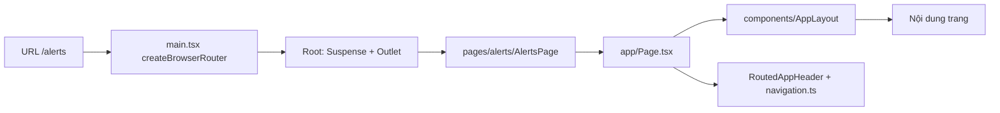
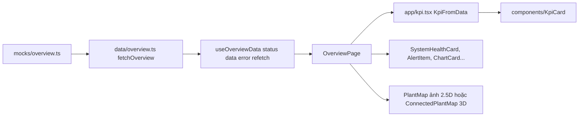
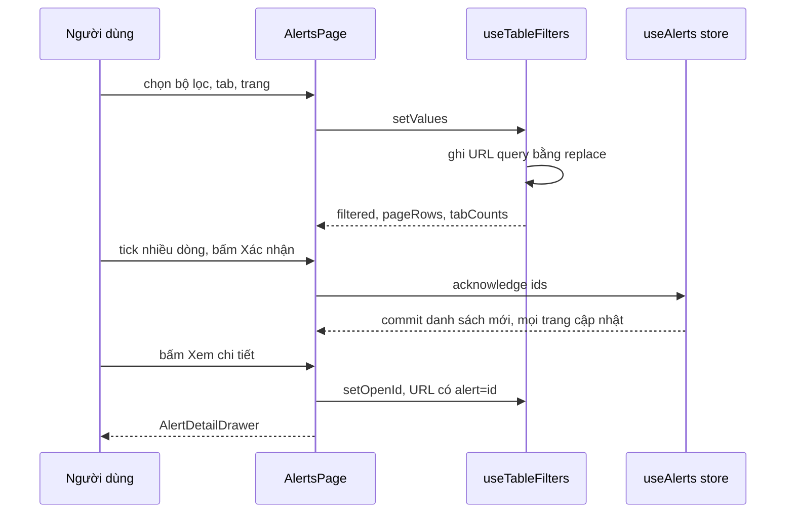
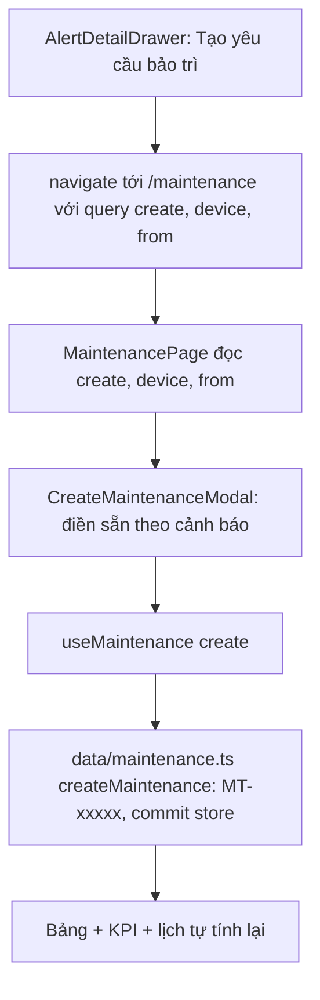
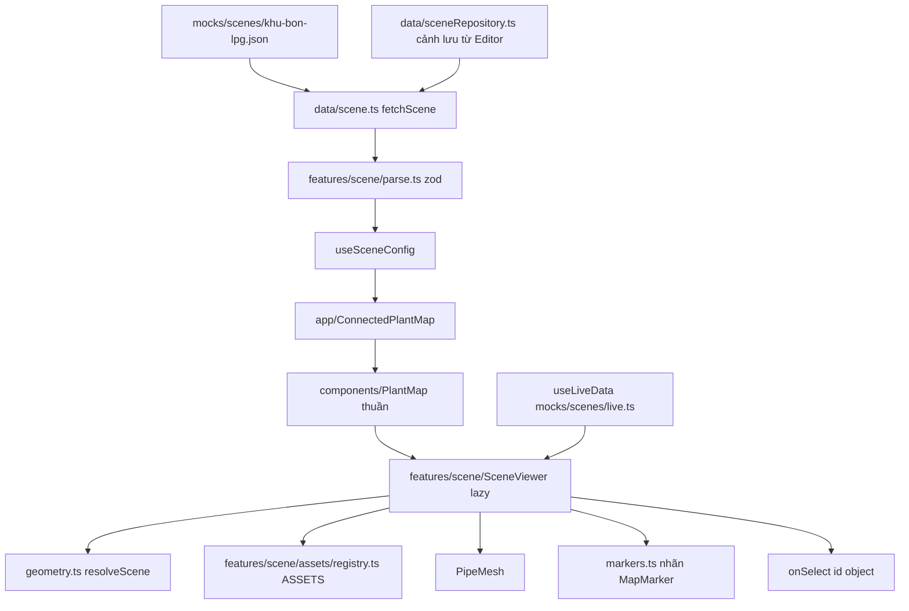
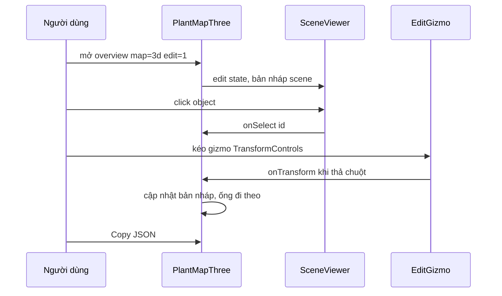
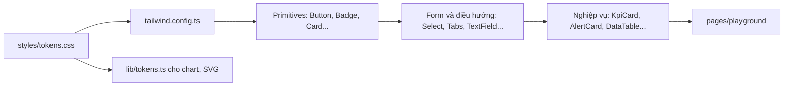

# GUIDE – Đọc code demo-lpg theo luồng

Tài liệu cho người mới: đọc theo **luồng** (URL → dữ liệu → màn hình) thay vì mở file ngẫu nhiên.
Quy ước chi tiết, quyết định kiến trúc và log sai khác Figma nằm ở [`CLAUDE.md`](CLAUDE.md).

---

## 1. Dự án làm gì

- Dashboard giám sát hệ thống LPG "Digital Twin 2026 – Plant Control": **Tổng quan**, **Cảnh báo**, **Bảo trì**.
- Dựng theo Figma (file `stJtcbE3XGzA4WFrJFE1un`); ảnh tham chiếu trong `public/figma-ref/`.
- Dữ liệu hiện là **mock** (`src/mocks/`), đi qua lớp `src/data/` để sau thay bằng API mà không sửa UI.
- Bản đồ nhà máy có 2 kiểu: ảnh 2.5D (mặc định) và cảnh 3D (three.js) dựng từ JSON `SceneConfig`.
- Có **Scene Editor** (`/editor`) để dựng/sửa cảnh 3D, lưu tạm trong localStorage.

**Chạy**

| Lệnh / URL | Tác dụng |
|---|---|
| `npm run dev` | Dev server Vite (mặc định http://localhost:5173) |
| `npm run build` · `npm run typecheck` | Build production (gồm `tsc -b`) · chỉ kiểm tra kiểu |
| `/overview?map=3d` | Bản đồ 3D thay cho ảnh 2.5D |
| `/overview?map=3d&edit=1` | Chế độ sửa nhanh trên bản đồ (kéo/xoay, Copy JSON) |
| `/overview?map=3d&quality=low` | Ép preset 3D `low` / `medium` / `high` (mặc định tự chọn theo FPS) |
| `/overview?scene=tram-chiet-nap` | Mở cảnh 3D khác (cảnh mẫu hoặc cảnh lưu từ Editor), luôn ở 3D |
| `/editor?edit=1` | Scene Editor (không có `?edit=1` → về `/overview`) |
| `/playground` | Xem mọi component và biến thể, đặt cạnh ảnh Figma |

- Deploy (Netlify): `netlify.toml` (build `npm run build`, publish `dist`, Node 20, chuyển `/*` → `/index.html` status 200) – không thêm file `_redirects` vào `public/` để tránh 2 nguồn cấu hình.
- Lý do: app là SPA dùng history router (`createBrowserRouter` trong `src/main.tsx`), host tĩnh không có file `/alerts` nên gõ thẳng URL hoặc F5 sẽ 404 nếu thiếu luật trả `index.html` cho React Router xử lý; vì vậy `base` trong `vite.config.ts` phải để mặc định `/`.

---

## 2. Bản đồ thư mục

```
src/
├─ main.tsx            khai báo route (createBrowserRouter)
├─ app/                "keo" nối router + dữ liệu vào component
├─ pages/              mỗi màn một thư mục (overview, alerts, maintenance, editor, playground)
├─ components/         component THUẦN (không import router/data), barrel index.ts
├─ data/               hook + hàm dữ liệu theo màn (bọc mock, chỗ thay API)
├─ mocks/              dữ liệu giả từ Figma; mocks/scenes/*.json = cảnh 3D
├─ features/scene/     engine 3D: kiểu SceneConfig, validate, Viewer, asset
├─ features/scene-editor/  logic Editor (store, ops, validate, nháp)
├─ lib/                tiện ích chung (cn, store, dialog, focus…)
├─ assets/digital-twin/    SVG/PNG từ Figma + sổ đăng ký icon
└─ styles/             tokens.css (màu, bo góc…) + global.css
```

| Thư mục | Chứa gì | Khi nào cần vào |
|---|---|---|
| `src/main.tsx` | Danh sách route, lazy-load trang | Thêm trang / đổi đường dẫn |
| `src/app/` | `Page.tsx` (layout + header có router), `navigation.ts` (menu), `useTableFilters.ts`, `kpi.tsx`, `HeaderActions.tsx`, `ConnectedPlantMap.tsx`, `editorAccess.ts`, `Placeholder.tsx` | Nối component với URL/dữ liệu; thêm tab menu |
| `src/pages/` | Trang ghép component: `src/pages/overview/`, `src/pages/alerts/`, `src/pages/maintenance/`, `src/pages/editor/`, `src/pages/playground/`, `src/pages/SimplePage.tsx` | Sửa bố cục/hành vi một màn |
| `src/components/` | 40+ component thuần, mỗi cái một thư mục `<Tên>/` | Sửa giao diện dùng chung |
| `src/data/` | `src/data/overview.ts`, `src/data/alerts.ts`, `src/data/maintenance.ts`, `src/data/scene.ts`, `src/data/sceneRepository.ts` | Đổi nguồn dữ liệu, bộ lọc, số liệu suy dẫn |
| `src/mocks/` | `src/mocks/overview.ts`, `src/mocks/alerts.ts`, `src/mocks/maintenance.ts`, `src/mocks/types.ts`, `src/mocks/scenes/` (cảnh 3D + số liệu giả `live.ts`) | Sửa/thêm dữ liệu giả |
| `src/features/scene/` | Viewer 3D + asset + validate zod | Mọi thứ về bản đồ 3D |
| `src/features/scene-editor/` | Store undo/redo, thao tác thuần, kiểm tra, nháp | Logic của `/editor` |
| `src/lib/` | `cn`, `createCollectionStore`, `useDialog`, `useRovingFocus`, `tokens`, `useNow`, `useElementSize` | Viết hook/tiện ích dùng lại |
| `src/assets/digital-twin/` | Icon + ảnh bản đồ, đăng ký trong `src/assets/digital-twin/index.ts` | Thêm icon từ Figma |
| `src/styles/` | `tokens.css`, `global.css` | Đổi màu/token |
| `public/figma-ref/` | Ảnh chụp Figma để so | Đối chiếu thiết kế |

---

## 3. Quy ước cần biết trước khi đọc

| Chủ đề | Quy ước | File |
|---|---|---|
| Màu, bo góc, font | **Không hardcode màu.** Token là CSS var dạng kênh RGB, map sang Tailwind (`bg-surface`, `text-fg-muted`, `border-line/30`…). Palette mặc định của Tailwind đã tắt. Chart/SVG/3D đọc màu bằng `tokenColor` / `useTokenColors` / `sceneColor` | `src/styles/tokens.css`, `tailwind.config.ts`, `src/lib/tokens.ts`, `src/features/scene/colors.ts` |
| Component thuần | `src/components/*` không import router, không import `src/data`/`src/mocks` (ngoại lệ: `PageHeader` dùng `<Link>`). Nhận dữ liệu qua props, báo sự kiện qua callback | `src/components/index.ts` |
| Component nối dữ liệu | Nằm ở `src/app/` hoặc trong trang: `Page` (header gắn router), `KpiFromData`, `ConnectedPlantMap` (nạp cảnh 3D) | `src/app/` |
| Hook dữ liệu | Trang chỉ đọc qua `useOverviewData()`, `useAlerts()`, `useMaintenance()`, `useSceneConfig()`, `useLiveData()`. Không import `src/mocks` trong trang | `src/data/*.ts` |
| 3 trạng thái | Mỗi trang xử lý `loading` (Placeholder) · `error` (Card danger + "Thử lại") · `success` | `src/app/Placeholder.tsx` |
| Số liệu suy dẫn | KPI, số đếm tab, thẻ ưu tiên, lịch… tính bằng hàm `derive*` từ cùng một danh sách (Cảnh báo, Bảo trì). KPI Tổng quan hiện là mock tĩnh | `src/data/alerts.ts`, `src/data/maintenance.ts` |
| Mock | Nội dung lấy nguyên văn từ Figma | `src/mocks/` |
| Kiểu dữ liệu chính | `OverviewData`, `QueryState` · `AlertRecord` · `MaintenanceRecord` · `KpiMock` · `SceneConfig`/`SceneObject`/`Pipe`/`AssetType`/`LiveData` | `src/data/overview.ts`, `src/mocks/alerts.ts`, `src/mocks/maintenance.ts`, `src/mocks/types.ts`, `src/features/scene/types.ts` |
| Đặt tên | Thư mục `src/components/<PascalCase>/` + `<PascalCase>/index.ts`. Prop thống nhất: `variant`, `tone`, `size: sm\|md`, `label` (aria), `className`. Giá trị domain tiếng Anh kebab-case, nhãn hiển thị tiếng Việt | — |
| Alias | `@/` → `src/` | `vite.config.ts` |

---

## 4. Đi theo luồng

### 4a. Từ URL đến màn hình



| Thứ tự đọc | File | Vai trò |
|---|---|---|
| 1 | `src/main.tsx` | Khai báo route; trang có chart/3D lazy-load; `/editor` đi qua `EditorRoute` (kiểm quyền) |
| 2 | `src/app/editorAccess.ts` | `canUseEditor()` – `?edit=1` hoặc `VITE_SCENE_EDITOR=true` |
| 3 | `src/app/Page.tsx` | `Page` = `AppLayout` + `RoutedAppHeader` (tab active theo URL) |
| 4 | `src/app/navigation.ts` | `NAV_ROUTES` – thứ tự, nhãn, icon, đường dẫn menu |
| 5 | `src/components/AppLayout/AppLayout.tsx` | 3 biến thể: `full`, `sidebar` (326px), `workspace` (cao 1 màn hình) |
| 6 | `src/components/AppHeader/AppHeader.tsx` | Header 60px + `NavTabs` |
| 7 | `src/pages/<màn>/…Page.tsx` | Ghép component cho từng màn |

| Muốn sửa | Sửa ở |
|---|---|
| Thêm/đổi đường dẫn | `src/main.tsx` |
| Tab menu (nhãn, thứ tự, icon) | `src/app/navigation.ts` |
| Khung trang, padding, cột sidebar | `src/components/AppLayout/AppLayout.tsx` |
| Nút góc phải header trang (Hôm nay, Xuất, Làm mới, Dữ liệu trực tiếp, đồng hồ) | `src/app/HeaderActions.tsx` |

### 4b. Dữ liệu chảy thế nào (ví dụ: Tổng quan)



| Thứ tự đọc | File | Vai trò |
|---|---|---|
| 1 | `src/mocks/overview.ts` | Mock nguyên văn Figma: `overviewKpis`, `priorityAlarms`, `watchlist`, chart… |
| 2 | `src/mocks/types.ts` | `KpiMock` – dạng KPI thuần (icon là tên, không phải ReactNode) |
| 3 | `src/data/overview.ts` | `OverviewData` (hợp đồng UI–dữ liệu), `fetchOverview()` (chỗ thay API), `useOverviewData()` |
| 4 | `src/pages/overview/OverviewPage.tsx` | 3 trạng thái; KPI → bản đồ → 4 chart; sidebar 4 card |
| 5 | `src/app/kpi.tsx` | `KpiFromData`: `KpiMock` → `<KpiCard>` (tên icon → `<Icon>`) |

Đoạn chính của hook (mọi hook dữ liệu đều theo mẫu này):

```ts
export async function fetchOverview(): Promise<OverviewData> {
  return { systemStatus: mock.systemStatus, kpis: mock.overviewKpis, /* … */ };
}
export function useOverviewData() { /* → { status, data, error, refetch } */ }
```

| Muốn sửa | Sửa ở |
|---|---|
| Nối API thật cho Tổng quan | Thân `fetchOverview()` trong `src/data/overview.ts` |
| Nội dung KPI/thẻ/chart | `src/mocks/overview.ts` |
| Thứ tự/bố cục khối | `src/pages/overview/OverviewPage.tsx` |

### 4c. Cảnh báo: lọc, chọn nhiều, xác nhận, drawer, URL



| Thứ tự đọc | File | Vai trò |
|---|---|---|
| 1 | `src/mocks/alerts.ts` | `AlertRecord`, `alertRecords`, `ALERT_ASSIGNEES` |
| 2 | `src/lib/createCollectionStore.ts` | Store danh sách dùng chung giữa trang; `commit` = cập nhật optimistic |
| 3 | `src/data/alerts.ts` | `ALERT_PARAMS` (tham số URL), `matchAlert`, `derive*`, `fetchAlerts`, `acknowledgeAlerts`/`assignAlerts`/`completeAlerts`, `useAlerts()` |
| 4 | `src/app/useTableFilters.ts` | Bộ lọc ↔ URL (`replace`), phân trang, số đếm tab, bản ghi đang mở, chọn dòng |
| 5 | `src/pages/alerts/AlertsPage.tsx` | Thẻ ưu tiên, KPI, Tabs, FilterBar, thao tác hàng loạt, `DataTable`, drawer, xuất CSV |
| 6 | `src/components/AlertDetailDrawer/AlertDetailDrawer.tsx` | Drawer chi tiết (Xác nhận / Hoàn thành / Tạo yêu cầu bảo trì) |

Tham số URL: `?tab=&q=&severity=&area=&device=&shift=&range=&page=&alert=` – giá trị mặc định không ghi lên URL.

| Muốn sửa | Sửa ở |
|---|---|
| Thêm bộ lọc | `ALERT_PARAMS` + `AlertFilters` + `matchAlert` (`src/data/alerts.ts`), `filterDefs` (`AlertsPage.tsx`) |
| Cột bảng | Mảng `columns` trong `AlertsPage.tsx` (+ `exportCsv` nếu cần xuất) |
| Hành vi Xác nhận/Phân công | `acknowledgeAlerts`, `assignAlerts` trong `src/data/alerts.ts` |
| KPI / thẻ ưu tiên | `deriveAlertKpis`, `derivePriorityCards` trong `src/data/alerts.ts` |

### 4d. Bảo trì: model, quá hạn, modal tạo, liên kết từ cảnh báo



| Thứ tự đọc | File | Vai trò |
|---|---|---|
| 1 | `src/mocks/maintenance.ts` | `MaintenanceRecord` (gồm trường của form), `maintenanceRecords`, danh mục `PEOPLE`, `DEPARTMENTS`, `SHIFTS`, `CHECKLIST_TEMPLATES` |
| 2 | `src/data/maintenance.ts` | `daysUntilDue`, `isOverdue`, `dueLabel`; `MAINTENANCE_PARAMS`, `matchMaintenance`, `sortMaintenance`; `derive*`; `createMaintenance`, `advanceMaintenance`; `useMaintenance()`; gợi ý AI mock `suggestForRequest`; nháp form |
| 3 | `src/pages/maintenance/MaintenancePage.tsx` | KPI, việc ưu tiên, bảng 7 tab (gồm "Quá hạn"), lịch, `DetailDrawer` chuyển bước, mở modal theo URL |
| 4 | `src/pages/maintenance/CreateMaintenanceModal.tsx` | Form tạo yêu cầu: `blank()` / `fromAlert()` khởi tạo, `validate()`, lưu nháp |

Quá hạn **không lưu** – tính mỗi lần:

```ts
export const isOverdue = (r: MaintenanceRecord, now = new Date()) =>
  r.status !== 'done' && daysUntilDue(r, now) < 0;
```

| Muốn sửa | Sửa ở |
|---|---|
| Quy tắc quá hạn / nhãn hạn | `isOverdue`, `dueLabel` (`src/data/maintenance.ts`) |
| Các bước trạng thái | `advanceMaintenance`, `NEXT_STEP_LABEL`, `STATUS_LABEL` (`src/data/maintenance.ts`) |
| Trường của form tạo | `MaintenanceRecord` (`src/mocks/maintenance.ts`), `NewMaintenanceInput` + `createMaintenance` (`src/data/maintenance.ts`), `CreateMaintenanceModal.tsx` |
| Liên kết từ cảnh báo | `onCreateMaintenance` trong `AlertsPage.tsx`; đọc `from` trong `MaintenancePage.tsx` |

### 4e. Bản đồ 3D



**Ranh giới quan trọng:** `src/components/PlantMap/PlantMap.tsx` là component **thuần** – nhận `scene` đã nạp, không gọi hook dữ liệu.
Nạp cảnh nằm ở `src/app/ConnectedPlantMap.tsx` (`useSceneConfig(sceneId)` + 3 trạng thái). Trang Tổng quan truyền `liveData` từ `useLiveData()`.

| Thứ tự đọc | File | Vai trò |
|---|---|---|
| 1 | `src/features/scene/types.ts` | Hợp đồng dữ liệu `SceneConfig`, `SceneObject`, `Pipe`, `ASSET_TYPES`, `LiveData` (không phụ thuộc three) |
| 2 | `src/mocks/scenes/khu-bon-lpg.json` | Ví dụ cảnh thật: camera, views, thresholds, objects, pipes |
| 3 | `src/data/scene.ts` | `fetchScene` (mock → kho), `useSceneConfig`, `useLiveData`, `SCENE_IDS`, `SENSOR_TAGS` |
| 4 | `src/features/scene/parse.ts` | Validate zod: cấu trúc + tham chiếu (asset, id trùng, cổng ống, params…) |
| 5 | `src/app/ConnectedPlantMap.tsx` | Nạp theo `sceneId` → `PlantMap renderer="three"` |
| 6 | `src/components/PlantMap/PlantMap.tsx` | Khung chung (nút view, zoom, toàn màn hình, 2.5D/3D); lazy-load SceneViewer |
| 7 | `src/features/scene/SceneViewer.tsx` | Canvas R3F: camera, đèn, sàn, object, ống, nhãn, tooltip, preset chất lượng |
| 8 | `src/features/scene/geometry.ts` | `resolveScene`: đặt object, dựng đường cong ống, object gắn ống (`attach`) |
| 9 | `src/features/scene/assets/specs.ts` → `registry.ts` → `tanks.tsx`/`equipment.tsx`/`structures.tsx` | Spec thuần (tham số, cổng, hộp bao) + component hình học |
| 10 | `src/features/scene/PipeMesh.tsx` | Ống: lõi sáng, vỏ trong mờ, vệt chảy theo `flowTag` |
| 11 | `src/features/scene/fields.ts` + `markers.ts` | Bindings → trạng thái (ngưỡng) → nhãn tự sinh `MapMarker` |
| 12 | `src/features/scene/look.ts`, `quality.ts`, `PostEffects.tsx` | Ánh sáng/exposure, preset high/medium/low, bloom + outline |

| Muốn sửa | Sửa ở |
|---|---|
| Vị trí/nhãn/binding của object | `src/mocks/scenes/<id>.json` (hoặc dùng `/editor`) |
| Ngưỡng cảnh báo | `thresholds` trong JSON cảnh, hoặc ngưỡng riêng trong binding |
| Hình dáng thiết bị | `src/features/scene/assets/*.tsx` |
| Ánh sáng, màu nét viền, bloom | `src/features/scene/look.ts` |
| Nhãn hiển thị thế nào | `src/features/scene/markers.ts`, `src/components/PlantMap/MapMarker.tsx` |
| Xử lý khi bấm object | Prop `onSelect` của `PlantMap` (Tổng quan hiện chưa truyền; ví dụ có ở `src/pages/playground/SceneSection.tsx`) |

### 4f. Chế độ sửa nhanh (`?edit=1` trên bản đồ) và Scene Editor



| File | Vai trò |
|---|---|
| `src/pages/overview/OverviewPage.tsx` | Đọc `?edit=1` → `editable` |
| `src/components/PlantMap/PlantMap.tsx` | `PlantMapThree`: bản nháp, thanh sửa (Di chuyển/Xoay), `copyJson` |
| `src/features/scene/EditTools.tsx` | `SceneEditState`, `EditGizmo` (pivot, snap 0.5 m / 15°), chọn bằng tia/vùng, viền sàn |
| `src/features/scene/editConstants.ts` | Hằng thuần: snap, vùng sàn ±60 m, MIME kéo thả |

Scene Editor đầy đủ (`/editor?edit=1`) dùng cùng SceneViewer:

| File | Vai trò |
|---|---|
| `src/pages/editor/EditorPage.tsx` | Bố cục, thanh tệp, phím tắt, nạp/lưu, nháp, chặn rời trang |
| `src/pages/editor/useEditorActions.ts` | Thêm/xoá/nhân bản/copy/dán/đổi id |
| `src/features/scene-editor/store.ts` | `useSceneDoc` (zustand + zundo, undo/redo) và `useEditorUi` (chọn, công cụ, ẩn/khoá) |
| `src/features/scene-editor/ops.ts` | Biến đổi thuần trên `SceneConfig`, sinh id theo `idPrefix` |
| `src/features/scene-editor/validate.ts` | Lỗi zod + cảnh báo (tag lạ, ngoài sàn) |
| `src/data/sceneRepository.ts` | `SceneRepository` + `LocalStorageRepository` |
| `src/pages/editor/PropertiesPanel.tsx`, `Outliner.tsx`, `AssetLibrary.tsx`, `ViewsPanel.tsx`, `ValidationPanel.tsx`, `dialogs.tsx` | Các bảng của Editor |

Phím tắt Editor: xem bảng trong `CLAUDE.md` mục 6b.

### 4g. Design system: tokens → primitives → nghiệp vụ



| Bước | File |
|---|---|
| Token | `src/styles/tokens.css` (nhóm Background, Border, Text, Brand, Status, `scene-*`) |
| Map sang class | `tailwind.config.ts` (`v('…')` → `rgb(var(--color-…) / alpha)`) |
| Dùng trong JS | `src/lib/tokens.ts` (`tokenColor`, `useTokenColors`), 3D: `src/features/scene/colors.ts` |
| Xem trực quan | `/playground` – `src/pages/playground/PlaygroundPage.tsx`, mỗi mục một file `*Section.tsx` |

Mục playground: `#tokens` (1), `#primitives` (2), `#navigation` (3), `#layout` (4), `#business` (5), `#charts` (6), `#forms` (7), `#scene` (8), `#editor` (9).

---

## 5. Cách làm các việc hay gặp

**Thêm KPI vào Tổng quan**
1. Thêm phần tử `KpiMock` vào `overviewKpis` trong `src/mocks/overview.ts` (`id`, `label`, `value`, `unit`, `icon` là tên trong `src/assets/digital-twin/index.ts`).
2. Nếu cần biến thể (danger, with-progress, compact): xem `KpiCardProps` trong `src/components/KpiCard/KpiCard.tsx`.
3. Lưới đang 6 cột (`grid-cols-3 … min-[1520px]:grid-cols-6`) trong `src/pages/overview/OverviewPage.tsx` – chỉnh nếu số KPI đổi.
4. KPI của Cảnh báo/Bảo trì **không** sửa mock: sửa `deriveAlertKpis` (`src/data/alerts.ts`) hoặc `deriveMaintenanceKpis` (`src/data/maintenance.ts`).

**Thêm cột vào bảng (ví dụ bảng Cảnh báo)**
1. Nếu là dữ liệu mới: thêm trường vào `AlertRecord` (`src/mocks/alerts.ts`) và điền giá trị cho mọi phần tử `alertRecords` (TypeScript báo lỗi nếu sót). Không muốn điền hết → khai báo tuỳ chọn (`sensor?: string`), ô trống sẽ hiện rỗng.
2. Thêm cột vào mảng `columns` trong `src/pages/alerts/AlertsPage.tsx`: `{ id, header, width?, align?, className?, cell? }` (kiểu `DataTableColumn` trong `src/components/DataTable/DataTable.tsx`). Không có `cell` → hiển thị `row[id]`, nên `id` phải trùng tên trường.
3. Màu chữ dùng token (`text-info`, `text-fg-muted`…), không hardcode.
4. Muốn cột đó có trong file CSV: thêm vào `head` và mảng giá trị trong `exportCsv` (cùng file).
5. Muốn tìm kiếm theo cột đó: thêm trường vào mảng trong `matchAlert` (`src/data/alerts.ts`).
6. Muốn hiện trong drawer chi tiết: thêm vào `toDetail()` (cùng file `AlertsPage.tsx`, kiểu `AlertDetailData` của `src/components/AlertDetailDrawer/AlertDetailDrawer.tsx`).
7. Kiểm tra: `npm run typecheck`, mở `/alerts?range=30d`, gõ giá trị của cột vào ô tìm kiếm.
8. Bảng Bảo trì làm tương tự ở `src/pages/maintenance/MaintenancePage.tsx` + `src/mocks/maintenance.ts`.

**Thêm loại asset 3D**
1. Thêm tên vào `ASSET_TYPES` trong `src/features/scene/types.ts` (đúng nhóm equipment/environment).
2. Thêm spec vào `ASSET_SPECS` trong `src/features/scene/assets/specs.ts`: `label`, `category`, `idPrefix` (tiền tố id khi Editor tự sinh), `paramsSchema`, `dataFields` (trường cho bindings, nhãn/đơn vị lấy từ `FIELD_META`), `layout(params)` trả `{ ports, bounds, labelAnchor? }`.
   - `ports`: tên cổng → toạ độ cục bộ; ống nối bằng `"id.tênCổng"` (`from`/`to`), zod báo lỗi nếu sai tên.
   - `bounds`: hộp bao cục bộ (dùng helper `box(min, max)` có sẵn trong file) – quyết định khung camera khi bay tới và vị trí nhãn (đỉnh hộp nếu không có `labelAnchor`).
   - Tham số đọc trong `layout` bằng `params.ten!` (đã gộp mặc định).
3. Viết component trong `src/features/scene/assets/` (vd `equipment.tsx`): nhận `AssetComponentProps` (`{ params, path }`), lấy vật liệu bằng `useAssetMaterials()`, chi tiết dùng lại từ `parts.tsx` (`Flange`, `Ladder`, `Railing`…).
   - **Gốc toạ độ tại tâm đáy, Y lên, không phần nào dưới y = 0** (`bounds.min[1] = 0`). Hình dựng quanh tâm (vd van quanh trục ống) → bọc trong `<group position-y={…}>` dịch lên; asset lắp trên ống khai báo `inline: { axisY }` trong spec.
   - Kiểm tra: đo hộp bao three (script `diagnose.mjs` trong scratchpad e2e, dùng `window.__sceneThree` ở dev) – min.y phải = 0.
4. Trong `src/features/scene/assets/registry.ts`: import component ở đầu file, rồi thêm `'ten-asset': TenComponent` vào `COMPONENTS`.
5. Thêm hình vẽ vào `PATHS` trong `src/pages/editor/AssetGlyph.tsx` (TypeScript báo lỗi nếu thiếu). Thư viện asset của Editor tự liệt kê theo `ASSET_TYPES`.
6. Kiểm tra: `npm run typecheck`, rồi thêm object vào cảnh (JSON trong `src/mocks/scenes/` hoặc `/editor`) và mở `/overview?scene=<id>`. Validate zod tự nhận loại mới (params ngoài min–max, cổng sai… hiện thành Card lỗi).

**Thêm scene mới**
1. Cách nhanh: `/editor?edit=1` → dựng → "Lưu thành bản mới" (lưu localStorage) → mở `/overview?scene=<id>`.
2. Cách cố định (cảnh mẫu): tạo `src/mocks/scenes/<id>.json` theo `SceneConfig` (`src/features/scene/types.ts`); `import.meta.glob` trong `src/data/scene.ts` tự nhận, `SCENE_IDS` tự thêm.
3. Mở `/overview?scene=<id>`; JSON sai → Card lỗi liệt kê từng lỗi zod.
4. Đổi cảnh mặc định của Tổng quan: `DEFAULT_SCENE_ID` trong `src/pages/overview/OverviewPage.tsx`.

**Thêm trang mới + tab menu**
1. Tạo `src/pages/<ten>/<Ten>Page.tsx`, bọc bằng `Page` (`src/app/Page.tsx`) + `PageHeader`; trang chưa có thiết kế dùng `src/pages/SimplePage.tsx`.
2. Thêm route vào mảng `children` trong `src/main.tsx` (trang nặng: `lazy(() => import(…))`).
3. Thêm mục vào `NAV_ROUTES` trong `src/app/navigation.ts` (`id`, `label`, `path`, `icon`, `activeIcon?`); icon phải có trong `icons` của `src/assets/digital-twin/index.ts`.
4. Dữ liệu: tạo `src/data/<ten>.ts` theo mẫu `fetchX` + `useX` (xem 4b), mock ở `src/mocks/`.

**Đổi màu / token**
1. Đổi giá trị kênh RGB trong `src/styles/tokens.css` (vd `--color-primary: 34 211 238;`).
2. Token mới: thêm biến vào `tokens.css`, map trong `tailwind.config.ts`, nếu chart/3D cần thì thêm tên vào `ColorToken` (`src/lib/tokens.ts`).
3. 3D đọc màu một lần khi mount qua `readScenePalette()` (`src/features/scene/colors.ts`).
4. Xem kết quả ở `/playground#tokens`.

**Thêm tag cảm biến**
1. Thêm giá trị nền vào `liveBase` trong `src/mocks/scenes/live.ts` (số hoặc chuỗi trạng thái như `running`, `fault`).
2. Muốn giá trị dao động: thêm biên độ vào `liveJitter` (cùng file).
3. Tag tự có trong `SENSOR_TAGS` (`src/data/scene.ts`) → Editor cho chọn trong ô binding.
4. Gắn vào object: `bindings` trong JSON cảnh (vd `"level": "LT-401"` hoặc `{ "tag": "PT-401", "warn": 5, "danger": 6 }`) hoặc qua Properties của `/editor`.
5. Trường mới (ngoài level/pressure/temperature/flow/position/state): thêm vào `FIELD_META` (`src/features/scene/fields.ts`) và `dataFields` của asset trong `specs.ts`.

---

## 6. Bảng component

Tất cả export từ `src/components/index.ts`. Cột "Dùng ở" chỉ tính trang/`src/app` (không tính playground).

**GĐ1 – Primitives**

| Tên | File | Props chính | Dùng ở | Playground |
|---|---|---|---|---|
| Button | `src/components/Button/Button.tsx` | `variant` (primary/ghost/icon/toolbar/overlay/link), `size`, `icon`, `pressed` | mọi trang | `#primitives` |
| Badge | `src/components/Badge/Badge.tsx` | `variant` (severity/status/count), `value`, `size` | Cảnh báo, Bảo trì | `#primitives` |
| StatusDot | `src/components/StatusDot/StatusDot.tsx` | `status`, `shape`, `pulse`, `label` | `src/app/HeaderActions.tsx` | `#primitives` |
| StatusPill | `src/components/StatusPill/StatusPill.tsx` | `tone`, `pulse`, `children` | Tổng quan | `#layout` |
| Card | `src/components/Card/Card.tsx` | `title`, `icon`, `action`, `headerVariant`, `tone`, `padding`, `bodyClassName` | mọi trang | `#primitives` |
| Divider | `src/components/Divider/Divider.tsx` | `orientation`, `tone` | trong AppHeader, DetailDrawer | `#primitives` |
| ProgressBar | `src/components/ProgressBar/ProgressBar.tsx` | `value`, `max`, `tone`, `size` | Bảo trì | `#primitives` |
| Icon (+ TempIcons, EditorIcons) | `src/components/Icon/Icon.tsx` | `name` (IconName), `box`, `label` | mọi trang | `#primitives`, `#editor` |

**GĐ2 – Form & điều hướng**

| Tên | File | Props chính | Dùng ở | Playground |
|---|---|---|---|---|
| NavTabs | `src/components/NavTabs/NavTabs.tsx` | `items`, `value`, `onChange` | trong AppHeader | `#navigation` |
| Tabs | `src/components/Tabs/Tabs.tsx` | `items` (count, countTone), `value`, `onChange`, `panelId` | Cảnh báo, Bảo trì, Editor | `#navigation` |
| SegmentedControl | `src/components/SegmentedControl/SegmentedControl.tsx` | `options`, `value`, `onChange`, `variant`, `size` | form Bảo trì, PlantMap | `#navigation` |
| SearchInput | `src/components/SearchInput/SearchInput.tsx` | `value`, `onChange`, `onClear`, `label` | Editor; trong FilterBar | `#navigation` |
| Select | `src/components/Select/Select.tsx` | `options`, `value`, `onChange`, `variant` (filter/button/field), `allLabel` | Cảnh báo, Bảo trì, Editor | `#navigation`, `#forms` |
| Combobox | `src/components/Combobox/Combobox.tsx` | `options`, `value`, `onChange`, `multiple`, `clearable`, `showAvatar` | form Bảo trì, Editor | `#forms` |
| FormField + TextField, Textarea, DatePicker | `src/components/FormField/FormField.tsx`, `src/components/FormField/TextField.tsx` | `label`, `value`, `onChange`, `required`, `hint`, `error` | form Bảo trì, Editor | `#forms` |
| NumberField, Vec3Field | `src/components/FormField/NumberField.tsx` | `value`, `onChange` (chốt khi Enter/blur), `min`, `max`, `integer`, `unit`, `onClear` | Editor | `#editor` |
| Checkbox | `src/components/Checkbox/Checkbox.tsx` | `checked`, `onChange`, `indeterminate`, `label`, `showLabel` | trong DataTable, form Bảo trì, Editor | `#editor` |
| ChecklistEditor | `src/components/ChecklistEditor/ChecklistEditor.tsx` | `items`, `onChange`, `templates` | form Bảo trì | `#forms` |
| FileDropzone | `src/components/FileDropzone/FileDropzone.tsx` | `files`, `onChange`, `accept`, `maxSizeMB` | form Bảo trì | `#forms` |
| TreeView | `src/components/TreeView/TreeView.tsx` | `items`, `selected`, `onSelectionChange`, `onRename`, `renderActions` | Editor | `#editor` |

**GĐ3 – Layout**

| Tên | File | Props chính | Dùng ở | Playground |
|---|---|---|---|---|
| AppHeader | `src/components/AppHeader/AppHeader.tsx` | `navItems`, `navValue`, `onNavChange`, `user` | `src/app/Page.tsx` | `#layout` (bản gắn router) |
| PageHeader | `src/components/PageHeader/PageHeader.tsx` | `breadcrumb`, `title`, `description`, `actions` | mọi trang | `#layout` |
| AppLayout | `src/components/AppLayout/AppLayout.tsx` | `header`, `variant` (full/sidebar/workspace), `pageHeader`, `sidebar` | `src/app/Page.tsx` | không |

**GĐ4A – Nghiệp vụ**

| Tên | File | Props chính | Dùng ở | Playground |
|---|---|---|---|---|
| KpiCard | `src/components/KpiCard/KpiCard.tsx` | `label`, `value`, `unit`, `sub`, `variant`, `tone`, `progress`, `action` | qua `src/app/kpi.tsx` | `#business` |
| SystemHealthCard | `src/components/SystemHealthCard/SystemHealthCard.tsx` | `value`, `caption`, `stats` | Tổng quan | `#business` |
| AlertItem | `src/components/AlertItem/AlertItem.tsx` | dữ liệu `AlertItemData` + `highlighted`, `onClick` | Tổng quan | `#business` |
| AlertCard | `src/components/AlertCard/AlertCard.tsx` | dữ liệu `AlertCardData` + `onClick(id)` | Cảnh báo | `#business` |
| PriorityTaskCard | `src/components/PriorityTaskCard/PriorityTaskCard.tsx` | dữ liệu `PriorityTaskData` + `onDetail` | Bảo trì | `#forms` |
| AssetRow, AssetWatchlist | `src/components/AssetRow/AssetRow.tsx` | `assets`, `onAssetClick` | Tổng quan | `#business` |
| EventTimeline, RecentEventsCard | `src/components/EventTimeline/EventTimeline.tsx` | `events`, `variant` (event/schedule) | Bảo trì, Tổng quan | `#forms`, `#business` |
| DetailDrawer | `src/components/DetailDrawer/DetailDrawer.tsx` | `open`, `title`, `badges`, `fields`, `actions` | Bảo trì | `#forms` |
| AlertDetailDrawer | `src/components/AlertDetailDrawer/AlertDetailDrawer.tsx` | `alert`, `onAcknowledge`, `onComplete`, `onCreateMaintenance` | Cảnh báo | không |
| Modal | `src/components/Modal/Modal.tsx` | `open`, `onClose`, `title`, `footer`, `onSubmit`, `size` | form Bảo trì, Editor | `#forms` |
| PlantMap, MapMarker | `src/components/PlantMap/PlantMap.tsx`, `src/components/PlantMap/MapMarker.tsx` | ảnh: `image`, `markers`, `views` · 3D: `scene`, `liveData`, `editable`, `quality`, `onFallback`; chung `onSelect`, `onRendererChange`, `notice` | Tổng quan, `src/app/ConnectedPlantMap.tsx` | `#scene` (qua ConnectedPlantMap) |

**GĐ4B – Chart & bảng**

| Tên | File | Props chính | Dùng ở | Playground |
|---|---|---|---|---|
| ChartCard (+ ChartTooltip) | `src/components/ChartCard/ChartCard.tsx` | `title`, `description`, `height`, `action` | Tổng quan | `#charts` |
| AreaTrendChart, LineTrendChart | `src/components/TrendChart/TrendChart.tsx` | `data` (TrendPoint[]), `domain`, `unit`, `format` | Tổng quan | `#charts` |
| CategoryBarList | `src/components/CategoryBarList/CategoryBarList.tsx` | `items`, `max`, `unit` | Tổng quan | `#charts` |
| DonutGauge | `src/components/DonutGauge/DonutGauge.tsx` | `segments`, `total`, `totalLabel` | Tổng quan | `#charts` |
| FilterBar | `src/components/FilterBar/FilterBar.tsx` | `search`, `filters`, `values`, `onValuesChange`, `onAdvancedFilter` | Cảnh báo, Bảo trì | `#navigation` |
| DataTable (+ TableActionButton) | `src/components/DataTable/DataTable.tsx` | `columns`, `rows`, `getRowId`, `selectable`, `selectedIds`, `rowActions`, `pagination` | Cảnh báo, Bảo trì | `#charts` |
| Pagination | `src/components/Pagination/Pagination.tsx` | `page`, `pageCount`, `onPageChange` | trong DataTable | `#charts` (qua DataTable) |

---

## 7. Mẹo tìm code

| Muốn tìm | Grep / Glob |
|---|---|
| Trang nào dùng dữ liệu nào | `useOverviewData`, `useAlerts`, `useMaintenance`, `useSceneConfig`, `useLiveData` |
| Mọi nơi đọc/ghi URL query | `useSearchParams`, `useTableFilters`, `_PARAMS` (vd `ALERT_PARAMS`) |
| Số liệu suy dẫn | `derive` (vd `deriveAlertKpis`, `derivePriorityTasks`) |
| Chỗ nối API sau này | `fetch` trong `src/data/` (`fetchOverview`, `fetchAlerts`, `fetchMaintenance`, `fetchScene`) |
| Loại asset 3D | `AssetType`, `ASSET_TYPES`, `ASSET_SPECS`, `COMPONENTS` |
| Biến thể màu của component | `tone=`, `variant=` |
| Token màu | `--color-` (CSS), `ColorToken` (TS) |
| Node Figma của một component | số node trong JSDoc, vd `53:245` |
| Chỗ còn giả lập | `mock`, `TODO`, `⚠` |

| Quy ước đặt tên file | Ví dụ |
|---|---|
| Component: `src/components/<PascalCase>/<PascalCase>.tsx` + `src/components/<PascalCase>/index.ts` | `src/components/KpiCard/KpiCard.tsx` |
| Trang: `src/pages/<route>/<Route>Page.tsx` | `src/pages/alerts/AlertsPage.tsx` |
| Hook dữ liệu: `src/data/<màn>.ts`, hàm `useXxx` | `src/data/maintenance.ts` → `useMaintenance` |
| Mock: `src/mocks/<màn>.ts`; cảnh: `src/mocks/scenes/<id>.json` | `src/mocks/scenes/tram-chiet-nap.json` |
| Playground: `src/pages/playground/<Nhóm>Section.tsx` | `src/pages/playground/BusinessSection.tsx` |

Log sai khác Figma đã chuẩn hoá: `CLAUDE.md` mục 8. Việc chờ designer/khách: `CLAUDE.md` mục 7.

---

## 8. Chỗ còn là giả lập / TODO

| Phần | Hiện tại | Chờ |
|---|---|---|
| Dữ liệu Tổng quan, Cảnh báo, Bảo trì | Mock trong `src/mocks/`, mutation chỉ sửa bộ nhớ (mất khi F5) | Backend: thay thân `fetch*` và các hàm `acknowledge*/create*/advance*` trong `src/data/` |
| Số liệu cảm biến 3D | `useLiveData` dao động ngẫu nhiên từ `src/mocks/scenes/live.ts` mỗi 2 giây | WebSocket/SSE |
| Danh sách tag cảm biến | `SENSOR_TAGS` = khoá của `liveBase` | API danh mục tag |
| Kho cảnh của Editor | `LocalStorageRepository` (chỉ trên trình duyệt hiện tại) | Bản HTTP của `SceneRepository` |
| Quyền vào `/editor` | `?edit=1` hoặc `VITE_SCENE_EDITOR` | Phân quyền thật theo vai trò |
| Vẽ ống trong Editor | Chưa có (ống chỉ sửa trong JSON) | Bước 3D-4 |
| "Góp ý từ AI" trong form Bảo trì | `suggestForRequest` sinh theo luật | Dịch vụ AI thật |
| Tệp đính kèm | Chỉ giữ tên/kích thước, không upload | API lưu tệp |
| KPI Tổng quan | Số tĩnh từ Figma | API (hoặc derive từ dữ liệu thật) |
| Thiết kế | Drawer, thao tác hàng loạt, form, checkbox checked, trang `/map` `/reports`, Editor chưa có trong Figma | Designer |
| Icon tạm | `src/components/Icon/TempIcons.tsx`, `src/components/Icon/EditorIcons.tsx`, `src/pages/editor/AssetGlyph.tsx` | Asset từ Figma |
| Cần khách xác nhận | Danh sách ở `CLAUDE.md` mục 7 ("Cần xác nhận") | Khách/PO |

---

Cập nhật: 20/10/2026.
Khi thêm tính năng mới, cập nhật mục 4–6.
