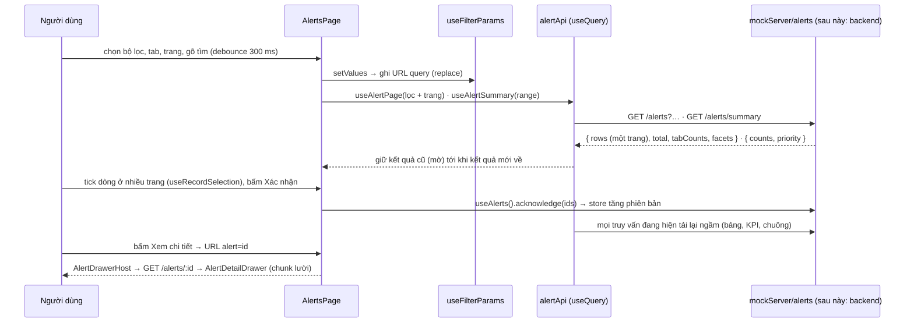
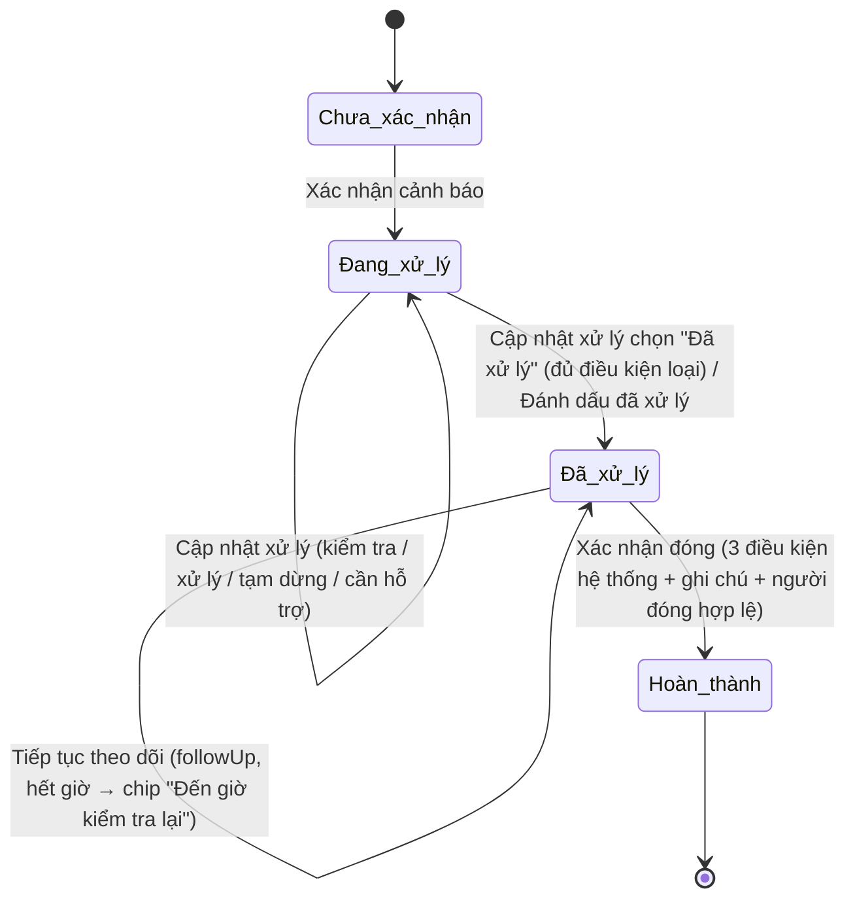

# Cảnh báo

Danh sách /alerts, drawer theo loại (áp suất/gas/cháy), phân công, cập nhật xử lý áp suất; kèm bảng mã mock để thử.

Tách nguyên văn từ `GUIDE.md` (28/10/2026) – số mục giữ như cũ (4m, 7b…) để tham chiếu cũ vẫn tìm được. Mục lục: [GUIDE.md](../../GUIDE.md).

### 4c. Cảnh báo: lọc, chọn nhiều, xác nhận, drawer, URL



| Thứ tự đọc | File | Vai trò |
|---|---|---|
| 1 | `src/mocks/alerts.ts` | `AlertRecord` (hợp đồng `Alert` + trường CHỈ FE: `kind`, `direction`, `tag`, `notifiedTime`, `acknowledgedAt`, `resolvedAt`, `guide`, `notes`, `history` – `ALERT_FE_ONLY_FIELDS`), `alertRecords` |
| 2 | `src/mocks/alertKinds.ts` (kiểu: `features/alerts/kinds.ts`) · `src/mocks/sensors.ts` · `src/features/plant/areas.ts` | `ALERT_KINDS` (cấu hình theo LOẠI cảnh báo: panel, nguồn số lớn, thang + bands, banner, nguyên nhân, hướng dẫn, nút phụ, kiểu cập nhật, mục thu gọn – mục 4m) · `AREA_SENSORS` (cảm biến theo khu) · `AREAS` – MỘT danh sách khu vực cho Cảnh báo + Bảo trì |
| 3 | `src/features/alerts/query.ts` | Thuần, có test – phần BACKEND làm: `queryAlerts` (lọc, mới nhất trước, cắt trang + kẹp trang, đếm tab theo bộ lọc còn lại, facet), `alertCounts` (KPI), `priorityAlerts`, `matchAlert`, kiểu `AlertListQuery` / `AlertListResult` / `AlertSummary` |
| 4 | `src/data/alertApi.ts` · `src/data/mockServer/alerts.ts` · `src/data/alertStore.ts` · `src/api/alertSchemas.ts` | Một `fetch*` mỗi endpoint (TODO(backend)), response qua `fromMock` + schema zod của endpoint (dev/test kiểm hợp đồng) + hook `useAlertPage`, `useAlertSummary`, `useAlertById`, `useAlertsByDevices(devices, kinds)`, `useRelatedOpen`, `useAlertLoads`, `useUnacknowledgedCount`, `useRecentAlerts` (revision = phiên bản store) · mock server tải lười gọi `query.ts` · "cơ sở dữ liệu" mock (`mutateAlerts`, `alertsReady`) – trang KHÔNG đọc danh sách từ store |
| 5 | `src/features/alerts/workflow.ts` · `gauge.ts` | Thuần, có test: quy trình chỉ đi tiến (`acknowledgeAlert`, `assignAlert`, `resolveAlert` cần ghi chú, `toggleGuideStep`, `addAlertNote`, `linkedMaintenance`, `planBulk`, `alertSteps`) · thang đo (`gaugeScale`, `isBreached`, `gaugeValueText`) |
| 6 | `src/data/alerts.ts` | `ALERT_PARAMS` (tham số URL), tuỳ chọn bộ lọc, `alertKpis(counts)` / `priorityCard` (dựng hiển thị từ số máy chủ), thao tác (`acknowledgeAlerts`/`assignAlerts` trả `{ done, skipped }`, `closeAlerts` (4p), `resolveOneAlert`, `updateAlert`, `closeOneAlert`, `monitorAlert`, `toggleAlertGuide`, `addNoteToAlert`, `noteMaintenanceCreated`), `useAlerts()` = CHỈ thao tác |
| 7 | `src/data/alertDetail.ts` | Chỉ drawer: `alertMetric` (ngưỡng theo cấu hình tag → `assets.ts`, thiếu thì ngưỡng bản ghi), `alertPlaybook`, `useAlertLive` (số trực tiếp của tag), `alertDateTimeLabel`, `ALERT_STAFF`, `useCloseConditions(alerts)` (liên quan đang mở hỏi máy chủ) |
| 8 | `src/app/useTableFilters.ts` (`useFilterParams`) · `src/app/useRecordSelection.ts` | Bộ lọc + trang + bản ghi đang mở ↔ URL (`replace`) · lựa chọn giữ bản ghi qua nhiều trang, đổi bộ lọc → bỏ chọn |
| 9 | `src/pages/alerts/AlertsPage.tsx` · `AlertDrawerHost.tsx` · `list/AlertBulkActions.tsx` | Thẻ ưu tiên, KPI, Tabs, FilterBar, `DataTable` (một trang), xuất CSV mọi dòng khớp · drawer theo id + modal tạo yêu cầu (lười, nạp trước lúc rảnh) · thao tác hàng loạt + modal phân công / đóng hàng loạt |
| 10 | `src/pages/alerts/AlertDetailDrawer.tsx` (ghi chú: `AlertNotesSection.tsx`; + `AlertAssignModal`, `AlertBulkCloseModal`, `AlertUpdateModal`, `AlertCloseModal`) | Drawer chi tiết theo ảnh (mục 4m); phân công (4n); cập nhật xử lý (4o); xác nhận đóng + đóng hàng loạt (4p) |

Tham số URL: `?tab=&q=&severity=&area=&device=&shift=&range=&page=&alert=` – giá trị mặc định không ghi lên URL.

| Muốn sửa | Sửa ở |
|---|---|
| Thêm bộ lọc | `ALERT_PARAMS` (`src/data/alerts.ts`) + `AlertFilters` / `matchAlert` (`src/features/alerts/query.ts` – báo backend thêm tham số), `alertFilterDefs` (`list/alertTable.tsx`) |
| Cột bảng | Mảng `columns` trong `AlertsPage.tsx` (+ `exportCsv` nếu cần xuất) |
| Hành vi Xác nhận/Phân công/Hoàn thành | Hàm thuần `src/features/alerts/workflow.ts` (drawer và hàng loạt dùng chung); nối store ở `src/data/alerts.ts` |
| Nguyên nhân / hướng dẫn / panel / nút của một loại cảnh báo | `ALERT_KINDS` (`src/mocks/alertKinds.ts`) + `kind` của bản ghi (`EXTRA` trong `src/mocks/alerts.ts`) |
| Ngưỡng / chiều cảnh báo | Cấu hình tag `alarms` trong `src/mocks/assets.ts` (bản ghi có `tag`) hoặc `threshold` + `direction` của bản ghi |
| KPI / thẻ ưu tiên | Số đếm: `alertCounts`, `priorityAlerts` (`src/features/alerts/query.ts`); hiển thị: `alertKpis`, `priorityCard` (`src/data/alerts.ts`) |

**Người nhận xử lý cảnh báo = TOÀN BỘ `STAFF`** (`ALERT_STAFF`, kể cả trưởng ca/quản lý vận hành) – khác bảo trì (chỉ technician + engineer, `ASSIGNABLE_STAFF`) là **có chủ đích**: cảnh báo thuộc vận hành, trưởng ca thường nhận đầu tiên. Thay `ALERT_ASSIGNEES` cũ.

**Hàng loạt** (thanh "Đã chọn N cảnh báo"): Xác nhận (chỉ Chưa xác nhận) · Phân công (không tự xác nhận, bỏ qua Đã hoàn thành) · **Đóng cảnh báo** (chỉ Đã xử lý đủ 3 điều kiện hệ thống, MỘT ghi chú kết luận chung – `AlertBulkCloseModal`, 4p; thay "Đánh dấu hoàn thành" cũ). Thông báo "Đã đóng X · bỏ qua N (lý do)". Không còn đường nào nhảy cóc sang Hoàn thành.

### 4m. Drawer chi tiết cảnh báo (ảnh, 27/10/2026) – khung chung + panel theo loại

Ảnh tham chiếu: `scratch/figma-ref/alert-drawer-{design,header,body,footer}.png` (áp suất), `alert-drawer-gas-{design,header,body,footer}.png` (khí gas) và `alert-drawer-fire-{design,header,body,footer}.png` (báo cháy) – gitignore, chỉ máy dev, KHÔNG để `public/`. Vẫn là DRAWER (đúng Figma màn Cảnh báo): 440 px, dưới `sm` toàn màn hình; mép trái `border-primary/40`; header cố định, thân cuộn, chân dính đáy (khung `Drawer` dùng chung trong `components/DetailDrawer/`).

**Tổ chức theo loại cảnh báo.** Drawer = khung chung (`pages/alerts/AlertDetailDrawer.tsx`: header, hướng dẫn, tiến trình, ghi chú, nhật ký, chân) + panel thông số theo `ALERT_KINDS[kind].panel`:

| `panel` | File | Loại dùng | Nội dung |
|---|---|---|---|
| `threshold` | `pages/alerts/panels/ThresholdPanel.tsx` | áp suất bồn + mọi loại cũ | Giá trị LÚC cảnh báo + "Hiện tại", ngưỡng cấu hình tag, thang một ngưỡng, Thiết bị liên quan, Nguyên nhân |
| `gas` | `pages/alerts/panels/GasPanel.tsx` | `gas-leak` | Nồng độ LIVE + "Lúc cảnh báo", badge mức theo bands, thang nhiều mức, 4 chỉ số, banner ESD, Cảm biến trong khu |
| `fire` | `pages/alerts/panels/FirePanel.tsx` | `fire` | "Thông tin báo cháy" (nhiệt độ ĐẦU BÁO live + "Lúc cảnh báo", loại tín hiệu, báo động / thiết bị TÁCH RIÊNG, cập nhật cuối) · "Tín hiệu liên quan" (gas, khói, nút nhấn) · banner xác nhận chéo · "Thiết bị liên quan" (máy trong khu, nhiệt độ máy là tag riêng) |
| (sau) `vaporizer` | – | hóa khí | thêm panel + giá trị `panel` mới |

Cấu hình một loại (`AlertKindConfig` trong `src/mocks/alertKinds.ts`):

| Trường | Ý nghĩa | gas-leak |
|---|---|---|
| `panel` | panel thông số | `'gas'` |
| `value` | số lớn: `record` (lúc cảnh báo) / `live` (tag) | `'live'` |
| `scale`, `bands` | thang + mức `{ level, from, to?, label, tone }` – badge, màu thang, banner, điều kiện đóng đều tính từ đây | 0–100; 0–10 Bình thường · 10–20 cấp 1 · 20–40 cấp 2 · ≥ 40 ESD (CHỜ chốt – docs/decisions.md) |
| `banner` | hiện khi mức ≥ `fromLevel`; ≥ `esdLevel` đổi câu | từ cấp 2; ≥ 40 "Đã vượt ngưỡng ESD…" |
| `causes`, `steps` | nguyên nhân (trống → ẩn mục) / hướng dẫn (`{device}`, `{safetyValve}`, `{nearbySensor}`) | không nguyên nhân · 7 bước như ảnh |
| `actions` | nút phụ ở chân: `assign` · `support` · `maintenance` · `procedure` ("Xem quy trình khẩn cấp", cần `emergency`) | `support`, `maintenance` (**không** `assign`) |
| `update` | nút chính khi Đang xử lý: `resolve-note` ("Đánh dấu đã xử lý" → Đã xử lý) / `alert-update` (modal chung `AlertUpdateModal` – mục 4o: ô trạng thái, điều kiện `close.rule`, dòng thông số, nguồn xác minh, mục xác minh, vấn đề phát sinh, theo dõi) | `alert-update` (`GAS_UPDATE`, đóng khi < cấp 1) |
| `defaultOwner` | nhóm phụ trách hiển thị khi chưa phân công cá nhân (KHÔNG ghi `assignee`) | – (fire: "Trực ca") |
| `falseAlarmMaintenance` | đóng "Báo động giả" → nút "Tạo yêu cầu bảo trì" tên điền sẵn (`{device}`) | – (fire: "Kiểm tra đầu báo {device}") |
| `crossConfirmTitle`, `emergency` | tiêu đề banner xác nhận chéo · quy trình + danh bạ khẩn cấp (`draft` = nhãn chưa duyệt; liên hệ thiếu `phone` → "Chờ khách cung cấp") | – (fire) |
| `collapsed` | mục thu gọn mặc định | `progress`, `notes` (Nhật ký vốn thu gọn) |
| `gauge` | `false` = không vẽ thang (tốc độ thay đổi) | – |

**Thêm loại cảnh báo mới** (vd hóa khí):
1. Thêm id vào `ALERT_KIND_IDS` + một mục trong `ALERT_KINDS` (loại một ngưỡng chỉ cần `label/causes/steps` trong `PLAYBOOKS` – phần còn lại lấy `THRESHOLD`).
2. Panel mới: thêm giá trị vào `AlertKindConfig['panel']`, viết `pages/alerts/panels/<Tên>Panel.tsx` (nhận `{ alert, now }`), rẽ nhánh trong `DrawerBody`. Logic thuần (mức, ngưỡng…) đặt ở `features/alerts/` kèm test.
3. Gán `kind` (và `tag`, `previousValue` nếu cần) cho bản ghi ở `EXTRA` (`src/mocks/alerts.ts`); tag mới thêm vào `features/live/tags.ts` + `mocks/scenes/live.ts` (+ `liveUnit`).
4. Nút phụ mới: thêm giá trị vào `actions` + nhánh trong `DrawerFooter` + modal riêng (mở TRÊN drawer).
5. Test: hàm thuần + một test trang (`AlertsPage.test.tsx` / `AlertGasDrawer.test.tsx` làm mẫu); thêm mẫu vào playground mục 15.

**Panel báo cháy – quy tắc** (loại `fire`, FIR-00018):
- Cấu hình tag ở `mocks/sensors.ts`: `HEAT_DETECTORS` (đầu báo: tag nhiệt độ/báo động/trạng thái, **`alarmAt` 57 °C** – giả định, chờ khách), `AREA_FIRE_SIGNALS` (tín hiệu liên quan theo khu), `AREA_EQUIPMENT` (máy trong khu). Tag giả định: `VAPORIZER_AREA_TAGS` (`features/live/tags.ts`): `HD-02` °C · `HD-02.ALARM` alarm/normal · `HD-02.STATE` online/fault · `SD-02.ALARM` · `MCP-02.STATE` idle/activated · `GS-05` (gas trạm hóa hơi) · `E-101A/B.STATE`. Nhiệt độ máy E-101A = `TT-201` (KHÁC nhiệt độ đầu báo).
- Trạng thái đầu báo tách 2 dòng: báo động (Đang báo động / Đã phục hồi / Không rõ) + thiết bị (Trực tuyến / Mất kết nối / Lỗi). Mất tín hiệu: không giữ số/trạng thái cũ.
- Xác nhận chéo (`crossConfirm`, `features/alerts/fire.ts`): khói báo động, gas ≥ cấp 1 (`GAS_BANDS`) hoặc nút nhấn kích hoạt → `EmergencyBanner` "Nhiều tín hiệu cùng báo, nguy cơ cháy cao"; nút nhấn → câu "Nút nhấn khẩn cấp đã được kích hoạt" đứng đầu; `role="alert"` chỉ khi mới hiện / tập nguồn đổi.
- Chân: Chưa xác nhận → "Xác nhận cảnh báo" + "Phân công xử lý" + "Xem quy trình khẩn cấp" (đúng ảnh, KHÔNG có Tạo yêu cầu bảo trì) · Đang xử lý → "Cập nhật xử lý" (khung chung `AlertUpdateModal`, 4o – thay `FireUpdateModal` từ 28/10/2026): 6 ô gồm Đã xử lý sự cố / Báo động giả; 2 ô này khoá (aria-disabled + lý do) khi đầu báo còn báo động; mất tín hiệu → mục xác minh "Đã xác minh qua camera/tại chỗ" bắt buộc (`canCloseFire`) · Đã xử lý (chờ đóng, 4p) → lưu `resolution { kind: handled | false-alarm, closedBy: live | field }` (thống kê); báo động giả → "Tạo yêu cầu bảo trì" điền sẵn "Kiểm tra đầu báo HD-02" (không trùng → "Xem MT-…").
- `EmergencyProcedureModal`: bước ứng phó + danh bạ từ `ALERT_KINDS.fire.emergency` (BẢN NHÁP – nhãn "Bản nháp, cần bộ phận An toàn duyệt"; Cứu hỏa 114 là link `tel:`, số nội bộ "Chờ khách cung cấp"). Mở trên drawer, Esc/Đóng trả focus.
- Header mọi loại: khu có mã (`AREA_CODES` ở `features/plant/areas.ts`) hiện "Trạm hóa hơi (FZ-02)".

**Phân công cảnh báo gas**: chân drawer gas KHÔNG có nút Phân công (theo ảnh) – phân công qua thao tác hàng loạt ở bảng (tick dòng → "Phân công…", mục 4n). Người phụ trách vẫn hiện ở header.

**Panel gas – quy tắc**: số lớn = nồng độ LIVE (mất tín hiệu → "Mất tín hiệu", không giữ số cũ; thang + banner khi đó dùng giá trị lúc cảnh báo cho thận trọng) · Mức tăng = live − `previousValue` (ảnh chụp lưu cùng cảnh báo) · T/G vượt ngưỡng = bây giờ − lúc phát sinh khi live còn ≥ ngưỡng bản ghi · định dạng MỘT hàm `formatMeasure` / `formatDelta` ("25% LEL", "+11% LEL") · banner `EmergencyBanner`: không đóng được, `role="alert"` chỉ khi mới hiện / đổi mức · "Cập nhật xử lý" (khung chung `AlertUpdateModal`, 4o – thay `GasUpdateModal` từ 28/10/2026): "Đã xử lý" khoá aria-disabled + lý do khi live ≥ cấp 1; mất tín hiệu → bắt buộc số đo lại (máy đo cầm tay) < cấp 1 · "Yêu cầu hỗ trợ" (`SupportRequestModal`): trưởng ca/quản lý + An toàn – HSE từ STAFF, lý do bắt buộc → người phối hợp + lịch sử, KHÔNG gửi thông báo (TODO backend).

```
AlertDetailDrawer (pages/alerts, nhận AlertRecord + handler) – panel threshold (áp suất):
  ├─ Header: icon theo mức độ · Badge severity chip · mã · tiêu đề · Thiết bị (link /map/<id> nếu có trang) | Khu vực · Thời gian "HH:mm:ss - dd/mm/yyyy" · Người phụ trách · Badge trạng thái
  ├─ Thông số cảnh báo: KpiCard sm lg "Giá trị lúc cảnh báo" (+ "Hiện tại: x" live / Mất tín hiệu – chỉ khi bản ghi có tag) · "Ngưỡng cho phép" (/"Ngưỡng tối thiểu" khi below)
  │    └─ ThresholdGauge role=meter: thang 0 → nguy hiểm × 1.2 (cấu hình) | ngưỡng × 1.2 (bản ghi); vượt thang → giá trị × 1.05;
  │       không vẽ khi loại cảnh báo cấu hình `gauge: false` (tốc độ thay đổi, vd level-drop) – `alertGauge` (data/alertDetail)
  ├─ Thiết bị liên quan: useRelatedDevice (mã, tên assets.ts, trạng thái xấu nhất, áp suất, nhiệt độ live) | "Chưa có số liệu trực tiếp"
  ├─ Nguyên nhân có thể + Hướng dẫn xử lý: ALERT_KINDS[kind] – Checklist plain, tick khi Đang xử lý (lưu `guide[stepId]` + lịch sử);
  │    trước khi xác nhận: ô `aria-disabled` (vẫn Tab tới) + aria-describedby → "Xác nhận cảnh báo để bắt đầu xử lý."
  ├─ Tiến trình: WorkflowStepper vertical – bước XONG thì quá khứ + giờ ("Đã phát hiện (10:45:22)", "Đã gửi thông báo (…)", "Đã xác nhận (…)",
  │    "Đã xử lý (…)", "Hoàn thành (…)"), bước đang chờ = tên trạng thái ("Chưa xác nhận" / "Đang xử lý") + "Nhật ký (n)" (<details>, EventTimeline history)
  ├─ Ghi chú xử lý: ghi chú đã lưu + Textarea + "Lưu ghi chú"
  └─ Chân: Chưa xác nhận → "Xác nhận cảnh báo" (Button danger = nền danger-solid) · Đang xử lý → "Đánh dấu đã xử lý" (cần ghi chú; ô có nội dung thì dùng luôn) · Hoàn thành → chỉ xem
         + "Phân công xử lý"/"Đổi người xử lý" (AlertAssignModal – mục 4n, toàn STAFF; chỉ panel áp suất + cháy, gas không có) · "Tạo yêu cầu bảo trì" | "Xem MT-…" (link, nhận focus sau khi tạo)
```

| Quy tắc | Ở đâu |
|---|---|
| Chỉ đi tiến; phân công không đổi trạng thái; đánh dấu đã xử lý bắt buộc ghi chú | `src/features/alerts/workflow.ts` (+ test) |
| Modal mở TRÊN drawer: Esc chỉ đóng hộp trên cùng, trả focus nút đã mở | `src/hooks/useDialog.ts` (ngăn xếp hộp thoại) |
| `?alert=<id>` mở thẳng, F5 giữ; Esc đóng + trả focus | `useFilterParams(ALERT_PARAMS, 'alert')` + `AlertDrawerHost` (`useAlertById`) + `Drawer` |
| Không tạo trùng yêu cầu bảo trì | `linkedMaintenance` + `DuplicateFromAlertError` (`createMaintenance`) |
| Thang đo bật/tắt theo loại cảnh báo | `ALERT_KINDS[kind].gauge` (`src/mocks/alertKinds.ts`) → `alertGauge` |
| Mức gas, banner, thời gian vượt ngưỡng, điều kiện đóng | `src/features/alerts/bands.ts` (+ test); cập nhật/hỗ trợ: `gasUpdate`, `requestSupport` (`workflow.ts`) |
| Đầu báo (báo động/thiết bị), tín hiệu liên quan, xác nhận chéo, điều kiện đóng báo cháy | `src/features/alerts/fire.ts` (+ test); `fireUpdate` (`workflow.ts`); số liệu: `useFireReadings` (`data/alertDetail.ts`) |

**Mã mock để thử drawer** (`/alerts?alert=<mã>`; cảnh báo cũ hơn hôm nay cần thêm `&range=30d` để thấy trong bảng – drawer vẫn mở theo URL):

| Mã | Trạng thái mock | Thử gì |
|---|---|---|
| FIR-00018 | Chưa xác nhận · **báo cháy** HD-02 · Trạm hóa hơi (FZ-02) · phát sinh 3 phút trước | Như ảnh cháy: 68 °C live, Đang báo động / Trực tuyến, Trực ca (chưa phân công cá nhân), "Xem quy trình khẩn cấp". **Dev:** `&live=fire-cross` (khói báo động → banner xác nhận chéo) · `&live=fire-mcp` (nút nhấn) · `&live=fire-clear` (đầu báo phục hồi → đóng được: thử "Báo động giả" → "Tạo yêu cầu bảo trì") · `&live=bad:HD-02,HD-02.ALARM` (mất tín hiệu → kiểm tra tại chỗ) |
| ALT-00128 | Chưa xác nhận · V-101 · tag PT-101 | Như ảnh: "Hiện tại" live (thêm `&live=bad:PT-101` → Mất tín hiệu), ngưỡng từ cấu hình (10.5 / nguy hiểm 12 → thang 0–14.4). **Đã có yêu cầu MT-00128** (`sourceAlertId`) → chân hiện "Xem MT-00128" thay nút tạo (không tạo trùng) |
| ALT-00127 | Đang xử lý · **khí gas** GS-04 · Khu nạp xuất · phát sinh 6 phút trước | Panel gas như ảnh (25% LEL cấp 2, banner cấp 2, 4 cảm biến); "Cập nhật xử lý" → "Đã xử lý xong" khoá (live ≥ 10). **Dev:** `&live=gas-rise` (tăng dần tới 46 → banner "Đã vượt ngưỡng ESD", ~30 s) · `&live=gas-clear` (giảm dần về 6 → "Đã xử lý xong" mở khoá, ~30 s) · `&live=bad:GS-04` (mất tín hiệu → bắt buộc số đo lại). Thử "Tạo yêu cầu bảo trì", "Yêu cầu hỗ trợ" |
| ALT-00118 | Đã hoàn thành (hôm qua) · khí gas GS-03 | Panel gas chỉ xem (live GS-03 ~8% → Bình thường, không banner) |
| ALT-00126 | Chưa xác nhận · E-101A · chiều **dưới ngưỡng** | Thử tạo yêu cầu; thang đảo màu, "Ngưỡng tối thiểu", aria-valuetext "dưới ngưỡng"; xác nhận → tick → đánh dấu đã xử lý |
| ALT-00112 | Đã hoàn thành (3 ngày trước) · loại `level-drop` | **Không vẽ thang** (cấu hình `gauge: false`, −4.2 / −3.0 %/h) – chỉ hai ô số + câu giải thích; chỉ xem |

Playground mục 15 (`#alert-drawer`): drawer theo các trạng thái mẫu (áp suất + GAS "Chưa xác nhận" (chỉ ở playground) / "Đang xử lý" + CHÁY Chưa xác nhận / Đang xử lý / Đã đóng – báo động giả), nút mô phỏng nồng độ GS-04 (tăng/giảm/mất tín hiệu), nút mô phỏng tín hiệu trạm hóa hơi (HD-02 phục hồi/báo động/mất tín hiệu, khói, nút nhấn, GS-05 tăng – dev), (không ghi store), ThresholdGauge (vượt / trong giới hạn / dưới ngưỡng), KpiCard lg, Button danger/lg, StaffList compact, WorkflowStepper dọc, Checklist plain.

### 4n. Phân công xử lý cảnh báo (modal theo ảnh, 27/10/2026)

Ảnh: `scratch/figma-ref/alert-assign-modal-design.png` (chỉ máy dev, gitignore – KHÔNG để `public/`; chưa có node). Lệch ảnh: `docs/figma-diffs.md`. TÁI DÙNG lõi của modal phân công bảo trì (mục 4l): `StaffList`/`StaffPickerCard`, nhãn + ngưỡng Bận (`features/staff/availability.ts`), `AssignNotices`, nháp `lib/sessionDraft.ts`.

```
Mở: drawer áp suất + báo cháy – "Phân công xử lý" (chưa có người) / "Đổi người xử lý" (đã có) – ALERT_KINDS[kind].actions có `assign`
      (drawer gas KHÔNG có nút – theo ảnh) · bảng /alerts – tick dòng → "Phân công… (n)" (n = dòng chưa Hoàn thành)
  → AlertAssignModal (src/pages/alerts) – size xl, lưới 3fr/2fr
      ├─ Thẻ đầu AlertAssignSummary: badge mức độ (▲ khi Nghiêm trọng) · "mã: tiêu đề" · badge trạng thái · Thiết bị · Khu vực (areaLabel)
      │    · Thời gian phát hiện ("10:45 hôm nay" – alertShortTimeLabel) · "Lúc cảnh báo: 11.8 bar / 10.5 bar" (alertRecordedValue:
      │    giá trị BẢN GHI / ngưỡng cấu hình tag; loại `numericValue: false` → ẩn ô). Hàng loạt: "Đã chọn N cảnh báo" + mã gọn (tối đa 12 + "+N")
      ├─ Trái "Chọn nhân sự": StaffFilters (tìm theo tên/chức danh/chuyên môn · phòng ban · ca · "Chỉ người đang trong ca") + StaffList (radiogroup)
      │    nguồn ALERT_STAFF (= toàn STAFF); thẻ: chức danh • chuyên môn, Sẵn sàng/Bận/Ngoài ca, ca (xanh = đang trong ca),
      │    "x cảnh báo đang xử lý (y nghiêm trọng)" + tooltip ALERT_LOAD_HINT, chip gợi ý "Cùng khu · Đúng chuyên môn"
      │    rankAlertStaff: cùng khu (STAFF.areas) hoặc đúng chuyên môn (STAFF.skills ∩ ALERT_KINDS[kind].skills) trước → Sẵn sàng → Bận → Ngoài ca → tên
      ├─ Phải "Chi tiết phân công": [hàng loạt: "Sẽ đổi người (k): mã: A → B" + "Bỏ qua …"] · [Lý do đổi người *] · Người phối hợp (nhiều,
      │    bỏ người chính) · Ghi chú chỉ đạo · Checkbox "Gửi thông báo khẩn cấp ngay" (tick sẵn khi ≥ 1 Nghiêm trọng; CHỈ giao diện –
      │    "Chưa gửi được – chờ backend") · AssignNotices (cảnh báo aria-live polite + lý do chặn)
      └─ Chân: Hủy (đã sửa / có nháp → hỏi "Bỏ các thay đổi?") · Nháp (CHỈ một cảnh báo; sessionStorage `demo-lpg:alert-assign-draft:<id>`)
             · Xác nhận phân công / Xác nhận đổi người / Cập nhật phân công (aria-disabled + aria-describedby khi bị chặn)
Ghi (features/alerts/assign.ts → data/alerts.ts):
  một cảnh báo – assignOneAlert → applyAlertAssignment: người phụ trách, người phối hợp, ghi chú chỉ đạo → ghi chú "Chỉ đạo: …",
    MỘT dòng lịch sử `assign` ("Phân công xử lý cho A · phối hợp: B · kèm ghi chú chỉ đạo" / "Đổi người xử lý: A → B – lý do: …" /
    "Cập nhật phân công (A) · …"). TRẠNG THÁI GIỮ NGUYÊN (không tự xác nhận). `notify` không ghi gì (không giả vờ đã gửi).
  hàng loạt – assignAlerts → planBulkAlertAssign: chưa có người → phân công · người khác → đổi người (MỘT lý do chung, bắt buộc) ·
    Hoàn thành / đã đúng người / không còn → bỏ qua; người phối hợp GỘP với người cũ (bulkRowForm);
    thông báo "Đã phân công 3 (đổi người 1) · bỏ qua 2 (1 đã hoàn thành, 1 đã giao đúng người)".
```

| Quy tắc | Ở đâu |
|---|---|
| Chặn: chưa chọn người · đổi người thiếu lý do · không có thay đổi · cảnh báo Hoàn thành · lô không còn dòng | `validateAlertAssign`, `validateBulkAlertAssign` (`features/alerts/assign.ts`) |
| Cảnh báo KHÔNG chặn: Ngoài ca · Bận · đang phụ trách cảnh báo Nghiêm trọng khác (chỉ khi chọn người MỚI) | `alertAssignWarnings` (`features/alerts/assignStaff.ts`) |
| Tải việc = người phụ trách chính, đã giao chưa xác nhận + đang xử lý; Bận từ `BUSY_THRESHOLD` (3) | `computeAlertLoads` |
| Ngoài ca = giờ nhà máy `now` ngoài ca mặc định (`STAFF.defaultShift`; chưa có lịch ca thật); Ngoài ca THẮNG Bận | `isOnShift`, `staffAvailability` (`features/staff/availability.ts`) |
| Khu / chuyên môn của nhân sự · chuyên môn theo loại cảnh báo | `STAFF[].areas/skills` (`mocks/maintenance.ts`), `STAFF_SKILLS` (`features/staff/skills.ts`), `ALERT_KINDS[kind].skills` |
| Ẩn "Lúc cảnh báo" | `ALERT_KINDS[kind].numericValue: false` (sensor-signal-lost, pump-standby) |

`features/alerts/assign.ts` không import mock nhân sự (dùng được ở `data/alerts` – bundle chính); phần cần danh mục ca/nhân sự nằm ở `assignStaff.ts` (chỉ chunk trang Cảnh báo). Nhãn `Availability` ở `components/domain/StaffPicker/availability.ts` (component không import mock).

**Mã mock để thử** (`VITE_AUTH=off npx vite`; thêm `&now=2026-10-27T10:45` (dev) để Ca 1 đang làm như ảnh):

| Mã | Thử gì |
|---|---|
| ALT-00128 | Như ảnh: chưa phân công, Nghiêm trọng → ô thông báo tick sẵn; Trần Bình đứng đầu (cùng khu + chuyên môn); chọn Nguyễn Văn A → cảnh báo Ngoài ca (vẫn chọn được) |
| FIR-00018 | Báo cháy: Trần Thị B (PCCC, trạm hóa hơi) đứng đầu |
| ALT-00125 | Đã giao Trần Văn B → "Đổi người xử lý": chọn sẵn, đổi người cần lý do; giữ người + ghi chú → "Cập nhật phân công" |
| ALT-00122 | Mất tín hiệu → không có ô "Lúc cảnh báo" |
| Bảng `?q=ALT-0012` | Tick ALT-00128 + ALT-00125 + ALT-00124 → "Phân công… (2)": ALT-00125 vào "Sẽ đổi người", ALT-00124 bỏ qua (Hoàn thành), không có Nháp |

Playground mục 16 (`#alert-assign`): modal một / đổi người / không có số / hàng loạt (giờ cố định 10:45, dữ liệu mẫu, không ghi store) cạnh ảnh, thẻ đầu 3 biến thể, StaffPickerCard có xét ca, StaffFilters.

### 4o. Cập nhật xử lý – khung chung áp suất / gas / cháy (modal theo ảnh áp suất, 28/10/2026)

Ảnh: `scratch/figma-ref/alert-pressure-update-modal-{design,header,body,footer}.png` (chỉ máy dev, gitignore – KHÔNG để `public/`; chưa có node). Lệch ảnh: `docs/figma-diffs.md`. **Khung chung `AlertUpdateModal`** cho mọi loại có `ALERT_KINDS[kind].update.kind = 'alert-update'` (cấu hình `AlertUpdateConfig` trong `src/mocks/alertKinds.ts`): `tank-overpressure` (`PRESSURE_UPDATE`, bám ảnh), `gas-leak` (`GAS_UPDATE`), `fire` (`FIRE_UPDATE`) – gas/cháy chưa có thiết kế riêng, dựng theo khung áp suất. Modal gọn cũ `GasUpdateModal` / `FireUpdateModal` đã bỏ. Loại còn lại (kể cả `pressure-high` PT-201) dùng "Đánh dấu đã xử lý" (`resolve-note`) – ngoại lệ cũ của PT-201 không còn: mọi loại đều đi Đã xử lý → đóng qua modal đóng (4p). Loại khác muốn dùng khung: thêm `update: <AlertUpdateConfig>` vào mục của loại trong `PLAYBOOKS`.

| Phần theo loại | Áp suất | Gas | Cháy |
|---|---|---|---|
| Tiêu đề | Cập nhật xử lý cảnh báo áp suất | … rò rỉ khí | … báo cháy |
| Ô trạng thái | 5 ô | 5 ô | 6 ô: "Đã xử lý" tách **Đã xử lý sự cố** / **Báo động giả** (cả hai → resolved + `resolution`) |
| Điều kiện "Đã xử lý" (giữ nguyên như modal cũ) | `canClosePressure` | `canCloseGas` (live < đầu mức cấp 1; mất tín hiệu → số đo lại) | `canCloseFire` (đầu báo phục hồi; mất tín hiệu → mục xác minh "Đã xác minh qua camera/tại chỗ") |
| Thông số | PT-101 · sau PR-101 · nhiệt độ bồn | nồng độ GS-04 + cảm biến cùng khu (màu theo bands) | nhiệt độ HD-02 · khói SD-02 (chữ trạng thái) · gas GS-05 |
| Nguồn xác minh | Cảm biến / Đồng hồ cơ / Cả hai | Cảm biến / Máy đo cầm tay / Cả hai | không có (chỉ số cảm biến) |
| Xác minh | 5 mục (role normal bắt buộc, over mâu thuẫn) | 4 mục, không ràng buộc | 4 mục: field = căn cứ khi mất tín hiệu · real-fire mâu thuẫn "Báo động giả" · normal "Đầu báo đã phục hồi" (chỉ tick khi đủ điều kiện) |
| Mục tiêu theo dõi | < 10 bar | < 10 % LEL | không có mục tiêu số |

```
Drawer (Đang xử lý) → "Cập nhật xử lý" (Button info) → AlertUpdateModal (pages/alerts, React.lazy → chunk riêng, size xl,
header + footer cố định, thân cuộn; < lg xếp 1 cột). Mỗi khối dưới đây là một component trong `pages/alerts/update/`
(UpdateSummary, UpdateStateSection, UpdateInspectionSection, UpdateReadingsSection, UpdateVerificationFieldset, UpdateCauseFields,
UpdateFilesSection, UpdateIssueSection, UpdateFollowUpSection); state + kiểm tra = `useAlertUpdateForm` (reducer + useFormModal).
  ├─ Thẻ đầu: InfoGrid (mã, nội dung, thiết bị = tên tài sản, khu vực, mức độ, người xử lý, trạng thái, thời gian, giá trị lúc cảnh báo, ngưỡng)
  ├─ Trạng thái xử lý: StatusOptionGroup inline 5 ô (columns={5}) – xem bảng map bên dưới; "Đã xử lý" khoá (aria-disabled + lý do hiện trên màn hình)
  │    Tạm dừng → Textarea lý do · Cần hỗ trợ → StaffList compact (SUPPORT_STAFF, dùng chung "Yêu cầu hỗ trợ" của gas) + lý do
  ├─ Kết quả kiểm tra thiết bị: InspectionTable – hạng mục = ALERT_KINDS[kind].steps (CÙNG danh sách "Hướng dẫn xử lý" của drawer)
  │    Trạng thái Chưa kiểm tra / Đạt / Có vấn đề / Không áp dụng (đổi → tự điền người + giờ), ghi chú sửa inline, Có vấn đề → bắt buộc ghi chú
  ├─ Thông số trước và sau xử lý: BeforeAfterReadings – dòng theo cấu hình (`readings`): Áp suất {device} (tag cảnh báo, ngưỡng như drawer) ·
  │    Áp suất sau {regulator} (REGULATOR_TAGS – PT-103 GIẢ ĐỊNH, chưa có ngưỡng) · Nhiệt độ bồn (tag nhiệt độ tài sản + ngưỡng cấu hình).
  │    Trước = số lúc cảnh báo (dòng chính = `value`, khác = `readingsAtAlert`; không có → "–") · Sau = số live; nguồn "Đồng hồ cơ"/"Cả hai" → sửa tay.
  │    Màu theo ngưỡng (≥ cảnh báo warning, ≥ nguy hiểm danger-text). Nguồn xác minh (mặc định Cả hai) + thời gian ghi nhận (mặc định now)
  ├─ Kết quả xác minh (chọn nhiều): Checkbox variant="card", 5 mục cấu hình; "Hệ thống đã trở về bình thường" khoá khi điều kiện đóng chưa đúng
  ├─ Nguyên nhân xử lý · Nội dung đã xử lý: bắt buộc khi "Đã xử lý"
  ├─ Ảnh và tài liệu: AttachmentCard (tệp mẫu của cảnh báo – Xem = modal "Dữ liệu mẫu", Tải xuống = .txt mẫu) + UploadTile (luật tệp của
  │    modal tiến độ bảo trì); tệp mới chỉ lưu { name, size, kind, isTemp } – KHÔNG tạo object URL
  ├─ Vấn đề phát sinh (chọn một): Không có (mặc định) · Cần thêm nhân sự hỗ trợ (→ gợi ý + nút "Chuyển sang Cần hỗ trợ") · Không thể tiếp cận
  │    thiết bị · Thiếu dữ liệu xác minh · Khác (bắt buộc mô tả)
  ├─ Theo dõi sau xử lý: Không / 15 phút / 30 phút (mặc định) / 1 giờ / 2 giờ / Tùy chỉnh – chỉ áp dụng khi "Đã xử lý" (khác: khoá + gợi ý).
  │    Giá trị mục tiêu (mặc định cấu hình `< 10 bar`) · Thời điểm kiểm tra lại TỰ TÍNH = lúc lưu + thời gian (Tùy chỉnh: ô ngày giờ, phải sau
  │    lúc lưu) · Người chịu trách nhiệm (STAFF, mặc định người xử lý)
  ├─ AssignNotices: cảnh báo KHÔNG chặn (aria-live) + lý do chặn (nút "Lưu cập nhật" aria-disabled + aria-describedby)
  └─ Chân: Hủy (đã sửa so với bản đã lưu gần nhất → hỏi "Bỏ thay đổi"; nháp đã lưu giữ lại) · Lưu nháp (sessionStorage
         `demo-lpg:alert-update-draft:<id>`, try/catch; tệp tạm không vào nháp) · Lưu cập nhật (một ghi chú + một dòng lịch sử, nháp xoá)
         Lỗi lưu (máy chủ trả `{ ok: false }` hoặc lỗi mạng) tự xoá khi sửa một ô (từ 06/11/2026).
```

| Trạng thái (ô) | Bản ghi | Điều kiện |
|---|---|---|
| Đang kiểm tra | `in-progress` + `phase: 'inspecting'` | mặc định sau "Xác nhận cảnh báo" (`acknowledgeAlert`) |
| Đang xử lý | `in-progress` + `phase: 'resolving'` | – |
| Tạm dừng | `in-progress` + `hold: { kind: 'paused', reason, at }` | lý do bắt buộc |
| Cần hỗ trợ | `in-progress` + `hold: { kind: 'needs-support', … }` + người phối hợp | người hỗ trợ + lý do bắt buộc (thông báo thật: TODO backend) |
| Đã xử lý (cháy: Đã xử lý sự cố / Báo động giả) | `resolved` (chờ đóng – 4p) + `resolvedAt` + `resolvedBy` + `closingReading` (áp suất/gas) hoặc `resolution` (cháy) + `followUp?` | theo loại (bảng trên); áp suất: LIVE < ngưỡng cảnh báo **và** giá trị "sau xử lý" < ngưỡng; mất tín hiệu (hoặc không có tag) → nguồn phải có Đồng hồ cơ + số đo tay < ngưỡng; đang đọc số đầu tiên → khoá; chọn "Hệ thống đã trở về bình thường"; nguyên nhân + nội dung |

Quay lại Đang kiểm tra/Đang xử lý từ Tạm dừng/Cần hỗ trợ → bỏ cờ, lịch sử "Tiếp tục xử lý (…)". Cờ hiện cạnh badge trạng thái ở header drawer và cột Trạng thái của bảng.

| Quy tắc | Ở đâu |
|---|---|
| Đọc hạng mục từ `guide` – MỘT hàm cho dạng cũ `{at, by}` (= Đạt) và dạng mới `{status, at, by, note?}`; drawer tick = Chưa kiểm tra ↔ Đạt, "Có vấn đề"/"Không áp dụng" hiện chip + khoá ở drawer | `src/features/alerts/inspection.ts` (`inspectionEntry`, `inspectionItems`, `toggledInspection`, `writeInspection`) |
| Map trạng thái (`updateStateOf`, `updateStateFields`), điều kiện theo loại (`updateCloseCheck`), màu theo ngưỡng, xác minh mâu thuẫn (`verificationErrors`), kiểm tra form (`validateAlertUpdate`), cảnh báo không chặn (`updateWarnings`), ghi bản ghi (`alertUpdate`), nháp (`parseUpdateDraft`) | `src/features/alerts/update.ts` |
| Theo dõi sau xử lý (`followUpWindow`, `followUpLabel`, `followUpDue`, nhãn thời lượng) | `src/features/alerts/followUp.ts` |
| Điều kiện áp suất | `canClosePressure` – `src/features/alerts/pressure.ts` (+ `pressure.test.ts`) |
| Dòng thông số (tag + ngưỡng theo thiết bị), ngưỡng đóng, mục xác minh đã điền chữ, nháp, trạng thái đầu báo | `updateReadingRows`, `closeLimit`, `verificationItems`, `updateDraft`, `useTagReadings`, `useDetectorStatus` (`src/data/alertDetail.ts`) |
| Cấu hình loại | `PRESSURE_UPDATE` / `GAS_UPDATE` / `FIRE_UPDATE` trong `src/mocks/alertKinds.ts`; `REGULATORS` (V-101 → PR-101); chữ thay `{device}` `{tag}` `{regulator}` `{safetyValve}` `{sensor}` `{smoke}` `{gas}` |
| "Đang theo dõi đến HH:MM[, mục tiêu < 10 bar]" (drawer + cột Trạng thái bảng, khi Đã xử lý / Hoàn thành) – hết giờ thì ẩn; Đã xử lý hết giờ → chip "Đến giờ kiểm tra lại". Tự tạo lại cảnh báo khi vượt mục tiêu: **TODO backend** | `followUpLabel`, `followUpDue` |

**Mã mock để thử** (`VITE_AUTH=off npx vite`):

| Mã / URL | Thử gì |
|---|---|
| `/alerts?alert=ALT-00128` → "Xác nhận cảnh báo" → "Cập nhật xử lý" | Áp suất: PT-101 mock 9.2 bar (< 10.5) → "Đã xử lý" chọn được → chờ đóng. Dev: `&live=bad:PT-101` (mất tín hiệu → nhập số đo tay) |
| `/alerts?alert=ALT-00127` → "Cập nhật xử lý" | Gas: GS-04 = 25 % LEL → "Đã xử lý" khoá; dev `&live=bad:GS-04` → nhập số đo lại < 10 |
| `/alerts?alert=FIR-00018` → xác nhận → "Cập nhật xử lý" | Cháy: 6 ô, khoá khi HD-02 còn báo động; dev `&live=bad:HD-02.ALARM` → tick "Đã xác minh qua camera/tại chỗ" → Báo động giả |
| `/alerts?tab=resolved&alert=ALT-00120` | Chờ đóng, mức Cao, Khu bơm không còn cảnh báo mở → đóng được (4p) |
| `/alerts?range=7d&tab=resolved&alert=ALT-00116` | Chờ đóng, Nghiêm trọng, hết giờ theo dõi (chip), còn ALT-00128/00123/00122 mở cùng khu → khoá, thử "Tiếp tục theo dõi" |

Playground mục 17 (`#alert-update`): modal áp suất theo ảnh (giờ cố định 14:06, không ghi store), modal gas / cháy, modal đóng theo ảnh + mẫu "Nghiêm trọng – người đóng = người xử lý", nút PT-101 về 9.2 / tăng 11.2 / mất tín hiệu, InspectionTable, BeforeAfterReadings, Checkbox card. Mục 15 thêm mẫu drawer "Đã xử lý – đang theo dõi", "Đã xử lý – hết giờ theo dõi", "Hoàn thành – đang theo dõi", "CHÁY – báo động giả (chờ đóng)".

### 4p. Xác nhận đóng cảnh báo + tab "Chờ đóng" (modal theo ảnh, 28/10/2026)

Ảnh: `scratch/figma-ref/alert-close-modal-{header,body,footer}.png` (chỉ máy dev). Lệch ảnh: `docs/figma-diffs.md`. Quyết định: `docs/decisions.md`.



Chỉ đi tiến (`workflow.ts` + `close.ts`), không lùi bước, không nhảy cóc (kể cả hàng loạt). `status` FE = hợp đồng + `resolved` (CHỈ FE – `AlertStatus` ở `src/mocks/alerts.ts`; contracts.test bỏ qua dòng resolved). Tiến trình drawer: bước "Đã xử lý" xong khi resolved (giờ `resolvedAt`), "Hoàn thành" xong khi đóng (giờ `closedAt`).

```
Drawer (Đã xử lý) → "Xác nhận đóng cảnh báo" → AlertCloseModal (React.lazy, size xl)
  ├─ Thẻ đầu: icon + "mã: tiêu đề", badge "Đã xử lý" (xanh), Thiết bị · Khu vực · Người xử lý (resolvedBy) · Thời gian (giờ CB → resolvedAt)
  ├─ Kết quả kỹ thuật (chỉ đọc – closeSummary): Nguyên nhân · Hành động (actionTaken, thiếu → ghi chú cuối) · {Đại lượng} trước/sau + "Ngưỡng cho phép < X"
  │    (ngưỡng đóng `closeLimit`); cháy báo động giả → "Kết luận: Báo động giả"
  ├─ Xác nhận điều kiện: 3 mục HỆ THỐNG (*) – đạt: tick sẵn, aria-readonly · sai: aria-disabled + lý do (aria-describedby) + link cảnh báo liên quan
  │    + 2 mục tick tay không bắt buộc (lưu `closeChecks`)
  ├─ Ghi chú kết luận (bắt buộc khi đóng, không bắt buộc khi theo dõi) · Thời gian theo dõi (Select, điền sẵn followUp.minutes, "(Mặc định)" theo cấu hình)
  └─ Chân: Hủy · Tiếp tục theo dõi (khoá khi "Không theo dõi") · Xác nhận đóng cảnh báo (aria-disabled đến khi đủ – lý do đọc được)
```

| Quy tắc | Ở đâu |
|---|---|
| 3 điều kiện: ổn định (tín hiệu chính đọc được, đầu báo trực tuyến + đã phục hồi, tín hiệu phụ không bất thường – mất tín hiệu phụ không chặn) · trong ngưỡng (live tag chính < ngưỡng đóng theo chiều) · không còn cảnh báo **Chưa xác nhận / Đang xử lý** cùng thiết bị HOẶC cùng khu. Không có tag → 2 điều kiện đầu đạt kèm ghi chú | `closeConditions`, `relatedOpenAlerts` (`src/features/alerts/close.ts`); đầu vào từ live: `closeConditionInput`, `useCloseConditions` (`src/data/alertDetail.ts`) |
| Người đóng: Nghiêm trọng → khác người xử lý (`resolvedBy`, thiếu → người phụ trách); mức khác tự đóng được. Chưa đăng nhập = 'Admin'. **TODO backend: kiểm tra vai trò** | `closerCheck` |
| Đóng: done + `closedAt`/`closedBy`/`closingNote` + ghi chú "Kết luận: …" + lịch sử `close` | `closeAlert`, `closeBlock` |
| Theo dõi: MỘT giá trị `followUp` – giữ nguyên nếu không đổi và chưa hết giờ, đổi → tính lại từ lúc lưu; Tiếp tục theo dõi giữ resolved, lịch sử `monitor` | `followUpFor`, `continueMonitoring` |
| Đóng hàng loạt (bảng): chỉ dòng resolved đủ 3 điều kiện, một ghi chú chung, bỏ qua Nghiêm trọng nếu người đóng là người xử lý → "Đã đóng X · bỏ qua N (lý do)". Thao tác cũ "Đánh dấu hoàn thành" đã bỏ | `planBulkClose`, `bulkCloseMessage`, `closeAlerts` (data), `AlertBulkCloseModal` |
| Tab "Chờ đóng" (ngoài Figma) giữa "Đang xử lý" và "Đã hoàn thành"; 5 KPI giữ như Figma (resolved không vào ô nào); thẻ ưu tiên bỏ resolved; badge "Đã xử lý" xanh (`resolved`), "Hoàn thành" trung tính (`closed`) | `ALERT_PARAMS`, `countByStatus`, `alertBadgeStatus` (`src/data/alerts.ts`), `Badge` |

## 5. Cách làm các việc hay gặp (phần của luồng này)

**Thêm cột vào bảng (ví dụ bảng Cảnh báo)**
1. Nếu là dữ liệu mới: thêm trường vào `AlertRecord` (`src/mocks/alerts.ts`) và điền giá trị cho mọi phần tử `alertRecords` (TypeScript báo lỗi nếu sót). Không muốn điền hết → khai báo tuỳ chọn (`sensor?: string`), ô trống sẽ hiện rỗng.
2. Thêm cột vào mảng `columns` trong `src/pages/alerts/AlertsPage.tsx`: `{ id, header, width?, align?, className?, cell? }` (kiểu `DataTableColumn` trong `src/components/DataTable/DataTable.tsx`). Không có `cell` → hiển thị `row[id]`, nên `id` phải trùng tên trường.
3. Màu chữ dùng token (`text-info`, `text-fg-muted`…), không hardcode.
4. Muốn cột đó có trong file CSV: thêm vào `head` và mảng giá trị trong `exportCsv` (cùng file).
5. Muốn tìm kiếm theo cột đó: thêm trường vào mảng trong `matchAlert` (`src/data/alerts.ts`).
6. Muốn hiện trong drawer chi tiết: drawer nhận nguyên `AlertRecord` – thêm vào khối tương ứng trong `src/pages/alerts/AlertDetailDrawer.tsx` (`DrawerHeader` / `AlertMetrics` / `RelatedDevice`).
7. Kiểm tra: `npm run typecheck`, mở `/alerts?range=30d`, gõ giá trị của cột vào ô tìm kiếm.
8. Bảng Bảo trì làm tương tự ở `src/pages/maintenance/MaintenancePage.tsx` + `src/mocks/maintenance.ts`.
