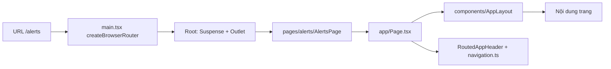

# Cấu trúc app: route, mẹo tìm code, chỗ còn giả lập

Từ URL đến màn hình, thêm trang/tab, mẹo tìm code, bảng giả lập/TODO, cấu trúc thư mục + route/query chi tiết.

Tách nguyên văn từ `GUIDE.md` (28/10/2026) – số mục giữ như cũ (4m, 7b…) để tham chiếu cũ vẫn tìm được. Mục lục: [GUIDE.md](../../GUIDE.md).

### 4a. Từ URL đến màn hình

| Thứ tự đọc | File | Vai trò |
|---|---|---|
| 1 | `src/main.tsx` | Khai báo route; trang có chart/3D lazy-load; `/editor` đi qua `EditorRoute` (kiểm quyền) |
| 2 | `src/app/auth/RequireAuth.tsx` | Route bảo vệ: chưa đăng nhập → `/login?next=…` |
| 2b | `src/app/editorAccess.ts` | `canUseEditor(search, role)` – có quyền `scene:write` (engineer/admin); `VITE_AUTH=off` → `?edit=1` như cũ |
| 3 | `src/app/Page.tsx` | `Page` = `AppLayout` + `RoutedAppHeader` (tab active theo URL) |
| 4 | `src/app/navigation.ts` | `NAV_ROUTES` – thứ tự, nhãn, icon, đường dẫn menu |
| 5 | `src/components/AppLayout/AppLayout.tsx` | 3 biến thể: `full`, `sidebar` (326px), `workspace` (cao 1 màn hình) |
| 6 | `src/components/AppHeader/AppHeader.tsx` | Header 60px + `NavTabs` |
| 7 | `src/pages/<màn>/…Page.tsx` | Ghép component cho từng màn |

| Muốn sửa | Sửa ở |
|---|---|
| Thêm/đổi đường dẫn | `src/main.tsx` |
| Tab menu (nhãn, thứ tự, icon) | `src/app/navigation.ts` |
| Khung trang, padding, cột sidebar | `src/components/AppLayout/AppLayout.tsx` |
| Nút góc phải header trang (Hôm nay, Xuất, Làm mới, Dữ liệu trực tiếp, đồng hồ) | `src/app/HeaderActions.tsx` |

## 5. Cách làm các việc hay gặp (phần của luồng này)

**Thêm trang mới + tab menu**
1. Tạo `src/pages/<ten>/<Ten>Page.tsx`, bọc bằng `Page` (`src/app/Page.tsx`) + `PageHeader`; trang chưa có thiết kế dùng `src/pages/SimplePage.tsx`.
2. Thêm route vào mảng `children` trong `src/main.tsx` (trang nặng: `lazy(() => import(…))`).
3. Thêm mục vào `NAV_ROUTES` trong `src/app/navigation.ts` (`id`, `label`, `path`, `icon`, `activeIcon?`); icon phải có trong `icons` của `src/assets/digital-twin/index.ts`.
4. Dữ liệu: tạo `src/data/<ten>.ts` theo mẫu `fetchX` + `useX` (xem 4b), mock ở `src/mocks/`.

**Đổi màu / token**
1. Đổi giá trị kênh RGB trong `src/styles/tokens.css` (vd `--color-primary: 34 211 238;`).
2. Token mới: thêm biến vào `tokens.css`, map trong `tailwind.config.ts`, nếu chart/3D cần thì thêm tên vào `ColorToken` (`src/lib/tokens.ts`).
3. 3D đọc màu một lần khi mount qua `readScenePalette()` (`src/features/scene/colors.ts`).
4. Xem kết quả ở `/playground#tokens`.

## 7. Mẹo tìm code

| Muốn tìm | Grep / Glob |
|---|---|
| Trang nào dùng dữ liệu nào | `useOverviewData`, `useAlerts`, `useMaintenance`, `useSceneConfig`, `useLiveData` |
| Mọi nơi đọc/ghi URL query | `useSearchParams`, `useTableFilters`, `_PARAMS` (vd `ALERT_PARAMS`) |
| Số liệu suy dẫn | `derive` (vd `deriveAlertKpis`, `derivePriorityTasks`) |
| Chỗ nối API sau này | `fetch` trong `src/data/` (`fetchOverview`, `fetchAlerts`, `fetchMaintenance`, `fetchScene`) |
| Loại asset 3D | `AssetType`, `ASSET_TYPES`, `ASSET_SPECS`, `COMPONENTS` |
| Biến thể màu của component | `tone=`, `variant=` |
| Token màu | `--color-` (CSS), `ColorToken` (TS) |
| Node Figma của một component | số node trong JSDoc, vd `53:245` |
| Chỗ còn giả lập | `mock`, `TODO`, `⚠` |

| Quy ước đặt tên file | Ví dụ |
|---|---|
| Component: `src/components/<PascalCase>/<PascalCase>.tsx` + `src/components/<PascalCase>/index.ts` | `src/components/KpiCard/KpiCard.tsx` |
| Trang: `src/pages/<route>/<Route>Page.tsx` | `src/pages/alerts/AlertsPage.tsx` |
| Hook dữ liệu: `src/data/<màn>.ts`, hàm `useXxx` | `src/data/maintenance.ts` → `useMaintenance` |
| Mock: `src/mocks/<màn>.ts`; cảnh: `src/mocks/scenes/<id>.json` | `src/mocks/scenes/tram-chiet-nap.json` |
| Playground: `src/pages/playground/<Nhóm>Section.tsx` | `src/pages/playground/BusinessSection.tsx` |

Log sai khác Figma đã chuẩn hoá: `docs/figma-diffs.md`. Việc chờ designer/khách: `scratch/designer-questions.md`.

---

## 8. Chỗ còn là giả lập / TODO

| Phần | Hiện tại | Chờ |
|---|---|---|
| Dữ liệu Tổng quan, Cảnh báo, Bảo trì | Mock trong `src/mocks/`, mutation chỉ sửa bộ nhớ (mất khi F5) | Backend: thay thân `fetch*` và các hàm `acknowledge*/create*/advance*` trong `src/data/` |
| Số liệu trực tiếp | `MockLiveSource` (`src/data/live`) dao động quanh `src/mocks/scenes/live.ts` mỗi 2 giây, giả lập mất kết nối/tag lỗi | `WebSocketLiveSource` cùng interface `LiveDataSource` |
| Quy đổi mức bồn → thể tích | Công thức bồn trụ nằm (bỏ qua đáy) – `src/features/tank/volume.ts` | Bảng dung tích thật từ khách (`strappingVolume`) |
| Danh sách tag cảm biến | `SENSOR_TAGS` = khoá của `liveBase` | API danh mục tag |
| Tên tag giả định | Gom ở `src/features/live/tags.ts` (INV-TOTAL, PT-100, FQ-100, LT-101, **LT-101W** mặt nước đáy, PT-101 áp suất bồn V-101, TT-101, **PT-201** áp suất đầu vào hóa hơi, TT-201). Cảnh JSON ghi chuỗi → `src/mocks/assets.test.ts` canh khớp | Danh sách tag SCADA thật – đổi trong `tags.ts` rồi sửa JSON theo test |
| Kích thước V-101 | Trang chi tiết: D 1,9 m × L 4,8 m ≈ 13,6 m³ (suy từ ảnh: 10,4 m³ = 76,2 %) – `src/mocks/assets.ts` + `mocks/scenes/v-101.json`. **Cảnh Tổng quan vẫn vẽ V-101 theo mặc định 4,4 × 11 m (≈ 167 m³)**: đổi sẽ dời cổng ống và lệch bố cục ảnh Figma Tổng quan, nên chưa dùng chung một nguồn kích thước (test ghi nhận lệch) | Kích thước thật của khách → cập nhật cả hai cảnh (dời điểm ống) |
| Số tạm trang chi tiết tài sản | `placeholders` (`isPlaceholder: true` + `note`) trong `src/mocks/assets.ts`: xu hướng thể tích 1 h, tồn kho 152,0 Nm³, "Dự kiến 12 ngày", sức khỏe 98 %, tình trạng hồ sơ 100 % | Định nghĩa + nguồn từ khách |
| Áp suất sau bộ điều áp PR-101 | Tag **`PT-103` GIẢ ĐỊNH** (`REGULATOR_TAGS` ở `tags.ts`, mock 4,2 bar), chưa có ngưỡng → số không tô màu. Không dùng PT-102 (đã là áp suất đẩy bơm P-101A trong cảnh 3D + cảm biến của ALT-00122/MT-00116) | Tag + ngưỡng thật |
| Modal cập nhật xử lý áp suất | Lưu ở bộ nhớ (FE-only: `phase`, `hold`, `readings`, `readingsAtAlert`, `verification`, `issue`, `cause`, `actionTaken`, `attachments`, `followUp`); tệp chỉ tên/kích thước; theo dõi sau xử lý chỉ hiển thị | `PATCH /alerts/:id/pressure-update` (server kiểm lại live), upload tệp, job tự tạo lại cảnh báo khi vượt mục tiêu |
| Nước đáy bồn | Tag `LT-101W` (giả định), ngưỡng 3 % / 5 % thể tích (giả định) | Tag + ngưỡng thật |
| "Xem toàn bộ nhật ký" (chi tiết tài sản) | Nút tắt – chưa có trang nhật ký | Thiết kế + API nhật ký |
| Kho cảnh của Editor | `LocalStorageRepository` (chỉ trên trình duyệt hiện tại) | Bản HTTP của `SceneRepository` |
| Quyền vào `/editor` | Theo vai trò đăng nhập (engineer/admin); chỉ ẩn ở FE – chưa có API lưu cảnh để BE chặn | API scene (`@Roles(...rolesFor('scene:write'))`) |
| Dữ liệu qua backend | Backend mới có xác thực + quản lý user + audit; Cảnh báo/Bảo trì/Cảnh 3D vẫn mock ở FE | Endpoint nghiệp vụ (GUIDE backend "Thêm endpoint") rồi thay `fetch*` bằng `api.request` (mục 9f) |
| Đăng nhập SSO | Chỉ `local` (mật khẩu argon2 trong DB) | OIDC/Entra ID/LDAP qua `CredentialsAuthProvider` / `startSession` |
| Ống trong Editor | Vẽ/sửa được (3D-4); điểm gập chỉ kéo ngang, chưa tự đi tránh thiết bị, nhánh T chỉ là đầu ống nằm trên ống khác | Kéo theo Y, auto-route, tee có cấu trúc |
| Bơm/lọc nâng 0.3 m trong cảnh mẫu | `elevation: 0.3` (dữ liệu cũ để khớp cổng ống) – bảng Kiểm tra báo "lơ lửng" | Thêm bệ (asset/tham số) hoặc hạ xuống sàn + dời điểm ống |
| "Góp ý từ AI" trong form Bảo trì | `suggestForRequest` sinh theo luật | Dịch vụ AI thật |
| Tệp đính kèm | Chỉ giữ tên/kích thước, không upload; tệp thêm ở modal cập nhật tiến độ = `isTemp` ("Chưa tải lên máy chủ", URL xem trước bị thu hồi khi đóng modal) | API lưu tệp |
| Cập nhật tiến độ / nghiệm thu | `reportedProgress`, `hold`, `attachments[].isTemp`, `submission`, `review`, `reviewFailed`, loại lịch sử mới – chỉ FE (`FE_ONLY_FIELDS`); quyền: tiến độ/gửi = `maintenance:write`, nghiệm thu = `maintenance:review` (chỉ ẩn ở FE); người nghiệm thu = `REVIEWERS` mock | Hợp đồng + endpoint (`scratch/designer-questions.md`), chỉ người được phân công cập nhật/gửi, danh sách người nghiệm thu = user engineer/admin, cảnh báo khi hết thời gian theo dõi |
| Drawer chi tiết cảnh báo | Gas: tag GS-01…GS-04 + bands 0/10/20/40 là giả định (chờ khách); "Yêu cầu hỗ trợ" chưa gửi thông báo; kịch bản `?live=…` (cả gas-rise/gas-clear) chỉ dev – `devScenarios.ts` nạp động, không có trong `dist/`. Trường chỉ FE (`ALERT_FE_ONLY_FIELDS`: loại, chiều, tag, `previousValue`, `collaborators`, `closingReading`, giờ gửi thông báo, giờ xác nhận/xử lý, tick hướng dẫn, ghi chú, lịch sử); cấu hình loại = mock `ALERT_KINDS` (`src/mocks/alertKinds.ts`); giờ "Gửi thông báo" mock = phát hiện + 3 s; chỉ ALT-00128 (PT-101) và ALT-00113 (PT-201) có tag | Hợp đồng + endpoint cảnh báo (`scratch/designer-questions.md`), danh mục playbook, tag thật cho mọi cảnh báo |
| Phân công / nhân sự | Modal theo ảnh (mục 4l); danh mục nhân sự = mock `STAFF` (vai trò, ca, chuyên môn); tải việc tính từ danh sách yêu cầu trong bộ nhớ; công tắc "Gửi thông báo đẩy và SMS" chỉ là giao diện | API danh mục nhân sự (user + vai trò + ca), `PATCH /maintenance/:id/assign`, gửi thông báo đẩy/SMS (kể cả khi đổi người) |
| Chi tiết yêu cầu bảo trì | Trường mở rộng chỉ ở FE (`cancelled`, `dueHasTime`, `createdBy`, `objectives`, luồng `notes[]`, `history[]`, checklist `doneAt/na/active`, `attachments[].kind` – `FE_ONLY_FIELDS`); "Xem" tệp = modal giữ chỗ, "Tải xuống" = `.txt` mẫu; avatar = chữ cái đầu; quyền chi tiết theo vai trò chưa làm | Đưa vào hợp đồng API (`docs/API.md` backend), lưu tệp, ảnh đại diện, quyền theo vai trò |
| `?now=` / `VITE_FIXED_NOW` (dời / ghim giờ app) | `src/lib/demoNow.ts` – `?now=` chỉ dev hoặc `VITE_DEMO=true`; `VITE_FIXED_NOW` đặt lúc build, mặc định tắt | Không đặt `VITE_DEMO` / `VITE_FIXED_NOW` trên bản công khai |
| KPI Tổng quan | Tồn kho / Mức bồn / Áp suất / Tiêu thụ lấy từ tag trực tiếp (mock); Cảnh báo, Sức khỏe và số chuông thông báo (2) vẫn tĩnh | API (hoặc derive từ dữ liệu thật) |
| Màu chưa đạt tương phản AA | Đã sửa: chữ đỏ (`danger-text`), chữ menu (`fg-secondary/70`). Còn: chữ `danger-strong` nhỏ ở Tổng quan, Segmented "Nghiêm trọng", số đếm header (xem `docs/decisions.md`) | Duyệt màu với designer |
| Thiết kế | Modal phân công / hủy / xem tệp (chi tiết bảo trì), chân drawer cảnh báo sau khi xác nhận + hộp phân công cảnh báo, thao tác hàng loạt, form, checkbox checked, trang `/reports`, bản đồ toàn nhà máy cho `/map`, trang 404, Editor chưa có trong Figma; trang chi tiết tài sản chỉ có ảnh (không node) | Designer |
| Icon tạm | `src/components/Icon/TempIcons.tsx`, `src/components/Icon/EditorIcons.tsx`, `src/pages/editor/AssetGlyph.tsx` | Asset từ Figma |
| Cần khách xác nhận | Danh sách ở `scratch/designer-questions.md` ("Cần xác nhận") | Khách/PO |

---

### Phụ lục A – Dự án, cấu trúc thư mục chi tiết, route và query (CLAUDE.md mục 1 cũ)

- Dashboard giám sát hệ thống LPG (Tổng quan · Cảnh báo · Bảo trì · Chi tiết tài sản), dựng từ Figma, dữ liệu mock có thể thay bằng API.
- Stack: Vite 5 · React 18 · TypeScript strict · Tailwind 3.4 · react-router 6 · recharts 2.13 · clsx · three 0.170 + @react-three/fiber 8 + drei 9 (chỉ trong chunk lazy `SceneViewer`) · @react-three/postprocessing 2.19 (chỉ trong chunk lazy `PostEffects`) · zod 3.23 (validate cảnh ở chunk lazy `parse`; validate response API ở `src/api/types.ts` – nằm trong bundle chính vì cần ngay lúc đăng nhập) · zustand 5 + zundo 2 (chỉ trong chunk lazy `EditorPage`). Alias `@/` → `src/`.
- npm workspaces: gốc = frontend; `packages/shared` (`@demo-lpg/shared`: kiểu + zod dùng chung FE/BE). **Backend ở repo riêng `../demo-lpg-server`** (NestJS 12 · Prisma 7 + PostgreSQL 17 – có CLAUDE.md/GUIDE.md riêng), phụ thuộc shared qua `file:../demo-lpg/packages/shared` → không đổi tên/di chuyển `packages/shared` mà không sửa repo backend.
- Lệnh: `npm run dev` · `npm run typecheck` · `npm run build` · `npm run lint` (ESLint 9 + typescript-eslint + react-hooks + jsx-a11y) · `npm test` (vitest watch) · `npm run test:run` · `npm run test:coverage` · `npx vite preview --port 4317`. `npm run test:run` gồm cả test `packages/shared`. Backend: chạy trong `../demo-lpg-server` (`npm run db:up` · `npm run dev` · `npm test`).
- Deploy SPA (Netlify): `netlify.toml` (build + publish `dist` + Node 20 + `/*` → `/index.html` 200); chỉ một nguồn cấu hình (không thêm `public/_redirects`).
- Lý do: history router (`createBrowserRouter`) – host tĩnh không có file cho `/alerts`… nên gõ URL/F5 sẽ 404 nếu không trả `index.html`; giữ `base` của Vite là `/`, không đặt `basename`.
- Test tương tác: playwright-core + Edge cài sẵn (`channel: 'msedge'`; máy Linux: `npm i playwright-core` trong scratchpad + `executablePath: '/usr/bin/brave-browser'`), script để ngoài repo (scratchpad), không thêm dependency. Module thuần (parse, specs, data) test được trong trang qua `page.evaluate(() => import('/src/…ts'))` trên dev server. **Từ BE-1 mọi trang cần đăng nhập**: script cũ chạy với `VITE_AUTH=off npx vite` (phiên giả admin) hoặc thêm bước đăng nhập (mẫu `e2e/api-auth.mjs` trong scratchpad: FE ↔ backend thật, 16 bước).
- Cấu trúc:
  - `src/components/<Name>/`: component thuần (không import router, trừ PageHeader dùng `<Link>`); barrel `src/components/index.ts`.
  - `src/app/`: nối router: `navigation.ts` (menu), `Page.tsx` (AppLayout + header theo URL), `HeaderActions.tsx`, `useTableFilters.ts`, `kpi.tsx`, `Placeholder.tsx`, `ConnectedPlantMap.tsx` (nạp cảnh theo `sceneId` → PlantMap 3D), `editorAccess.ts` (quyền vào /editor), `LiveAnnouncer.tsx` (vùng aria-live dùng chung, gắn trong `Page`), `AssetModelPanel.tsx` (mô hình 3D tài sản + nhãn số liệu + toàn màn hình + ảnh dự phòng). `navigation.ts`: tab sáng theo tiền tố đường dẫn (`/map/...` → "Bản đồ nội khu"). `assetRoutes.ts` (nhẹ, không import mock – router dùng): `assetPath(id)` = `/map/<id>`, `DEFAULT_ASSET_ID` = V-101.
  - `src/data/`: lớp dữ liệu theo màn: `overview.ts` (`applyLive` ghép số liệu trực tiếp vào KPI/watchlist/marker 2.5D), `alerts.ts` (bộ lọc, KPI, thao tác cảnh báo trả `{ done, skipped }`), `alertStore.ts` (store danh sách NHẸ – `LiveAnnouncer` ở bundle chính chỉ import cái này), `alertDetail.ts` (chỉ drawer: `alertKind` cấu hình loại, `alertMetric` ngưỡng theo cấu hình tag, `alertPlaybook`, `alertOccurredAt`, `useAlertLive`, `useAreaSensors` cảm biến trong khu, `useTagSignal`, `levelOf`, `useFireReadings` số liệu drawer cháy, `ALERT_STAFF` = toàn STAFF; modal áp suất: `pressureUpdateConfig`, `pressureReadingRows` dòng thông số theo thiết bị, `verificationItems`, `useTagReadings`, `pressureDraft`), `maintenance.ts`, `scene.ts` (`useSceneConfig(sceneId)`, `fetchScene`, `SCENE_IDS`, `isSampleScene`, `useSceneList`), `live/` (`liveSource` + `useLiveData` + `useLiveStatus` + `SENSOR_TAGS` + `liveSimulator`; `MockLiveSource.ts`), `sceneRepository.ts` (`SceneRepository` + `LocalStorageRepository`), `assetDetail.ts` (`useAssetDetail`, `deriveAssetLive`, bộ lọc sự kiện `EVENT_PARAMS`/`filterAssetEvents`, `deriveRelatedAlerts`, `deriveMaintenanceSummary`), `maintenanceDetail.ts` (chi tiết bảo trì: `resolveMaintenanceId`, định dạng giờ, `historyEvents`, tệp mẫu, URL quay lại danh sách, `useRelatedDevice`).
  - `src/features/maintenance/`: thuần, có test – `workflow` (5 bước, không nhảy bước, hủy, phân công, ghi chú, lịch sử, vị trí stepper), `checklist` (tiến độ bỏ mục N/A, khoá theo trạng thái), `deadline` (giờ hạn: `isPastDue`/`dueInstant`/`deadlineCountdown`, hạn chỉ có ngày = 23:59:59), `progress` (modal "Cập nhật tiến độ": Đang thực hiện/Tạm dừng/Gặp sự cố → status + cờ `hold`, "Hoàn thành" chỉ chuyển sang modal Gửi nghiệm thu, `reportedProgress` bước 5, bắt buộc nội dung, một dòng lịch sử, gần hạn `NEAR_DUE_MS` 2 giờ, luật tệp tải lên), `assign` (phân công: `computeWorkloads`/`workloadOf` – đang làm = Đã phân công + Đang thực hiện của người chính, quá hạn, Bận khi ≥ `BUSY_THRESHOLD` 3; `validateAssign` chặn, `assignWarnings` cảnh báo, `inShift`, `applyAssignment` phân công/đổi người có lý do, `planBulkAssign` chỉ Chờ tiếp nhận, `countUnassignableOwners`), `review` (gửi nghiệm thu: `submitMissing`/`canSubmitForReview`/`submitForReview` + ảnh chụp số liệu `snapshotReading`; nghiệm thu: `validateReview`/`reviewRecord` Đạt · Cần bổ sung · Không đạt, chặn tự nghiệm thu, `resolveReviewer`, `followUpUntil`). `workflow.advanceRecord` chỉ còn Tiếp nhận/Bắt đầu.
  - `src/features/alerts/`: thuần, có test – `bands` (mức theo giá trị cho cảnh báo nhiều mức – gas: `bandOf`, `bannerFor` trước/sau ESD, `bandTicks`, `overThreshold` + `formatMinutes`, `canCloseGas` điều kiện "Đã xử lý xong"), `workflow` (`requestSupport` người phối hợp + lý do, `gasUpdate` tiếp tục / đã xử lý xong; cảnh báo chỉ đi tiến: xác nhận → đang xử lý → hoàn thành; phân công KHÔNG tự xác nhận; đánh dấu đã xử lý bắt buộc ghi chú; tick hướng dẫn; `linkedMaintenance` chống tạo trùng; `planBulk`/`bulkMessage`; `alertSteps` 5 bước), `fire` (báo cháy: `detectorStatus` tách báo động/thiết bị, `fireSignalView` tín hiệu liên quan, `crossConfirm` xác nhận chéo, `canCloseFire` chỉ đóng khi đầu báo đã phục hồi / kiểm tra tại chỗ khi mất tín hiệu; `workflow.fireUpdate` 3 kết quả + `resolution`), `gauge` (thang đo: 0 → nguy hiểm × 1.2 hoặc ngưỡng × 1.2, `isBreached` hai chiều above/below, `gaugeValueText`; MỘT hàm định dạng `formatMeasure` "25% LEL" / `formatDelta` "+11% LEL"), `assign` (phân công cảnh báo – KHÔNG import mock nhân sự, dùng được ở bundle chính: `initialAlertAssignForm`, `alertAssignChange` assign/reassign/update/none, `validateAlertAssign`, `applyAlertAssignment` (không tự xác nhận, ghi chú "Chỉ đạo:", một dòng lịch sử), hàng loạt `planBulkAlertAssign`/`validateBulkAlertAssign`/`bulkRowForm`/`bulkAlertAssignMessage`), `assignStaff` (chỉ chunk Cảnh báo: `computeAlertLoads` đã giao chưa xác nhận + đang xử lý, `rankAlertStaff` cùng khu/chuyên môn → Sẵn sàng → Bận → Ngoài ca, `alertAssignWarnings`), `inspection` (hạng mục kiểm tra = bước hướng dẫn, MỘT hàm đọc `guide` dạng cũ `{at, by}` = Đạt / dạng mới có `status`: `inspectionEntry`/`inspectionItems`/`toggledInspection`/`writeInspection`/`setInspectionStatus`), `pressure` (modal cập nhật xử lý áp suất – docs/guide/alerts.md (4o): 5 trạng thái ↔ `phase`/`hold`/done, `canClosePressure` live + sau xử lý < ngưỡng, mất tín hiệu → đồng hồ cơ + số đo tay, `verificationErrors`, `followUpWindow`/`followUpLabel`, `pressureWarnings`, `pressureUpdate`, `parsePressureDraft`). `src/features/staff/availability.ts`: DÙNG CHUNG hai modal phân công – `BUSY_THRESHOLD` 3, `inShift` (giờ bắt đầu), `isOnShift(ca, now)` giờ nhà máy, `staffAvailability` (Ngoài ca thắng Bận), nhãn Sẵn sàng/Bận/Ngoài ca (`AVAILABILITY_LABEL` ở `components/StaffPicker/availability.ts`).
  - `src/features/live/`: thuần – `types` (`TagValue`, `LiveData`, `LiveDataSource`), `signal` (quy tắc mất tín hiệu). `src/features/tank/volume.ts`: quy đổi mức → % thể tích (có test); `layers.ts`: 3 lớp nước/LPG/hơi từ 2 mức chiều cao + kích thước, `roundToTotal` (tổng = 100). `src/features/live/tags.ts`: **tên tag giả định – một chỗ** (`SYSTEM_TAGS`, `V101_TAGS`, `VAPORIZER_TAGS`, `VAPORIZER_AREA_TAGS` – báo cháy trạm hóa hơi: HD-02, SD-02, MCP-02, GS-05, E-101A/B; `REGULATOR_TAGS` – PR-101 → **PT-103 GIẢ ĐỊNH**, áp suất sau bộ điều áp).
  - `src/mocks/`: dữ liệu mẫu từ Figma; `mocks/scenes/`: `{sceneId}.json` (khu-bon-lpg, tram-chiet-nap – gồm views + nhãn), `live.ts` (số liệu giả lập), `v-101.json` (cảnh riêng bồn V-101 – trang chi tiết). `mocks/alertKinds.ts`: cấu hình theo LOẠI cảnh báo (`ALERT_KINDS`: panel threshold/gas, số lớn record/live, thang + bands, banner, nguyên nhân, hướng dẫn `{device}`/`{safetyValve}`/`{nearbySensor}`, nút phụ, kiểu cập nhật, mục thu gọn – docs/guide/alerts.md (4m)). `mocks/sensors.ts`: cảm biến theo khu (`AREA_SENSORS`, `sensorsInArea`, `nearbySensor`) + báo cháy (`HEAT_DETECTORS` – ngưỡng đầu báo 57 °C trong cấu hình tag, `AREA_FIRE_SIGNALS`, `AREA_EQUIPMENT`). `mocks/skills.ts`: chuyên môn nhân sự (`STAFF_SKILLS` – tạm) ↔ `STAFF[].areas/skills` (`mocks/maintenance.ts`) ↔ `ALERT_KINDS[kind].skills` (gợi ý sắp xếp modal phân công cảnh báo); `ALERT_KINDS[kind].numericValue: false` = ẩn "Lúc cảnh báo". `mocks/areas.ts`: MỘT danh sách khu vực (`AREAS`) + mã khu `AREA_CODES`/`areaLabel` ("Trạm hóa hơi (FZ-02)") cho Cảnh báo + Bảo trì ("Bồn chứa" gộp vào "Khu bồn LPG", test ở `contracts.test.ts`). `mocks/assets.ts`: thông số tĩnh tài sản (kích thước, định mức thiết kế, ngưỡng cảnh báo, số tạm `isPlaceholder`) + sự kiện; `assets.test.ts` canh JSON cảnh khớp tags.ts/assets.ts.
  - `src/features/scene/`: cảnh 3D (mục 6): `types`, `fields`, `geometry` (`resolveScene`), `markers`, `parse` (zod, lazy), `colors` (+ `inverseToneMap`), `ground` (thuần: độ cao đáy thế giới, `mayFloat`), `pipes` (thuần: cổng thế giới, đường đi ống, vuông góc, va chạm), `PipeTools` (vẽ ống, tay nắm điểm, chấm cổng), `migrate` (thuần: định dạng cũ → hiện tại), `look` (thông số ánh sáng/bloom/nét viền), `quality` (preset), `pulse`, `PipeMesh`, `SceneViewer` (default export, lazy), `EditTools` (`GROUND_PLANE`/`groundHit`, kéo trên sàn `startGroundDrag`, gizmo xoay/scale, chọn bằng tia/vùng, viền sàn, vạch chân), `editConstants` (thuần: MIME kéo thả, snap, vùng sàn, ngưỡng tia sàn), `PostEffects` (lazy), `assets/` (`specs` thuần + `registry` + component asset + `parts` (thang, lan can, bích…) + `materials`).
  - `src/features/scene-editor/`: logic Editor thuần/không UI (mục 6b): `store` (zustand + zundo), `ops` (biến đổi SceneConfig), `validate`, `draft` (tự lưu nháp).
  - `src/lib/`: `cn`, `useRovingFocus`, `useNow`, `tokens` (màu cho SVG/chart, `tokenHex`), `useDialog`, `createCollectionStore`, `useElementSize`, `plantTime` (ngày theo giờ nhà máy Asia/Bangkok), `reducedMotion` (`useReducedMotion`), `announce` (aria-live), `isTyping`, `useFullscreen`, `demoNow` (`appNow` – dời giờ bằng `?now=` chỉ ở dev / `VITE_DEMO=true`; `useNow` dùng nó), `sessionDraft` (`createSessionDraft(prefix, parse)` – nháp sessionStorage theo mã, try/catch; nháp phân công bảo trì + cảnh báo).
  - Gọi backend: `src/api/` – `client.ts` (fetch wrapper: `VITE_API_URL`, `credentials: 'include'`, Bearer, `ApiError` có `code`, validate zod, 401 → refresh một luồng + Web Locks → gọi lại, `onSessionLost`), `types.ts` (types + zod hợp đồng API – FE tự định nghĩa, không dùng `packages/shared`), `auth.ts` (`authService`: init/login/register/logout/refresh, `AUTH_MODE`), `test-utils.ts` (`mockFetch`).
  - Đăng nhập (FE): `src/app/auth/` (`AuthProvider`/`useAuth`/`useCan`, `RequireAuth`), `src/features/auth/` (thuần: `session.ts` hẹn refresh theo `exp` JWT/`safeRedirect`/`loginUrl`, `permissions.ts` vai trò + `can`, `errors.ts` câu lỗi theo mã), `src/pages/login/` (`LoginPage`, `RegisterPage`, `PendingPage`, `AuthLayout`).
  - `packages/shared/src/`: `scene/` (types, specs, migrate, parse – file cũ trong `src/features/scene/` chỉ còn re-export), `live.ts` (TagValue), `alerts.ts`, `maintenance.ts` (MaintenanceRequest = `MaintenanceRecord`), `roles.ts` (không zod), `auth.ts`.
  - `src/test/setup.ts`: setup vitest (jest-dom, cleanup, polyfill jsdom). Test đặt cạnh module (`*.test.ts` node, `*.test.tsx` jsdom).
  - `src/pages/`: `overview/`, `alerts/` (`AlertsPage`, `AlertDetailDrawer` – KHUNG drawer chi tiết + `panels/ThresholdPanel` (áp suất) / `panels/GasPanel` (khí gas) / `panels/FirePanel` (báo cháy) theo `ALERT_KINDS[kind].panel`, `drawerParts`, `GasUpdateModal` ("Cập nhật xử lý"), `FireUpdateModal` ("Cập nhật xử lý" báo cháy), `EmergencyProcedureModal` ("Xem quy trình khẩn cấp"), `SupportRequestModal` ("Yêu cầu hỗ trợ"), `AlertAssignModal` ("Phân công xử lý cảnh báo" – một / hàng loạt / đổi người, docs/guide/alerts.md (4n)) + `AlertAssignSummary` (thẻ đầu), `AlertBulkCompleteModal`, `PressureUpdateModal` ("Cập nhật xử lý cảnh báo áp suất" – chỉ loại `tank-overpressure`, React.lazy chunk riêng, docs/guide/alerts.md (4o))), `maintenance/` (gồm `CreateMaintenanceModal.tsx`, `MaintenanceDetailPage.tsx` + `MaintenanceDetailDialogs.tsx` – chi tiết yêu cầu + hộp phân công/hủy/xem tệp, `ProgressUpdateModal.tsx` – cập nhật tiến độ, `SubmitReviewModal.tsx` – gửi yêu cầu nghiệm thu, `ReviewModal.tsx` – nghiệm thu, `AssignModal.tsx` – phân công / đổi người xử lý, `MaintenanceResult.tsx` – khối "Kết quả bảo trì" sau Đạt, `attachments.ts` – tải tệp mẫu), `asset/` (`AssetDetailPage` – chi tiết tài sản), `editor/` (Scene Editor: `EditorPage`, `EditorViewport`, `AssetLibrary`, `Outliner`, `PropertiesPanel`, `ViewsPanel`, `ValidationPanel`, `dialogs`, `useEditorActions`, `AssetGlyph`), `playground/`, `SimplePage.tsx`.
  - `src/assets/digital-twin/`: SVG/PNG từ Figma, đăng ký trong `index.ts`.
  - `src/styles/`: `tokens.css`, `global.css`.
  - Ảnh tham chiếu Figma: `scratch/figma-ref/` (gitignore, CHỈ máy dev). **KHÔNG đặt ảnh thiết kế trong `public/`** (deploy công khai). Playground tham chiếu bằng hằng `import.meta.env.DEV ? '/scratch/figma-ref/…' : undefined` (bản build không có ảnh/đường dẫn). `public/figma-ref/` đã xoá 27/10/2026 nhưng 15 ảnh vẫn còn trong lịch sử git (thêm ở 07f15d0, 0e43a7b, f175997, b899cad) – chưa viết lại lịch sử.
- Route (data router `createBrowserRouter` – cần cho `useBlocker`; `future.v7_startTransition` = giữ trang cũ khi chunk trang mới đang tải, không hiện fallback trống; chuyển hướng CỐ ĐỊNH (`/`, `/map`, `/operations/:id`) dùng `loader: () => redirect(…)` – KHÔNG `<Navigate>` vì nó render khung trống trước → nháy màn hình): `/overview` `/alerts` `/alerts?alert=<id>` (drawer chi tiết cảnh báo mở thẳng, F5 giữ, Esc đóng + bỏ query; dev: `&live=gas-rise` / `&live=gas-clear` kịch bản nồng độ GS-04 tăng qua ESD / giảm dưới cấp 1; `&live=fire-cross` / `fire-mcp` / `fire-clear` báo cháy HD-02: khói báo động / nút nhấn kích hoạt / đầu báo phục hồi; mọi `?live=` CHỈ dev – `data/live/devScenarios.ts` nạp động, production bỏ qua) `/maintenance` `/maintenance/:id` (chi tiết yêu cầu theo ảnh MT-00128; mã khác kiểu chữ → mã chuẩn; mã không có → "Không tìm thấy yêu cầu"; `/maintenance?open=<id>` cũ → chuyển hướng, drawer đã bỏ; `#checklist` cuộn + focus khối Checklist) `/maintenance?progress=<id>` (modal "Cập nhật tiến độ" – chỉ yêu cầu Đã phân công/Đang thực hiện) `/maintenance?submit=<id>` (modal "Gửi yêu cầu nghiệm thu" – chỉ Đang thực hiện; mở từ "Tiếp tục gửi nghiệm thu") `/maintenance?review=<id>` (modal "Nghiệm thu" – chỉ Chờ nghiệm thu + quyền `maintenance:review`; badge "Chờ nghiệm thu") `/maintenance?assign=<id>` (modal "Phân công người xử lý" – chỉ Chờ tiếp nhận; badge "Chờ tiếp nhận") `/maintenance?create=1&from=<alertId>` (cảnh báo đã có yêu cầu chưa hủy → chuyển tới yêu cầu đó, không mở form) `/maintenance/:id?submit=1|review=1|assign=1` (mở sẵn modal, bỏ query sau khi mở; assign = phân công hoặc đổi người theo trạng thái) `/map` (→ `/map/V-101`: tab "Bản đồ nội khu" mở thẳng trang chi tiết bồn như ảnh 5D – chưa có bản đồ toàn nhà máy) `/map/:assetId` (chi tiết tài sản; mã khác kiểu chữ `/map/v-101` → `/map/V-101` giữ query; mã không có → "Không tìm thấy tài sản"; `?hide=<loại,…>` ẩn loại sự kiện, `?create=1` modal tạo yêu cầu bảo trì) `/operations/:assetId` (đường dẫn cũ → `/map/:assetId`, giữ query) `/reports` (placeholder) `/editor` (chỉ engineer/admin; `VITE_AUTH=off` → `?edit=1` hoặc `VITE_SCENE_EDITOR=true`; không thì về `/overview`) `/playground`; `/` → `/overview`; route lạ → trang "Không tìm thấy trang" (`src/pages/NotFoundPage.tsx`, URL giữ nguyên, không tab nào sáng). `/login` `/register` `/pending` công khai; mọi route khác nằm trong `RequireAuth` (chưa đăng nhập → `/login?next=<trang>`). Trang có chart lazy-load (`src/main.tsx`). `/overview?map=3d` bật bản đồ 3D (mặc định ảnh 2.5D); nút 2.5D/3D góc dưới trái bản đồ đổi query (`replace`). `?edit=1` (dev, chỉ engineer/admin) bật chế độ sửa cảnh 3D. `?quality=low|medium|high` ghi đè preset 3D (mặc định auto). `/overview?scene=<id>` mở cảnh khác (mẫu hoặc lưu từ Editor) – luôn 3D; về 2.5D thì bỏ `scene`. `/overview?focus=<id object>` (luôn 3D) thêm view "<nhãn object>" và bay tới (nút "Xem trên bản đồ" của chi tiết tài sản). Dev: `?exposure=1.2` thử exposure; `window.__sceneGl` = renderer (đếm draw call), `window.__sceneThree` = scene three (đo hộp bao), `window.__sceneR3f()` = store R3F (camera/controls cho test).

- Khi thêm/đổi luồng, component, asset 3D, scene thì cập nhật `docs/guide/<luồng>.md` tương ứng; backend/xác thực: `docs/guide/backend-auth.md`.
