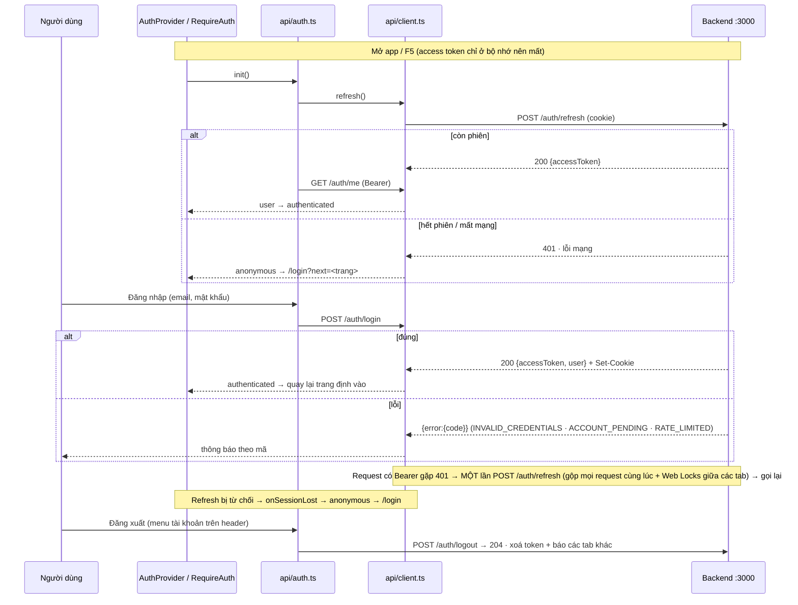

# Đăng nhập (frontend) và backend

Biến môi trường, chạy cùng backend, hợp đồng API, luồng đăng nhập, gọi endpoint mới.

Tách nguyên văn từ `GUIDE.md` (28/10/2026) – số mục giữ như cũ (4m, 7b…) để tham chiếu cũ vẫn tìm được. Mục lục: [GUIDE.md](../../GUIDE.md).

## 9. Đăng nhập (frontend) và backend

Backend (NestJS + Prisma/PostgreSQL) ở **repo riêng** `../demo-lpg-server` (có GUIDE.md riêng). FE gọi backend **trực tiếp** qua CORS – không proxy – và tự định nghĩa types + zod của hợp đồng API trong `src/api/types.ts` (không dùng `packages/shared` cho phần này).

### 9a. Biến môi trường

| Biến | Ở đâu | Giá trị |
|---|---|---|
| `VITE_API_URL` | `.env.development` (commit sẵn) · Vercel: Project Settings → Environment Variables · ghi đè cục bộ: `.env.development.local` | Gốc URL backend, không "/" cuối. Dev: `http://localhost:3000` |
| `VITE_AUTH` | `.env` / `.env.local` / `vercel.json` (`buildCommand`) | `api` (mặc định) · `off` = không đăng nhập, phiên giả admin (demo tĩnh) |

Mẫu: `.env.example`. Thiếu `VITE_API_URL` khi `VITE_AUTH=api` → mọi gọi API báo `CONFIG_ERROR` ("Chưa cấu hình địa chỉ máy chủ").

### 9b. Chạy cùng backend

```bash
# Terminal 1 – backend (repo ../demo-lpg-server, xem GUIDE.md của repo đó)
cd ../demo-lpg-server && npm run db:up && npm run dev     # http://localhost:3000, CORS cho http://localhost:5173
# Terminal 2 – frontend
npm run dev                                                # http://localhost:5173 → gọi http://localhost:3000
```

- Mở bằng `http://localhost:5173` (không phải `127.0.0.1` nếu backend chưa cho origin đó) – backend chỉ nhận origin trong `CORS_ORIGINS`.
- Cookie refresh do backend đặt (`HttpOnly`, `Path=/auth`); FE gửi `credentials: 'include'`. `localhost:5173` và `localhost:3000` cùng site nên `SameSite=Lax/Strict` vẫn gửi được; production khác site cần backend đặt `SameSite=None; Secure`.
- Không có backend: `VITE_AUTH=off npm run dev`. Backend tắt khi đang `api` → trang đăng nhập báo "Không kết nối được máy chủ".

### 9c. Hợp đồng API (`src/api/types.ts`)

| Endpoint | Gửi | Nhận |
|---|---|---|
| `POST /auth/register` | `{email, name, password}` | 201 `{message}` (tài khoản chờ duyệt) |
| `POST /auth/login` | `{email, password}` | 200 `{accessToken, user}` + cookie refresh |
| `POST /auth/refresh` | cookie | 200 `{accessToken}` |
| `POST /auth/logout` | cookie | 204 |
| `GET /auth/me` | `Authorization: Bearer` | 200 `user = {id, email, name, role, status}` |
| Lỗi | – | `{error: {code, message, details?}}` – code: `INVALID_CREDENTIALS`, `ACCOUNT_PENDING`, `VALIDATION_ERROR`, `RATE_LIMITED`, `UNAUTHORIZED` (+ mã khác → hiện `message` của backend) |

Mọi response đi qua zod: sai hợp đồng → `ApiError` mã `CONTRACT_ERROR` nêu trường sai (vd `role: Invalid enum value`). Lỗi phía FE: `NETWORK_ERROR` (không gọi được máy chủ), `CONFIG_ERROR`, `UNKNOWN` (lỗi HTTP không có thân `{error}`).

### 9d. Luồng đăng nhập



Đăng ký: `/register` → `POST /auth/register` → `/pending` ("Tài khoản đang chờ duyệt" + `message` của backend). Đăng nhập tài khoản chưa duyệt → `ACCOUNT_PENDING` → thông báo + liên kết `/pending`.

### 9e. File

| File | Vai trò |
|---|---|
| `src/api/client.ts` | `createApiClient` / `api`: baseURL `VITE_API_URL`, `credentials: 'include'`, Bearer, `ApiError {code, message, status, retryAfter?, details?}`, validate zod, 401 → refresh một luồng → gọi lại, `onSessionLost` |
| `src/api/types.ts` | Types + zod của hợp đồng (User, LoginResponse, RefreshResponse, RegisterResponse, thân lỗi) |
| `src/api/auth.ts` | `createAuthService` / `authService`: init (refresh + me), login, register, logout, refresh chủ động, đồng bộ tab; `AUTH_MODE`, phiên giả khi `VITE_AUTH=off` |
| `src/api/test-utils.ts` | `mockFetch`, `json`, `apiError`, `USER` – dùng trong test |
| `src/app/auth/AuthProvider.tsx` | `AuthProvider`, `useAuth`, `useCan`; hẹn refresh 60 s trước `exp` của JWT |
| `src/app/auth/RequireAuth.tsx` | Route bảo vệ: chưa đăng nhập → `/login?next=…` |
| `src/features/auth/session.ts` | Thuần: `tokenExpiresAt` (đọc `exp`), `refreshDelayMs`, `safeRedirect` (chặn chuyển hướng mở), `loginUrl` |
| `src/features/auth/permissions.ts` | Vai trò + quyền phía FE (`can`, `ROLE_LABELS`) – chỉ ẩn/hiện |
| `src/features/auth/errors.ts` | `authErrorMessage(err)` – câu hiển thị theo mã lỗi |
| `src/pages/login/LoginPage.tsx` · `src/pages/login/RegisterPage.tsx` · `src/pages/login/PendingPage.tsx` · `src/pages/login/AuthLayout.tsx` | Các trang công khai + khung chung |

| Vai trò | FE hiển thị |
|---|---|
| viewer | chỉ xem: không chọn dòng/xác nhận cảnh báo, không tạo/sửa bảo trì |
| operator | + xác nhận/hoàn thành/phân công cảnh báo, tạo/sửa yêu cầu bảo trì |
| engineer | + `/editor`, sửa nhanh `?edit=1` ở Tổng quan |
| admin | mọi quyền |

### 9f. Gọi endpoint mới có xác thực

1. Thêm schema zod + type vào `src/api/types.ts` (đúng hợp đồng backend).
2. Trong `src/data/<màn>.ts`: `api.request('/alerts', { schema: AlertListSchema })` (`import { api } from '@/api/client'`) – tự gắn Bearer, tự refresh khi 401, lỗi là `ApiError`.
3. Ẩn nút theo quyền bằng `useCan('<quyền>')` (chỉ UX – backend kiểm tra lại).
4. Test với `mockFetch` (`src/api/test-utils.ts`), mẫu: `src/api/client.test.ts`.

---

Cập nhật: 22/10/2026.
Khi thêm tính năng mới, cập nhật mục 4–6 (đăng nhập: mục 9; backend: GUIDE của `../demo-lpg-server`).

### Phụ lục D – Gọi backend + đăng nhập phía FE (CLAUDE.md mục 9 cũ)

- **Backend**: repo riêng `../demo-lpg-server` (quy ước BE trong CLAUDE.md của repo đó). FE gọi **trực tiếp** `VITE_API_URL` qua CORS (`.env.development` = `http://localhost:3000`; production = biến môi trường trên Vercel) – không proxy Vite.
- **Hợp đồng API do FE tự định nghĩa** (`src/api/types.ts`, zod), KHÔNG import `@demo-lpg/shared` cho phần API/auth. Mọi response validate bằng zod; sai → `ApiError('CONTRACT_ERROR')` nêu trường sai. Backend đổi hợp đồng → sửa `types.ts` + test; lệch giữa backend và hợp đồng đã chốt thì báo người dùng, không tự đoán. (Backend nhắc tới `docs/API.md` làm nguồn đối chiếu – chưa có file.)
- **Gọi API**: chỉ qua `api.request(path, { schema, method, body, auth })` (`src/api/client.ts`); không `fetch` trực tiếp trong trang/data. Lỗi luôn là `ApiError` có `code` – UI rẽ nhánh theo `code`, không theo câu chữ (`authErrorMessage`); `VALIDATION_ERROR` hiện `details`/`message` của backend.
- **Phiên**: access token chỉ trong bộ nhớ (closure của client), không localStorage/sessionStorage; refresh chỉ qua `api.refresh()` (gộp một luồng + Web Locks – backend thu hồi cả chuỗi nếu một refresh token bị dùng hai lần). Mở app: refresh → `/auth/me`. 401 → refresh một lần → gọi lại → thất bại thì `onSessionLost` → về `/login`.
- **Quyền ở FE chỉ là UX**: `useCan('<quyền>')` / `can()` từ `src/features/auth/permissions.ts` (bản riêng của FE, phải khớp vai trò backend). Trang mới mặc định nằm trong `RequireAuth`; chỉ `/login`, `/register`, `/pending` công khai.
- **`VITE_AUTH=off`**: phiên giả admin, không gọi backend (demo tĩnh trên Vercel). Đừng dùng cho môi trường có dữ liệu thật.
- **`packages/shared`** vẫn còn cho cảnh 3D/live/mock (`src/features/scene/*` re-export, `src/mocks/contracts.test.ts`) và repo backend cũ phụ thuộc qua `file:` – backend đang sửa đã bỏ phụ thuộc này; quyết định giữ/bỏ hẳn: chờ người dùng.
- **Chờ duyệt (phía FE)**: `/editor` theo vai trò (engineer/admin) không cần `?edit=1`; `vercel.json` đặt `VITE_AUTH=off`; header giữ đúng Figma – email/vai trò chỉ hiện trong menu tài khoản; zod trong bundle chính (+14.5 KB gzip).
