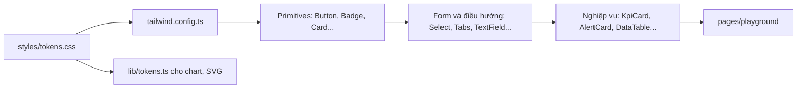

# Design system, quy ước và bảng component

Token → primitive → component nghiệp vụ; quy ước đầy đủ; bảng component (props, nơi dùng, mục playground).

Tách nguyên văn từ `GUIDE.md` (28/10/2026) – số mục giữ như cũ (4m, 7b…) để tham chiếu cũ vẫn tìm được. Mục lục: [GUIDE.md](../../GUIDE.md).

## 3. Quy ước cần biết trước khi đọc

| Chủ đề | Quy ước | File |
|---|---|---|
| Màu, bo góc, font | **Không hardcode màu.** Token là CSS var dạng kênh RGB, map sang Tailwind (`bg-surface`, `text-fg-muted`, `border-line/30`…). Palette mặc định của Tailwind đã tắt. Chart/SVG/3D đọc màu bằng `tokenColor` / `useTokenColors` / `sceneColor` | `src/styles/tokens.css`, `tailwind.config.ts`, `src/lib/tokens.ts`, `src/features/scene/colors.ts` |
| Component thuần | `src/components/*` không import router, không import `src/data`/`src/mocks` (ngoại lệ: `PageHeader` dùng `<Link>`). Nhận dữ liệu qua props, báo sự kiện qua callback | `src/components/index.ts` |
| Component nối dữ liệu | Nằm ở `src/app/` hoặc trong trang: `Page` (header gắn router), `KpiFromData`, `ConnectedPlantMap` (nạp cảnh 3D) | `src/app/` |
| Hook dữ liệu | Trang chỉ đọc qua `useOverviewData()`, `useAlerts()`, `useMaintenance()`, `useSceneConfig()`, `useLiveData()`. Không import `src/mocks` trong trang | `src/data/*.ts` |
| 3 trạng thái | Mỗi trang xử lý `loading` (Placeholder) · `error` (Card danger + "Thử lại") · `success` | `src/app/Placeholder.tsx` |
| Số liệu suy dẫn | KPI, số đếm tab, thẻ ưu tiên, lịch… tính bằng hàm `derive*` từ cùng một danh sách (Cảnh báo, Bảo trì). KPI Tổng quan hiện là mock tĩnh | `src/data/alerts.ts`, `src/data/maintenance.ts` |
| Mock | Nội dung lấy nguyên văn từ Figma | `src/mocks/` |
| Kiểu dữ liệu chính | `OverviewData`, `QueryState` · `AlertRecord` · `MaintenanceRecord` · `KpiMock` · `SceneConfig`/`SceneObject`/`Pipe`/`AssetType`/`LiveData` | `src/data/overview.ts`, `src/mocks/alerts.ts`, `src/mocks/maintenance.ts`, `src/mocks/types.ts`, `src/features/scene/types.ts` |
| Đặt tên | Thư mục `src/components/<PascalCase>/` + `<PascalCase>/index.ts`; component chỉ dùng cho MỘT nghiệp vụ (thẻ cảnh báo, sơ đồ thiết bị, chọn nhân sự…) đặt ở `src/components/domain/<PascalCase>/` (vẫn thuần, vẫn export qua `@/components`). Prop thống nhất: `variant`, `tone`, `size: sm\|md`, `label` (aria), `className`. Giá trị domain tiếng Anh kebab-case, nhãn hiển thị tiếng Việt | — |
| Alias | `@/` → `src/` | `vite.config.ts` |

---

### 4g. Design system: tokens → primitives → nghiệp vụ

| Bước | File |
|---|---|
| Token | `src/styles/tokens.css` (nhóm Background, Border, Text, Brand, Status, `scene-*`). Đỏ: xem bảng "Bốn token đỏ" ngay dưới |
| Map sang class | `tailwind.config.ts` (`v('…')` → `rgb(var(--color-…) / alpha)`) |
| Dùng trong JS | `src/lib/tokens.ts` (`tokenColor`, `useTokenColors`), 3D: `src/features/scene/colors.ts` |
| Xem trực quan | `/playground` – `src/pages/playground/PlaygroundPage.tsx`, mỗi mục một file `*Section.tsx` |

**Bốn token đỏ – dùng cho gì** (duyệt 26/10/2026; mẫu sống ở `/playground` mục 1). ESLint (`DANGER_TEXT_RULES` trong `eslint.config.js`, test `src/test/colorRules.test.ts`) chặn `text-danger` trần, `text-danger-strong` cho chữ thường và mọi độ mờ trên chữ đỏ `text-danger*/NN`; ngoại lệ ghi `// eslint-disable-next-line no-restricted-syntax -- icon` hoặc `-- chữ lớn 28px đậm`.

| Token | Hex | Dùng cho | Không dùng cho | Tương phản |
|---|---|---|---|---|
| `danger` | #D34957 | viền, nền có độ mờ (`bg-danger/10`), chấm, icon | chữ | chữ chỉ 3.3–4.4:1 |
| `danger-text` | #DC6D79 | **mọi chữ đỏ cỡ thường**: nhãn, mã cảnh báo, lỗi form, link "Xem chi tiết →", số nhỏ, nhãn 3D | viền/nền | ≥ 4.8:1 trên mọi nền tối/đỏ mờ đang dùng |
| `danger-strong` | #FA2439 | viền/vòng sáng cảnh báo, icon, **số lớn** WCAG (≥ 24px thường / ≥ 18.66px đậm: số KPI `text-kpi`/`text-2xl`, đồng hồ quá hạn) | chữ thường, chữ có độ mờ | 4.54:1 – chỉ đạt cho chữ lớn (chuẩn 3:1); test `KpiCard.test.tsx` kiểm cỡ chữ |
| `danger-solid` | #B42034 | **nền đặc có chữ trắng** (ô "Nghiêm trọng" của SegmentedControl field) | chữ, viền | chữ `fg` 5.07:1 (nền `danger` cũ 3.34:1) |

Thứ bậc thay cho độ mờ: phần phụ dùng cỡ nhỏ hơn / chữ thường (vd "Active" 16px cạnh số 28px đậm); link đỏ luôn gạch chân + "→" (không chỉ dựa vào màu).

Mục playground: `#tokens` (1), `#primitives` (2), `#navigation` (3), `#layout` (4), `#business` (5), `#charts` (6), `#forms` (7), `#scene` (8), `#editor` (9).

---

## 6. Bảng component

Tất cả export từ `src/components/index.ts`. Cột "Dùng ở" chỉ tính trang/`src/app` (không tính playground).

**GĐ1 – Primitives**

| Tên | File | Props chính | Dùng ở | Playground |
|---|---|---|---|---|
| Button | `src/components/Button/Button.tsx` | `variant` (primary/**danger** – nền `danger-solid`/**info** – nền `info`, "Cập nhật xử lý" gas/ghost/outline/**outline-warning** – viền vàng "Cấu hình trước khi chạy"/subtle/plain/icon/toolbar/overlay/link), `size` (sm/md/**lg** 44px), `icon`, `pressed`; `buttonClass(variant, size)` cho `<Link>` trông như nút | mọi trang | `#primitives`, `#maintenance-detail`, `#alert-drawer` |
| InfoChip | `src/components/InfoChip/InfoChip.tsx` | `icon`, `label` ("Tên" – tự thêm ":"), `value`, `tone` (default/success/warning/danger/muted) – ô "Nhãn: Giá trị" cao 36px trong actions PageHeader, chỉ hiển thị; chip bị giới hạn rộng (`className="w-full"`) → giá trị cắt "…" | Vận hành | – |
| StableWidth | `src/components/StableWidth/StableWidth.tsx` | `candidates` (mọi giá trị có thể hiện), `children` – ô chữ rộng bằng ứng viên dài nhất (xếp chồng `invisible`), đổi giá trị trực tiếp không xô hàng / xuống dòng (chống layout shift) | Vận hành (header chi tiết thiết bị) | – |
| PlcScadaDiagram | `src/components/domain/PlcScadaDiagram/PlcScadaDiagram.tsx` | `sources` ({ id, label, icon, state ok/lost/pending/danger }), `controller`, `heartbeat`, `scada`, `link`, `syncText`, `label` – "Sơ đồ kết nối PLC/SCADA" cố định 1060×323 (đặt trong vùng cuộn ngang), đường nối SVG `stroke-*`, nút mất tín hiệu xám + chữ ẩn | Vận hành (PLC-SCADA) | – |
| VaporizerDiagram | `src/components/domain/VaporizerDiagram/VaporizerDiagram.tsx` | `title`, `temperature`/`pressure` ({ text, tone normal/warning/danger/lost/pending }), `label` (tên truy cập `role="img"`) – sơ đồ SVG máy hóa hơi, viewBox 1330×390, màu qua class `fill-*`/`stroke-*` | Vận hành | – |
| Badge | `src/components/Badge/Badge.tsx` | `variant` (severity – `withIcon` md, `outline` sm · status – `size` sm/md, `cancelled`, `monitoring` ("Đang theo dõi" vàng – Nhật ký vận hành) · count – `tone` neutral/info/**warning**/danger · tag – `tone` neutral/primary/muted/success/warning/danger, `size`), `value` · export `WORK_STATUS_LABEL` (nhãn trạng thái dạng chữ) | Cảnh báo, Bảo trì, Báo cáo, Nhật ký vận hành | `#primitives`, `#maintenance-detail`, `#progress-update`, `#review` |
| StatusDot | `src/components/StatusDot/StatusDot.tsx` | `status` (+ `verify` tím – đọc tại chỗ / cần xác minh, `primary` cyan – nguồn IOT), `shape`, `pulse`, `label` | `src/app/HeaderActions.tsx` | `#primitives` |
| StatusPill | `src/components/StatusPill/StatusPill.tsx` | `tone` (+ `neutral`), `size` (md 36px / sm badge), `pulse`, `children` | Tổng quan, Chi tiết tài sản | `#layout`, `#asset` |
| Card | `src/components/Card/Card.tsx` | `title`, `icon`, `action`, `headerEnd` (phần tử tuỳ ý bên phải header), `headerVariant` (bar/plain/divided), `tone` (+ `primary`/`warning`/`success-vivid` – viền KPI Báo cáo), `padding`, `bodyClassName`; header tự xuống dòng khi hẹp | mọi trang | `#primitives` |
| Divider | `src/components/Divider/Divider.tsx` | `orientation`, `tone` | trong AppHeader, Drawer | `#primitives` |
| ProgressBar | `src/components/ProgressBar/ProgressBar.tsx` | `value`, `max`, `tone` (+ `primary`), `size`, `label` (bắt buộc – tên truy cập) | Bảo trì, trong KpiCard/CategoryBarList | `#primitives` |
| Icon (+ TempIcons, EditorIcons) | `src/components/Icon/Icon.tsx` | `name` (IconName), `box` (9/12/14/16/18/20/24), `label` | mọi trang | `#primitives`, `#editor` |

**GĐ2 – Form & điều hướng**

| Tên | File | Props chính | Dùng ở | Playground |
|---|---|---|---|---|
| NavTabs, NavMenu | `src/components/NavTabs/NavTabs.tsx` | `items`, `value`, `onChange` · `children` trên mục → dropdown menu con (`onChange` nhận id con, tab cha sáng theo `navTopId`) · NavTabs: đủ chữ ≥ `wide`, chỉ icon 1280–1519 · NavMenu: nút xổ danh sách < `xl` (mục con thụt vào) | trong AppHeader | `#navigation` |
| Tabs | `src/components/Tabs/Tabs.tsx` | `items` (count, countTone, `countMax` – mặc định 99), `value`, `onChange`, `panelId` | Cảnh báo, Bảo trì, Editor, Báo cáo | `#navigation` |
| SegmentedControl | `src/components/SegmentedControl/SegmentedControl.tsx` | `options`, `value`, `onChange`, `variant`, `size` | form Bảo trì, PlantMap | `#navigation` |
| Avatar | `src/components/Avatar/Avatar.tsx` | `name`, `size` sm 24 / md 32 / lg 40; `initials()` dùng chung với NotesThread (cùng người → cùng chữ, "Nguyễn Văn A" → "NA") | Combobox (avatar), thẻ nhân sự | `#assign` |
| Switch | `src/components/Switch/Switch.tsx` | `label`, `description`, `checked`, `onChange` – `role="switch"` + `aria-checked`, bật = primary | Modal phân công | `#assign` |
| StaffPicker (StaffList / StaffPickerCard) | `src/components/domain/StaffPicker/StaffPicker.tsx` | List: `label`/`labelledBy`, `items` ({ name, subtitle, shiftLabel, shiftMatch, busy, active, overdue, workloadHint, `meta`, `availability`, `loadLabel`, `suggestion` }), `value` (null = chưa chọn), `onChange`, `emptyState`, `compact` (thẻ gọn: avatar 32, tên, "chức danh • phòng ban", chip `meta`) – radiogroup dọc, ↑↓ chuyển + chọn, Space chọn. `availability`: Sẵn sàng (xanh) / Bận (vàng) / Ngoài ca (viền đứt + tên chữ phụ, KHÔNG opacity, vẫn chọn được); không truyền = chip Sẵn sàng/Bận theo `busy` (modal bảo trì). `loadLabel` thay chữ chip tải việc; `suggestion` = chip gợi ý | Modal phân công bảo trì + cảnh báo | `#assign`, `#alert-assign` |
| StaffFilters | `src/components/domain/StaffPicker/StaffFilters.tsx` | `search` (ô tìm), phòng ban / ca (Select), `onShiftOnly` (Switch "Chỉ người đang trong ca") – nút lọc = disclosure (`aria-expanded`, tên kèm số bộ lọc đang bật), vùng lọc mở ngay dưới | Modal phân công cảnh báo | `#alert-assign` |
| AssignNotices | `src/components/domain/StaffPicker/AssignNotices.tsx` | `warnings` ({ id, label, action? }) không chặn – vùng aria-live polite CHỈ chữ, khối nhìn thấy có nút; `issues` chặn → khối `id={blockId}` cho `aria-describedby` của nút xác nhận | Hai modal phân công | `#assign`, `#alert-assign` |
| SearchInput | `src/components/SearchInput/SearchInput.tsx` | `value`, `onChange`, `onClear`, `label` | Editor; trong FilterBar | `#navigation` |
| Select | `src/components/Select/Select.tsx` | `options`, `value`, `onChange`, `variant` (filter/button/field), `allLabel`, `hideAllInTrigger` (ô lọc chưa chọn chỉ hiện nhãn), `fullWidth` (trigger giãn theo bề rộng `className` – bề rộng cố định khi giá trị đổi) | Cảnh báo, Bảo trì, Editor, Vận hành | `#navigation`, `#forms` |
| Combobox | `src/components/Combobox/Combobox.tsx` | `options`, `value`, `onChange`, `multiple`, `clearable`, `showAvatar` | form Bảo trì, Editor | `#forms` |
| FormField + TextField, Textarea, DatePicker | `src/components/FormField/FormField.tsx`, `src/components/FormField/TextField.tsx` | `label`, `value`, `onChange`, `required`, `hint`, `error`, `labelVariant` (field/section – nhãn 18px như tiêu đề mục; DatePicker cũng có), DatePicker `hideLabel` (ô lọc ngày – chỉ aria-label) | form Bảo trì, Editor | `#forms` |
| NumberField, Vec3Field | `src/components/FormField/NumberField.tsx` | `value`, `onChange` (chốt khi Enter/blur – chỉ khi đã gõ; ↑/↓ chốt ngay), `min`, `max`, `integer`, `unit`, `onClear`, `tone` (default/warning/danger – màu số theo ngưỡng), `align` (start/center) | Editor, modal cập nhật xử lý áp suất | `#editor`, `#alert-update` |
| Checkbox | `src/components/Checkbox/Checkbox.tsx` | `checked`, `onChange`, `indeterminate`, `label`, `showLabel`, `variant="card"` (ô viền cả dòng, chọn = viền + nền primary nhạt; khoá bằng `aria-disabled` – vẫn focus, không đổi; `aria-readonly` = giá trị do hệ thống quyết định, không đổi được – điều kiện hệ thống ở modal đóng cảnh báo) | trong DataTable, form Bảo trì, Editor, "Kết quả xác minh" | `#editor`, `#alert-update` |
| ChecklistEditor | `src/components/ChecklistEditor/ChecklistEditor.tsx` | `items`, `onChange`, `templates` | form Bảo trì | `#forms` |
| FileDropzone | `src/components/FileDropzone/FileDropzone.tsx` | `files`, `onChange`, `accept`, `maxSizeMB` | form Bảo trì | `#forms` |
| TreeView | `src/components/TreeView/TreeView.tsx` | `items`, `selected`, `onSelectionChange`, `onRename`, `renderActions` | Editor | `#editor` |

**GĐ3 – Layout**

| Tên | File | Props chính | Dùng ở | Playground |
|---|---|---|---|---|
| AppHeader | `src/components/AppHeader/AppHeader.tsx` | `navItems`, `navValue`, `onNavChange`, `user` (`detail` hiện trong menu), `userMenu` + `onUserMenuSelect` (menu tài khoản – Đăng xuất) | `src/app/Page.tsx` | `#layout` (bản gắn router) |
| PageHeader | `src/components/PageHeader/PageHeader.tsx` | `breadcrumb`, `title`, `description`, `actions`, `titleEnd` (cạnh tiêu đề, ngoài `<h1>` – ô chọn "Thiết bị" Vận hành) | mọi trang | `#layout` |
| AppLayout | `src/components/AppLayout/AppLayout.tsx` | `header`, `variant` (full/sidebar/workspace), `pageHeader`, `sidebar`; nội dung tối đa `max-w-content` (1920px) | `src/app/Page.tsx` | không (mọi trang dùng) |

**GĐ4A – Nghiệp vụ**

| Tên | File | Props chính | Dùng ở | Playground |
|---|---|---|---|---|
| KpiCard | `src/components/KpiCard/KpiCard.tsx` | `label`, `value`, `unit`, `sub`, `variant`, `tone`, `progress`, `action`, `signalLost`, `dense` (thẻ ~102px, dòng phụ 11px), `hint` + `hintIcon` (định nghĩa: tooltip + đọc kèm nhãn), `size="sm"` (ô số liệu nhỏ; `emphasis` = ô thông tin modal tiến độ; `align="center"` + `footnote` = thông số modal nghiệm thu; `valueSize="lg"` = số 24px đậm + đơn vị 16px, nền nhạt – "Thông số cảnh báo"), `tone` thêm `primary`, `outlined` (compact: viền theo MỌI tone – KPI Báo cáo), `valueNote` + `valueNoteTone` + `valueNoteIcon` (ghi chú 12px CÙNG DÒNG sau số: "↑12", "(67%)" – KPI Nhật ký vận hành), `reserveSub` (giữ chỗ dòng phụ khi số liệu trực tiếp chưa về – thẻ không cao thêm) | qua `src/app/kpi.tsx`; Chi tiết tài sản, Chi tiết bảo trì, Báo cáo, Nhật ký vận hành | `#business`, `#asset`, `#maintenance-detail` |
| SystemHealthCard | `src/components/domain/SystemHealthCard/SystemHealthCard.tsx` | `value`, `caption`, `stats` | Tổng quan | `#business` |
| AlertItem | `src/components/domain/AlertItem/AlertItem.tsx` | dữ liệu `AlertItemData` + `highlighted`, `onClick`, `layout` (stacked / inline = icon + nội dung + giờ một dòng / **bar** = vạch màu trái + "giờ - `statusLabel`"), `tone` (danger/warning/success) | Tổng quan, Chi tiết tài sản, Vận hành | `#business`, `#asset` |
| AlertCard | `src/components/domain/AlertCard/AlertCard.tsx` | dữ liệu `AlertCardData` + `onClick(id)`; `variant="compact"` + `valueLabel` + `footer` (link) | Cảnh báo, Chi tiết bảo trì | `#business`, `#maintenance-detail` |
| PriorityTaskCard | `src/components/domain/PriorityTaskCard/PriorityTaskCard.tsx` | dữ liệu `PriorityTaskData` + `onDetail` | Bảo trì | `#forms` |
| AssetRow, AssetWatchlist | `src/components/domain/AssetRow/AssetRow.tsx` | `assets`, `onAssetClick`, `canOpen` (dòng nào bấm được), dòng `signalLost` | Tổng quan | `#business` |
| EventTimeline, RecentEventsCard | `src/components/EventTimeline/EventTimeline.tsx` | `events` (+ `tone`), `variant` (event/schedule/history/feed – feed: chấm theo `tone`, giờ trên nội dung 16px, neutral mờ – Theo dõi mô phỏng) | Bảo trì, Tổng quan, Chi tiết bảo trì | `#forms`, `#business`, `#maintenance-detail` |
| Drawer | `src/components/DetailDrawer/Drawer.tsx` | Drawer (khung): `open`, `onClose`, `labelledBy`, `header` (cố định; hàng đầu chừa `pr-10` cho nút ×), `children` (cuộn), `footer` (dính đáy), `accent` (mép trái primary/40), `contentKey`, `widthClass` (mặc định 440; dưới `sm` toàn màn hình) | Drawer chi tiết cảnh báo (`src/pages/alerts/AlertDetailDrawer.tsx`) | `#forms`, `#alert-drawer` |
| ThresholdGauge | `src/components/ThresholdGauge/ThresholdGauge.tsx` | `label`, `value`, `min`, `max`, `threshold`, `direction` (above/below – đảo màu), `valueText` (aria-valuetext, nói rõ vượt/dưới ngưỡng hoặc mức), `valueLabel`, `bands` (nhiều mức: đoạn success · warning/60 · warning · danger) + `ticks` (mốc trục, `danger` = chữ danger-text) – `role="meter"` | Drawer cảnh báo (áp suất, gas) | `#alert-drawer` |
| EmergencyBanner | `src/components/domain/EmergencyBanner/EmergencyBanner.tsx` | `title`, `text`, `stage` (đổi → báo lại) – không đóng được; `role="alert"` chỉ khi mới hiện / đổi `stage`; bỏ `stage` = banner TĨNH (không alert); `tone` danger/**warning** ("Chế độ mô phỏng") | Drawer cảnh báo gas | `#alert-drawer` |
| SensorList | `src/components/domain/SensorList/SensorList.tsx` | `label`, `rows` ({ name, valueText (null = mất tín hiệu), levelLabel, tone, highlight }) – dòng gây cảnh báo: vạch trái + chữ đậm | Drawer cảnh báo gas | `#alert-drawer` |
| ToastList (+ `ToastHost` ở src/app, store `lib/toast.ts`) | `src/components/Toast/Toast.tsx` | `items` ({ id, text, tone info/success/error }), `onDismiss`, `label` – góc trên phải dưới header (dưới `sm` trải ngang), viền + icon theo loại, nút × "Đóng thông báo"; KHÔNG phải vùng live (`showToast` tự `announce`); tự tắt 5 s / lỗi 8 s, tối đa 3 | mọi trang (`Page`): lỗi thao tác bấm nhanh (`runAction` mặc định `toastError`) | – |
| Modal | `src/components/Modal/Modal.tsx` | `open`, `onClose`, `title`, `footer`, `onSubmit`, `size`, `titleTone` (primary = modal tiến độ), `headerExtra` (dải thông tin trong header), `beforeBody` (dải không cuộn – tab điều hướng), `bodyRef` (thân cuộn) | form Bảo trì, Editor, Ghi nhận mốc kiểm tra | `#forms` |
| PlantMap, MapMarker | `src/components/PlantMap/PlantMap.tsx`, `src/components/PlantMap/MapMarker.tsx` | ảnh: `image`, `markers`, `views` · 3D: `scene`, `liveData`, `editable`, `quality`, `onFallback`, `focus` (id object → thêm view bay tới, chọn sẵn); chung `onSelect`, `onRendererChange`, `notice`; `preloadSceneViewer()` = tải code 3D sớm (song song dữ liệu cảnh) | Tổng quan, `src/app/ConnectedPlantMap.tsx` | `#scene` (qua ConnectedPlantMap) |
| SceneLoading | `src/components/SceneLoading/SceneLoading.tsx` | `label` (mặc định "Đang tải mô hình 3D…"), `hidden` (mờ dần 250 ms) – lớp chờ DUY NHẤT của cảnh 3D, nền `bg-app` = màu sàn cảnh, phủ `absolute inset-0` | PlantMap, ConnectedPlantMap, AssetModelPanel, SceneViewer | – |

**GĐ4B – Chart & bảng**

| Tên | File | Props chính | Dùng ở | Playground |
|---|---|---|---|---|
| ChartCard (+ ChartTooltip) | `src/components/ChartCard/ChartCard.tsx` | `title`, `description`, `height`, `action` | Tổng quan | `#charts` |
| AreaTrendChart, LineTrendChart | `src/components/TrendChart/TrendChart.tsx` | `data` (TrendPoint[]), `domain`, `unit`, `format` | Tổng quan | `#charts` |
| DualTrendChart | `src/components/TrendChart/TrendChart.tsx` | `data` ({ label, [id]: số \| null }), `series` (2 × { id, name, suffix, color, `area`/`dashed`, `domain` riêng, `threshold` { value, label, color } }), `xTicks` – mỗi series một trục Y ẩn, ngưỡng số trái/tên phải, nhãn khung ở điểm CUỐI (null → không nhãn) | Vận hành ("Xu hướng vận hành") | – |
| TargetTrendChart | `src/components/TrendChart/TrendChart.tsx` | `data` ({ x, value }), `xDomain` cố định + `xTicks`/`formatX`, `domain`/`yTicks`/`formatY` (trục Y hiện nhãn), `lines` (vạch nét đứt theo token), `color`, `name`, `format`, `grid` (lưới 2 chiều), `dots` (chấm mọi điểm), `endDot` (chấm cuối, mặc định bật), `areaOpacity`, `thinTicks` (khung hẹp bỏ bớt nhãn X) – vùng gradient, phần chưa chạy để trống; `ChartTooltip` thêm `labelFormat` | Theo dõi / Kết quả mô phỏng | – |
| CategoryBarList | `src/components/CategoryBarList/CategoryBarList.tsx` | `items`, `max`, `unit` | Tổng quan | `#charts` |
| DonutGauge | `src/components/DonutGauge/DonutGauge.tsx` | `segments`, `total`, `totalLabel`, `center` ({ value, caption, tone } thay chữ giữa), `ringWidth`, `label` (aria) | Tổng quan, Chi tiết tài sản | `#charts`, `#asset` |
| FilterBar | `src/components/FilterBar/FilterBar.tsx` | `search`, `filters`, `values`, `onValuesChange`, `onAdvancedFilter`, `layout` (split / inline – xếp từ trái, ô tìm 255px), `leading` (ô sau tìm kiếm), `onClear` + `clearDisabled` (link "Xóa bộ lọc"), `standalone` (bỏ vạch dưới – thanh lọc riêng trên danh sách thẻ, AI mô phỏng) | Cảnh báo, Bảo trì, Báo cáo | `#navigation` |
| DataTable (+ TableActionButton) | `src/components/DataTable/DataTable.tsx` | `columns`, `rows`, `getRowId`, `label` (→ `<caption>`), `selectable`, `selectedIds`, `rowActions`, `pagination`, `minWidth` (cuộn ngang trong khung), `stickyFirst`, `stickyActions`, `onRowClick` (chuột – bỏ qua nút/link/ô chọn trong hàng), `pagination.pageSizeOptions` + `onPageSizeChange` ("Số dòng mỗi trang"), `groupBy` (dòng nhóm thu gọn được – `aria-expanded`), `gridLines` (kẻ dọc), `density="dense"` (≥ 38px), `column.className` dạng hàm theo dòng | Cảnh báo, Bảo trì, Báo cáo, Chi tiết báo cáo ngày | `#charts` |
| Pagination | `src/components/Pagination/Pagination.tsx` | `page`, `pageCount`, `onPageChange` | trong DataTable | `#charts` (qua DataTable) |

**GĐ5D – Chi tiết tài sản** (ảnh `scratch/figma-ref/asset-v101-design.png`, chưa có node Figma)

| Tên | File | Props chính | Dùng ở | Playground |
|---|---|---|---|---|
| TankCutawayDiagram | `src/components/domain/TankCutawayDiagram/TankCutawayDiagram.tsx` | `layers` (`levelPct`, `waterPct` theo chiều cao để vẽ + 3 `%` thể tích cho nhãn; null = không vẽ), `state` (pending/lost), `length`, `diameter` (giữ tỉ lệ), `label` (→ `<title>`) | Chi tiết tài sản | `#asset` |
| TankLayerList | `src/components/domain/TankLayerList/TankLayerList.tsx` | `items` ({ id, label, value, tone }), `title` – `<dl>` | Chi tiết tài sản | `#asset` |
| MaintenanceSummaryCard | `src/components/domain/MaintenanceSummaryCard/MaintenanceSummaryCard.tsx` | `next` ({ date, note, overdue }), `last`, `records` ({ value, status, hint }) – ngày đã định dạng sẵn | Chi tiết tài sản | `#asset` |
| AssetModelPanel (src/app) | `src/app/AssetModelPanel.tsx` | `sceneId`, `assetName`, `liveData`, `tag`, `description` (văn bản thay canvas), `fallbackImage` | Chi tiết tài sản | – |

**Chi tiết yêu cầu bảo trì** (ảnh `scratch/figma-ref/mt-detail-design.png`, chưa có node Figma; số đo ước lượng ở `tokens.css`)

| Tên | File | Props chính | Dùng ở | Playground |
|---|---|---|---|---|
| WorkflowStepper | `src/components/WorkflowStepper/WorkflowStepper.tsx` | `steps` (+ `note`/`noteTone` nhãn phụ, `time` – chỉ dọc), `completed`, `current` (aria-current="step"; null = không còn bước chờ), `label`, `orientation` (horizontal / **vertical** – tiến trình drawer cảnh báo), `marker` (chỉ dọc: ring / **dot** + `detail` dòng phụ – "Luồng phê duyệt" modal ký báo cáo) | Chi tiết bảo trì, drawer cảnh báo | `#maintenance-detail`, `#alert-drawer` |
| InfoGrid | `src/components/InfoGrid/InfoGrid.tsx` | `items` ({ id, label, value, tone default/danger/warning/link, newRow }) – `<dl>` 4/2/1 cột; `variant="stats"` = hàng chỉ số nhỏ 2 cột → 4 cột từ `sm` (drawer gas) · `variant="pairs"` = luôn 2 cột (khung hẹp – "Thông tin báo cháy") | Chi tiết bảo trì, drawer gas, drawer cháy | `#maintenance-detail`, `#alert-drawer` |
| Checklist | `src/components/Checklist/Checklist.tsx` | `items` ({ done, na, active, time, `flag` (plain: chip "Có vấn đề"/"Không áp dụng"), `lockedHint` (plain: khoá riêng mục + gợi ý) }), `progress` (tính sẵn), `onToggle`, `lockHint`, `variant="summary"` (chỉ đọc gọn ✓ + chữ – modal Gửi nghiệm thu) / `"plain"` (vòng tròn + chữ, checkbox thật ẩn, không thanh tiến độ – hướng dẫn xử lý cảnh báo); `checklistSummary()` | Chi tiết bảo trì, drawer cảnh báo | `#maintenance-detail`, `#review`, `#alert-drawer` |
| NotesThread | `src/components/NotesThread/NotesThread.tsx` | `notes` ({ author, time đã định dạng, text }), `onAdd` async (không có = chỉ đọc; reject = lỗi → toast, giữ nội dung ô nhập; đang lưu → nút khoá), Ctrl+Enter gửi | Chi tiết bảo trì | `#maintenance-detail` |
| AttachmentCard | `src/components/AttachmentCard/AttachmentCard.tsx` | `id`, `name`, `kind` (image/document/manual – thiếu thì đoán theo đuôi), `meta`, `notice` (nhãn nhỏ, vd "Chưa tải lên máy chủ"), `fluid` (giãn theo lưới), `onView`, `onDownload` | Chi tiết bảo trì, modal tiến độ | `#maintenance-detail`, `#progress-update` |
| DeadlineCountdownCard | `src/components/domain/DeadlineCountdownCard/DeadlineCountdownCard.tsx` | `countdown` ({ clock, overdue, speech } – null = đã đóng), `dueText`, `closedText` | Chi tiết bảo trì | `#maintenance-detail` |
| AssigneeCard | `src/components/domain/AssigneeCard/AssigneeCard.tsx` | `assignee` (null = chưa phân công), `department`, `shift`, `onAssign` (không truyền = không có nút), `assignLabel` (ghi đè nhãn nút), `assignDisabled` | Chi tiết bảo trì | `#maintenance-detail` |
| StickyActionBar | `src/components/StickyActionBar/StickyActionBar.tsx` | `label` (tên vùng), `start`, `children` (nút); cao `--action-bar-height` | Chi tiết bảo trì | `#maintenance-detail` |

**Cập nhật tiến độ bảo trì** (ảnh `scratch/figma-ref/mt-progress-modal-design.png`, chưa có node Figma)

| Tên | File | Props chính | Dùng ở | Playground |
|---|---|---|---|---|
| StatusOptionCard / StatusOptionGroup | `src/components/StatusOptionCard/StatusOptionCard.tsx` | Group: `label`/`labelledBy`, `options` ({ id, label, icon, tone primary/warning/danger, `toneLabel` (chữ theo tone khi chưa chọn), disabled, disabledHint, `describedBy` (id lý do hiển thị – thay chữ ẩn) }), `value`, `onChange`, `layout` (stacked / inline = chấm radio + chữ một dòng / **plain** = radio thường không khung – "Điều kiện kết thúc"), `columns` (4 / 3 / 2 / **5** – trạng thái xử lý áp suất / **auto** – ô co theo chữ, xuống dòng / **1** = danh sách dọc), `size` (sm = ô inline chữ 14px + khoảng cách 12px – 3 cột trong modal md), `describedBy` – `role="radiogroup"`, mũi tên chuyển + chọn (roving tabindex) | Modal tiến độ, modal nghiệm thu, "Cập nhật xử lý" gas/cháy/áp suất | `#progress-update`, `#review`, `#alert-update` |
| ProgressSlider | `src/components/ProgressSlider/ProgressSlider.tsx` | `label`, `value`, `onChange`, `min`/`max`/`step` (mặc định 0/100/5), `unit`, `describedBy`, **`variant="threshold"`** (nhãn 14px, số 24px, rãnh không tô + `marker` vạch ngưỡng vàng + `scaleLabels`), `valueDisplay`, `valueText` – `role="slider"`, phím + kéo/bấm rãnh | Modal tiến độ, cấu hình kịch bản mô phỏng | `#progress-update` |
| UploadTile | `src/components/UploadTile/UploadTile.tsx` | `onFiles(File[])`, `accept`, `multiple`, `hint` (đọc kèm), `label` | Modal tiến độ, modal cập nhật xử lý áp suất | `#progress-update`, `#alert-update` |
| InspectionTable | `src/components/domain/InspectionTable/InspectionTable.tsx` | `caption` (sr-only `<caption>` + tên vùng cuộn), `rows` ({ id, text, status, by, time, note, error }), `statusOptions`, `onStatusChange`, `onNoteChange`, `readOnly` – `th scope`, ô chọn tên "Trạng thái: <hạng mục> <giá trị>", ghi chú inline tên "Ghi chú: <hạng mục>", cuộn ngang dưới 760 px | Modal cập nhật xử lý (khung chung) | `#alert-update` |
| BeforeAfterReadings | `src/components/domain/BeforeAfterReadings/BeforeAfterReadings.tsx` | `label`, `rows` ({ id, label, limit, unit, before, after, beforeTone/afterTone danger/warning/normal, editable, afterPlaceholder, afterText (giá trị chữ của tag trạng thái, vd đầu báo khói) }), `onAfterChange`, `footer` – màu kèm chữ ẩn "(vượt ngưỡng…)" | Modal cập nhật xử lý (khung chung) | `#alert-update` |

**Báo cáo định kỳ** (ảnh `scratch/figma-ref/reports-*.png`, chưa có node Figma) – luồng: docs/guide/reports.md

| Tên | File | Props chính | Dùng ở | Playground |
|---|---|---|---|---|
| MetricListCard | `src/components/MetricListCard/MetricListCard.tsx` | `title`, `count` ({ value, tone, label ẩn }), `progress` ({ label, value, max, valueText } – thanh + %), `rows` ({ id, label, value, tone default/success/warning/danger/**primary**, `separated` = vạch kẻ trên }) – `<dl>`, `action` (link cuối, căn phải), `headerVariant`, **`divided`** (kẻ mọi dòng – "Tóm tắt cấu hình"), `titleSize` | Báo cáo ("Chờ xác nhận", "Tiến độ tháng"), Vận hành ("Trạng thái nhanh") | `#reports` |
| ScheduleList | `src/components/ScheduleList/ScheduleList.tsx` | `items` ({ id, date, weekday, day, title, meta, dateLabel đọc thay ô ngày }), `onItemClick`, `emptyState` | Báo cáo ("Lịch báo cáo sắp tới") | `#reports` |
| ActionItemList | `src/components/ActionItemList/ActionItemList.tsx` | `items` ({ id, tone danger/warning, subject đậm, message }), `actionLabel` ("Xử lý ngay" + mã ẩn), `onAction`, `emptyState` | Báo cáo ("Cần xử lý hôm nay") | `#reports` |
| Khối trang báo cáo (src/pages/reports/shared) | `ReportKpiRow`, `ReportSummaryCards`, `ReportTableSection`, `useReportTable`, `ReportBadges` | Ghép cho mọi màn báo cáo định kỳ – xem docs/guide/reports.md (5O-1) | Báo cáo | `#reports` (badge) |

---

### Phụ lục B – Quy ước đầy đủ (CLAUDE.md mục 3 cũ)

- **Tái sử dụng trước khi viết mới.** Thiếu biến thể thì thêm prop/variant vào component có sẵn.
- **Không hardcode màu:** token ở `src/styles/tokens.css` (CSS var dạng kênh RGB), map trong `tailwind.config.ts`. Palette mặc định của Tailwind đã tắt; độ trong suốt dùng `bg-danger/10`, `border-line/30`. Chart/SVG lấy màu qua `useTokenColors()` (`src/lib/tokens.ts`).
- **Token:**
  - Nền: `bg-app|header|canvas`, `surface[-raised|-sunken|-muted|-chip]`.
  - Viền: `line` (/10, /30, 100%), `line-card`, `line-divider`.
  - Chữ: `fg[-secondary|-muted|-label|-inverse|-disabled]`.
  - Thương hiệu: `primary`, `accent`, `info`.
  - Trạng thái: `success[-strong]`, `live`, `warning[-soft]`, `danger[-strong]`, `neutral` · `verify` (tím #A78BFA – chờ duyệt; số đọc tại chỗ "XM hiện trường", mốc cần xác minh). **Bốn token đỏ** (docs/guide/design-system.md (4g), playground mục 1): `danger` = viền/nền mờ/chấm/icon · `danger-text` = MỌI chữ đỏ cỡ thường · `danger-strong` = viền/icon + SỐ LỚN WCAG (≥ 24px / ≥ 18.66px đậm) · `danger-solid` = nền đặc có chữ trắng. ESLint chặn `text-danger` trần, `text-danger-strong` cho chữ thường và độ mờ trên chữ đỏ (`text-danger*/NN`); thứ bậc dùng cỡ/độ đậm/gạch chân, không làm mờ.
  - Chữ: `2xs` 10 · `xs` 11 · `sm` 12 · `base` 14 · `md` 16 · `lg` 18 · `xl` 24 · `2xl`/`kpi` 28 · `3xl` 32. Bo góc: `xs` 2 · `sm` 4 · `md` 6 · `lg` 8 · `xl` 12.
- **Figma tự mâu thuẫn:**
  - Ưu tiên screenshot; nhưng trước khi kết luận lệch, kiểm tra `opacity-*`/`hidden` trên node và các node cha.
  - Sai khác nhỏ (bo góc, khoảng cách, sắc màu, cỡ chữ lệch 1–2px): tự chuẩn hóa về token rồi ghi log ở mục 8.
  - Chỉ hỏi khi thay đổi ý nghĩa, hành vi hoặc bố cục lớn.
- **Đặt tên:** thư mục `components/<PascalCase>/` + `index.ts` (ngoại lệ: TextField/Textarea/DatePicker nằm trong `FormField/`). Prop thống nhất: `variant`, `tone`, `size: sm|md`, `label` (aria), `className`. Giá trị domain viết tiếng Anh kebab-case, nhãn hiển thị tiếng Việt (ghi đè bằng `children`). JSDoc ghi node Figma.
- **Tránh xung đột class:** không truyền qua `className` class màu/cỡ chữ trùng loại với class nội bộ của component; thêm prop/variant thay vào đó.
- **Accessibility:**
  - Component điều khiển controlled (`value`/`onChange`).
  - Roving tabindex (`useRovingFocus`): Tabs và Segmented dùng `auto`, NavTabs dùng `manual`.
  - Role chuẩn: tablist, radiogroup, listbox, combobox, dialog.
  - `:focus-visible` hiển thị outline accent.
  - Dialog dùng `useDialog`: giữ focus, Esc lắng nghe ở document, khoá cuộn, trả focus khi đóng.
  - Có `onClick` thì render thành `<button>`; callback trả về `id`.
  - Focus sau render bằng effect, không dùng `requestAnimationFrame`.
- **Dữ liệu trực tiếp** (chi tiết docs/guide/live-data.md (4b)): `TagValue = { value; unit?; ts; quality: good|uncertain|bad }`, `LiveData = Record<tag, TagValue>`; mọi UI đọc qua `useLiveData`/`useLiveStatus` (`src/data/live`), nguồn là `LiveDataSource` (mock hôm nay, WebSocket/SCADA sau – chỉ đổi `liveSource`). **Mất tín hiệu** (bad, ≥ 10 s `STALE_MS` không cập nhật, hoặc không có tag) → "Mất tín hiệu" xám + `SignalLostIcon`, KHÔNG hiện số cũ; tính bằng `tagSignal(tv, Date.now())` lúc render. Không dùng số thuần cho số liệu trực tiếp.
- **Dữ liệu:**
  - Trang chỉ đọc qua hook `useOverviewData()` / `useAlerts()` / `useMaintenance()` (`src/data/*`), không import `src/mocks` trực tiếp. ESLint (`no-restricted-imports` trong `eslint.config.js`) chặn `@/mocks` ở `src/features`, `src/components`, `src/app`, `src/lib`, `src/pages` (trừ playground, test).
  - Kiểu dữ liệu: `features/alerts/types.ts` (AlertRecord…), `features/alerts/kinds.ts` (AlertKindConfig…), `features/maintenance/types.ts` (MaintenanceRecord…), `features/operations/types.ts`, `features/staff/org.ts` (SHIFTS, DEPARTMENTS, StaffMember), `features/staff/skills.ts`, `features/plant/areas.ts` (AREAS, areaLabel). Mock, test và code đều import kiểu thẳng từ các file này (mock không re-export). Danh mục nhân sự cho trang: `src/data/staff.ts`; logic cần tra nhân sự nhận hàm `StaffLookup` qua tham số. Dữ liệu sửa được dùng `createCollectionStore` (store chung, mutation optimistic).
  - Mọi số liệu suy dẫn (KPI, thẻ ưu tiên, số đếm tab, lịch) tính từ cùng một danh sách bằng các hàm `derive*`, không hardcode.
  - Trang xử lý đủ 3 trạng thái: loading (`Placeholder`) · error (`<PageError title error onRetry actions? preformatted?>` – `src/app/Placeholder.tsx`: Card danger + thông điệp + "Thử lại") · success.
  - Tải MỘT tài nguyên theo mã (Tổng quan, chi tiết tài sản / thiết bị, cảnh 3D, danh sách cảnh Editor): `useQuery(key, fetcher)` (`src/lib/useQuery.ts`) – đổi key / `refetch` → loading, bỏ kết quả cũ + sau unmount, luôn bắt lỗi; `fetcher(signal)` nhận AbortSignal bị huỷ khi đổi key / refetch / unmount (truyền vào `api.request`). Danh sách dùng chung nhiều trang: `createCollectionStore`.
- **Bảng có lọc → `useTableFilters`** (`src/app/useTableFilters.ts`):
  - Khai báo tham số bằng hằng `*_PARAMS as const`; bộ lọc, trang, bản ghi đang mở và lựa chọn dòng đồng bộ URL (`replace`).
  - Modal/drawer mở qua query (`?open=`, `?alert=`, `?create=1&device=&from=`).
- **Modal có form:** chỉ mount khi mở, khởi tạo state bằng hàm khởi tạo của `useState` (tránh nháy giá trị cũ). Khung chung `useFormModal({ initial, values, isDirty?, draft?, onSubmit, onClose, onSubmitError? })` (`src/lib/useFormModal.ts`) → `dirty`, `confirming`, `submitting`, `hasDraft`, `requestClose` (Esc / Hủy / ×), `keepEditing` + `keepEditingRef`, `discard`, `saveDraft`, `submit` (chặn gửi lặp; kết quả `{ ok: false }` giữ nháp). Kiểm tra form vẫn ở modal. Tuỳ chọn `stayOpenAfterDraft` / `keepDraftOnDiscard` / `confirmIfDraft` cho modal cập nhật xử lý cảnh báo và ghi mốc báo cáo.
- **Thao tác ghi thất bại** (`src/lib/actionError.ts`): modal bắt lỗi của `onSubmit`/`onConfirm` → `actionErrorText(e)` vào `
` (modal giữ mở, thử lại được). Handler không chờ kết quả (onClick, callback drawer) gọi qua `runAction(task, onError?)` – không để unhandled rejection; mặc định `toastError` (toast lỗi nhìn thấy + `announce`). Chưa có hoàn tác (mock ghi cục bộ; khi có API: POST xong mới commit).
- **Test** (chi tiết docs/guide/testing.md (7b)):
  - **Hàm logic mới phải có test trong cùng commit.** Test đặt cạnh module (`x.ts` → `x.test.ts`); `*.test.tsx` cần DOM ghi `// @vitest-environment jsdom`.
  - Hàm thuần nhận thời gian qua tham số (`now`), không gọi `Date.now()`/`new Date()` bên trong; "hôm nay" theo giờ nhà máy (`src/lib/plantTime.ts`), không theo múi giờ máy.
  - Có ca biên (0, rỗng, âm, vượt giới hạn, ranh giới ngày, chạy lại hai lần). Component test truy vấn theo vai trò/tên (Testing Library). Trước commit: `npm run test:run`, `npm run lint`, `npm run typecheck`.
  - Lỗi thật test tìm ra: sửa hàm, không sửa test cho khớp lỗi.
- **Breakpoint** (`tailwind.config.ts` → `screens`, KHÔNG viết `min-[…px]` tuỳ ý): `sm` 640 · `md` 768 · `lg` 1024 · `xl` 1280 · `wide` 1520 · `3xl` 1920.
  - ≥ `wide`: như Figma (1565) – không đổi giao diện ở 1565. `xl`–`wide`: bố cục đầy đủ, menu chỉ icon, KPI 3 cột. `lg`–`xl`: sidebar xuống dưới, menu thành nút `NavMenu`. < `lg`: dùng được.
  - Nội dung trang tối đa `max-w-content` (`--content-max-width` 1920px) căn giữa. Bảng rộng: `DataTable minWidth` + `stickyFirst`/`stickyActions` (cuộn ngang trong khung, trang không tràn).
  - Ảnh chụp kiểm tra để trong `scratch/` (gitignore).
- **Accessibility (bổ sung):**
  - ESLint jsx-a11y phải sạch; không `tabindex` > 0; vùng cuộn/bản đồ = `role="region"` + tên + `tabIndex={0}` (được phép trong config).
  - axe-core (WCAG 2.1 A/AA) trên từng trang: không còn lỗi critical; serious chỉ còn tương phản màu Figma chờ duyệt (mục 7).
  - Thông báo động qua `announce()` / `useAnnounceChange` (aria-live polite, `LiveAnnouncer`); không đặt vùng live trong nút.
  - `ProgressBar` bắt buộc `label`; SVG chart trong `role="img"` ẩn khỏi trình đọc (`aria-hidden`, recharts `rootTabIndex={-1}`).
  - `prefers-reduced-motion`: CSS toàn cục tắt animation; 3D dùng `useReducedMotion`/`prefersReducedMotion` (pulse đứng, ống không chảy, camera không bay, frameloop demand).
  - Canvas 3D có `DeviceList` ẩn: tóm tắt trạng thái + nút từng thiết bị (Tab hiện ra, Enter chọn + đưa camera tới).

### Phụ lục C – Bảng component tóm tắt (CLAUDE.md mục 4 cũ)

| Component | Mô tả |
|---|---|
| Icon / TempIcons / EditorIcons | `<Icon name>` từ assets Figma · `Icon/TempIcons.tsx` là SVG tạm (chỉ có trong ảnh; `SignalLostIcon` = mất tín hiệu; `ThermometerIcon`/`GaugeIcon`/`BoltIcon`/`CpuIcon`/`MapPinIcon` – màn Vận hành; `PdfFileIcon`/`SignaturePenIcon` – modal ký báo cáo; `BroadcastIcon`/`NetworkIcon`/`SlidersIcon`/`PipeLineIcon`/`FlameIcon`/`MonitorIcon` – sơ đồ PLC/SCADA) · `Icon/EditorIcons.tsx` icon tạm cho Editor (công cụ, ẩn/khoá, tệp, undo/redo, ống) |
| Button | primary/danger (nền `danger-solid` chữ trắng – "Xác nhận cảnh báo")/ghost/outline/subtle/plain (chỉ chữ phụ – "Hủy" chân modal tiến độ)/icon/toolbar/overlay/link, sm/md/lg (44px), `pressed`; `buttonClass()` cho `<Link>` trông như nút |
| Badge | severity (sm/md/chip, `withIcon` md/chip, `outline` sm) · status (unacknowledged/pending/assigned/in-progress/review/done/cancelled/monitoring; `size` sm/md) · count · tag (neutral/primary/muted/warning/danger – "Tạm dừng"/"Gặp sự cố", sm/md) |
| StatusDot, StatusPill | Chấm trạng thái (circle/square, pulse, `verify`) · pill trạng thái hệ thống (`size` md/sm, tone thêm `neutral`) |
| Card, Divider, ProgressBar | Khung card (bar/plain/divided header, tone, radius, `headerEnd` = phần tử tuỳ ý bên phải header; header tự xuống dòng) · đường kẻ · thanh tiến độ (`label` bắt buộc) |
| NavTabs, NavMenu, Tabs, SegmentedControl | Menu chính (đủ chữ ≥ `wide`, chỉ icon `xl`–`wide`) · menu thu gọn < `xl` (nút + danh sách, aria-current) · tabs gạch chân + chip đếm · nhóm chọn 1 (overlay/field + tone, overlay `size` sm/md) |
| SearchInput, Select, Combobox | Ô tìm kiếm · dropdown (filter/button/field, side) · combobox tìm kiếm đơn/nhiều + avatar/chip |
| FormField (+TextField, Textarea, DatePicker, NumberField, Vec3Field) | Nhãn/lỗi/gợi ý chung (`labelVariant="section"` = nhãn 18px như tiêu đề mục) · ô nhập · date/datetime-local · ô số (chốt khi Enter/blur/↑↓, kẹp min/max, integer, unit, `onClear` = về mặc định, `hideLabel`/`size sm`/`prefix`) · 3 ô X/Y/Z (`only` = chỉ hiện một số trục, vd `[0, 2]`) |
| Checkbox, ChecklistEditor, FileDropzone | Checkbox (indeterminate; `showLabel` = nhãn chữ bên cạnh) · checklist kéo thả/Alt+↑↓/mẫu · kéo thả tệp |
| TreeView | Cây chọn nhiều (ARIA tree): Ctrl/⌘ đảo, Shift dải, phím ↑↓←→ Home End Space Enter, F2/double-click đổi tên (trả lỗi → giữ ô), `renderActions` bên phải dòng; không controlled thì nhớ nhánh đóng |
| MetricListCard, ScheduleList, ActionItemList | Thẻ nhãn–số (+ thanh tiến độ, chip đếm, link) · lịch có ô ngày · hộp việc cần xử lý (danger/warning) – màn Báo cáo |
| FilterBar, DataTable, Pagination | Thanh lọc (`layout` split/inline, "Xóa bộ lọc") · bảng (`pageSizeOptions`, `groupBy`/`gridLines`/`dense` – bảng số liệu báo cáo ngày, (chọn dòng, header sticky, thao tác, rỗng, `<caption>` từ `label`, `minWidth` cuộn ngang trong khung, `stickyFirst`/`stickyActions`) · phân trang |
| AppHeader, PageHeader, AppLayout | Header 60px (NavTabs ≥ `xl`, NavMenu < `xl`; `userMenu` + `onUserMenuSelect` → menu tài khoản, vd Đăng xuất; `user.detail` chỉ hiện trong menu) · breadcrumb/tiêu đề/actions · layout full/sidebar 326px/`workspace` (cao đúng 1 màn hình, nội dung tự cuộn – /editor); nội dung tối đa `max-w-content` |
| KpiCard, SystemHealthCard | KPI (default/danger/with-progress/compact, `signalLost` → "—" + "Mất tín hiệu", `dense` thẻ ~102px, `hint`/`hintIcon` định nghĩa ⓘ) · độ tin cậy hệ thống |
| AlertItem, AlertCard, PriorityTaskCard | Dòng cảnh báo sidebar (`layout="inline"` + `tone` = icon/nội dung/giờ một dòng – "Cảnh báo liên quan") · thẻ cảnh báo ưu tiên (`variant="compact"` + `valueLabel` + `footer` – chi tiết bảo trì) · thẻ việc bảo trì ưu tiên |
| AssetRow/AssetWatchlist, EventTimeline/RecentEventsCard | Theo dõi thiết bị (`signalLost` → icon, `canOpen` = dòng có trang chi tiết mới là nút) · timeline (event/schedule + location / history: chấm theo `tone`, giờ bên phải) |
| WorkflowStepper, InfoGrid, Checklist, NotesThread, AttachmentCard, DeadlineCountdownCard, AssigneeCard, StickyActionBar | (Chi tiết bảo trì, ảnh MT-00128) stepper ngang `aria-current="step"` · lưới nhãn/giá trị `<dl>` · checklist checkbox thật + tiến độ + khoá/N/A/Đang làm · luồng ghi chú + ô nhập · thẻ tệp Xem/Tải xuống · hạn chót đếm ngược (aria theo phút, báo một lần khi quá hạn) · phân công · thanh hành động dính đáy (đệm + scroll-padding). `KpiCard size="sm"` = ô số liệu nhỏ (`emphasis` = nhãn 14/giá trị 16 đậm, tone thêm `primary`); `DataTable onRowClick`; stepper `note`/`noteTone` = nhãn phụ dưới bước; AttachmentCard `fluid` (giãn theo lưới) + `notice` ("Chưa tải lên máy chủ"); Modal `titleTone="primary"`. (Nghiệm thu) `Checklist variant="summary"` chỉ đọc ✓ + chữ · `Badge tag tone="success"` ("Đủ điều kiện gửi nghiệm thu") · `KpiCard size="sm" align="center" footnote` · `DatePicker labelVariant` · Button `aria-disabled` = trông khoá, vẫn focus (đọc được lý do) nhưng CHẶN click/Enter/Space/gửi form ngầm (`Button.test.tsx`) |
| Avatar, Switch, StaffList / StaffPickerCard | (Modal phân công, ảnh thiết kế) avatar chữ cái đầu sm/md/lg (Combobox dùng chung; NotesThread giữ bản riêng) · công tắc `role="switch"` + `aria-checked`, bật = primary · danh sách nhân sự = radiogroup dọc không chọn sẵn, thẻ: avatar, tên, "phòng ban • chuyên môn", chip ca (khớp ca đang chọn = xanh), Sẵn sàng/Bận (warning), "x đang làm (y quá hạn)" (có quá hạn = chip danger, lót nền đặc để đủ tương phản), tooltip cách tính. AssigneeCard thêm `assignLabel`. (Phân công cảnh báo) thẻ thêm `availability` (Sẵn sàng/Bận/Ngoài ca – Ngoài ca viền đứt, tên chữ phụ, KHÔNG opacity, vẫn chọn được), `loadLabel`, `suggestion`; `StaffFilters` (ô tìm + nút lọc disclosure: phòng ban, ca, "Chỉ người đang trong ca"); `AssignNotices` (cảnh báo aria-live polite + lý do chặn – dùng chung hai modal) |
| StatusOptionCard / StatusOptionGroup, ProgressSlider, UploadTile | (Modal "Cập nhật tiến độ", ảnh thiết kế) ô chọn trạng thái `role="radio"` trong `radiogroup` (mũi tên chuyển + chọn, bỏ qua ô disabled, tone primary/warning/danger; `layout="inline"` chấm radio + chữ một dòng, `columns={3}`, `toneLabel` chữ theo tone khi chưa chọn, `describedBy` – modal nghiệm thu) · thanh trượt `role="slider"` (bước 5, ←→↑↓ ±bước, PageUp/Down ±2 bước, Home/End, kéo/bấm rãnh, nút kéo 16px) · ô "Tải tệp lên" (input file ẩn, `accept`, `hint` cho trình đọc) |
| ChartCard, AreaTrendChart, LineTrendChart, DualTrendChart, CategoryBarList, DonutGauge | Khung chart + tooltip · area/line 24h · 2 chỉ số 2 thang + ngưỡng (Vận hành) · thanh theo khu vực · donut (`center`, `ringWidth`, `label`) |
| TankCutawayDiagram, TankLayerList, MaintenanceSummaryCard | (GĐ 5D) Hình cắt bồn SVG (`<title>`/`<desc>`, nhãn dẫn, chú thích 3 màu, tỉ lệ theo kích thước; nhận lớp đã tính) · danh sách "Cấu trúc tồn chứa" (`<dl>`) · thẻ bảo trì tiếp theo/gần nhất/hồ sơ |
| PlantMap, MapMarker | Thuần. `renderer="image"`: ảnh 2.5D + markers/views do trang truyền · `"three"`: nhận `scene` + `liveData` + `onSelect` (+ `editable`, `quality`, `onFallback`), views/nhãn lấy từ cảnh, SceneViewer lazy. `focus` (id object → view bay tới). Chung controls, `onRendererChange` → nút 2.5D/3D, `notice` → thông báo nhỏ cạnh nút; marker callout/side/tag, tone thêm `neutral` (offline/mất tín hiệu, `showSignalLostIcon`), `translucent` (nền /85 + blur, dùng ở 3D). Nạp cảnh theo id: `ConnectedPlantMap` (src/app) |
| Drawer, DetailDrawer, Modal | Khung drawer phải dùng chung (`components/DetailDrawer/Drawer.tsx`: header cố định + thân cuộn + chân dính đáy, 440px, dưới `sm` toàn màn hình, `accent` mép trái primary/40) · drawer nhãn/giá trị · modal md/lg/xl (icon, footerStart, form). Drawer chi tiết cảnh báo nằm ở `pages/alerts/AlertDetailDrawer.tsx` (cần router + dữ liệu) |
| EmergencyBanner, SensorList | (Ảnh drawer gas) banner khẩn cấp không đóng được (`role="alert"` chỉ khi mới hiện / đổi `stage`) · danh sách cảm biến: tên, giá trị live, badge mức, dòng gây cảnh báo vạch trái + chữ đậm, mất tín hiệu không hiện số. Kèm: `ThresholdGauge bands` + `ticks` (thang nhiều mức), `InfoGrid variant="stats"`, `Button variant="info"` ("Cập nhật xử lý"), `StatusOption.describedBy` + `columns={2}`. (Báo cháy) `InfoGrid variant="pairs"` (luôn 2 cột), `StatusOptionGroup size="sm"` (3 ô inline trong modal md), `EmergencyBanner` dùng lại cho xác nhận chéo |
| InspectionTable, BeforeAfterReadings + biến thể (modal áp suất) | (Ảnh modal cập nhật xử lý áp suất 28/10/2026) bảng hạng mục: `<caption>` + `th scope`, ô chọn trạng thái tên "Trạng thái: <hạng mục>", ghi chú inline, lỗi theo dòng, cuộn ngang < 760 px · thông số trước → sau (ô Sau sửa tay khi `editable`, màu theo ngưỡng + chữ ẩn). Kèm: `Checkbox variant="card"` (khoá `aria-disabled`), `StatusOptionGroup columns={5}` / `"auto"`, `Checklist plain` item `flag` + `lockedHint`, `NumberField tone` + `align`, `inputClass(invalid, text)` |
| ThresholdGauge + biến thể drawer cảnh báo | (Ảnh drawer cảnh báo 27/10/2026) thanh đo `role="meter"` (min/max/now + valuetext "vượt ngưỡng"/"dưới ngưỡng", `direction` below đảo màu) · `WorkflowStepper orientation="vertical"` (+ `time`) · `Checklist variant="plain"` (vòng tròn, checkbox thật ẩn) · `KpiCard size="sm" valueSize="lg"` (số 24px đậm) · `StaffList compact` (+ `meta`) · `useDialog` có ngăn xếp: modal mở trên drawer → Esc chỉ đóng hộp trên cùng |

Xem trực quan và các biến thể tại `/playground` (khung mẫu dùng chung `pages/playground/Demo.tsx`; mục "Trạng thái" = loading · lỗi · mất tín hiệu; mục 1–9, đặt cạnh ảnh tham chiếu; mục 8 = cảnh 3D: chọn cảnh, "Mô phỏng sự cố", "Chế độ sửa", id đã chọn; mục 9 = component Editor: NumberField, Vec3Field, TreeView, Checkbox có nhãn, icon; mục 10 = chi tiết tài sản: hình cắt (5 ca: theo ảnh/thấp/nhiều nước/đầy/mất tín hiệu), KPI dense, StatusPill sm, donut center, AlertItem inline, thẻ bảo trì, icon tạm; mục 11 = chi tiết yêu cầu bảo trì: stepper 6 trạng thái, InfoGrid, Checklist được tick/khoá/chỉ đọc, NotesThread, AttachmentCard, đồng hồ 5 ca (chạy thật/04:15:00/> 24 giờ/quá hạn/đã đóng), AssigneeCard, AlertCard compact, KpiCard sm, Button outline/subtle, StickyActionBar bật/tắt; mục 12 = cập nhật tiến độ: modal đầy đủ cạnh ảnh thiết kế (dữ liệu mẫu, không ghi store), StatusOptionGroup, ProgressSlider, AttachmentCard fluid/notice + UploadTile, badge cờ + stepper nhãn phụ; mục 14 = phân công: modal phân công/đổi người cạnh ảnh (dữ liệu mẫu, tải việc từ store), StaffList, Switch, Avatar; mục 13 = nghiệm thu: modal Gửi (7/7 và chưa đủ điều kiện) + modal Nghiệm thu cạnh ảnh thiết kế, StatusOptionGroup inline 3 cột/có icon, Checklist summary, Badge success, KpiCard căn giữa; mục 15 = drawer chi tiết cảnh báo: trạng thái mẫu áp suất (Chưa xác nhận theo ảnh / Đang xử lý / Hoàn thành có MT / không tag + dưới ngưỡng / không thang) + GAS (Chưa xác nhận – chỉ ở playground / Đang xử lý theo ảnh) – không ghi store, nút mô phỏng nồng độ GS-04, cạnh hai ảnh, ThresholdGauge 3 ca, KpiCard lg, Button danger/lg, StaffList compact, stepper dọc, Checklist plain; mục 16 = phân công xử lý cảnh báo: modal một / đổi người / không có số / hàng loạt (giờ cố định 10:45, dữ liệu mẫu, không ghi store) cạnh ảnh, thẻ đầu 3 biến thể, StaffPickerCard có xét ca, StaffFilters; mục 17 = cập nhật xử lý cảnh báo áp suất: modal theo ảnh (giờ cố định 14:06, không ghi store) + nút PT-101 về 9.2 / tăng 11.2 / mất tín hiệu, InspectionTable, BeforeAfterReadings, Checkbox card; mục 15 thêm mẫu drawer "Tạm dừng + Có vấn đề/Không áp dụng" và "Hoàn thành – đang theo dõi").

## Bổ sung 10/11/2026 (FE hardening)
- **ResponsiveImage** (`src/components/ResponsiveImage/`): `<picture>` AVIF → WebP → `src` từ `ImageAsset` (`src/lib/imageAsset.ts`: `src`, `srcSet`, `avifSrcSet`, `width`, `height`); `priority` = ảnh LCP (eager + fetchpriority high), mặc định lazy. Dùng ở PlantMap 2.5D và AssetModelPanel.
- **DetailDrawer** đã xoá (không còn nơi dùng) – khung drawer là `Drawer`.
- **Token Tailwind mới**: `h-field`/`min-h-field` (ô nhập 35px), `w-sidebar` (326px), `size-4.5`/`leading-4.5` (18px), `border-1.5`, `backdrop-blur-xs` (3px; 4px dùng `backdrop-blur-sm`). Không viết lại `-[35px]`, `-[326px]`, `-[18px]`.
- **Icon SVG** là file riêng (`build.assetsInlineLimit` không inline `.svg`) – không còn ~90 KB data URI trong chunk chính. Icon Toast ở `Icon/StatusIcons.tsx`, khuôn chung `Icon/iconBase.ts`.
- **KpiCard** tách nội bộ (KpiStat, KpiStatLarge, KpiHeader, KpiValue, KpiSubLine) – API props giữ nguyên. **Select** tách `triggerText`, `triggerClass`, `OptionList`.
- Quy ước export: module nạp bằng `lazy()` dùng `export default`; còn lại export có tên.

## Bổ sung 11/11/2026 (dọn trùng lặp + độ phức tạp – nhánh `refactor/fe-cleanup`)
- **Thư mục `src/components/domain/`**: 17 component nghiệp vụ (AlertCard, AlertItem, AssetRow, AssigneeCard, BeforeAfterReadings, DeadlineCountdownCard, EmergencyBanner, InspectionTable, MaintenanceSummaryCard, PlcScadaDiagram, PriorityTaskCard, SensorList, StaffPicker, SystemHealthCard, TankCutawayDiagram, TankLayerList, VaporizerDiagram). `PlantMap` giữ ở gốc (component lõi). Import qua `@/components` không đổi.
- **DiscardConfirmButtons** (`Modal/`): chân modal form khi hỏi "bỏ thay đổi?" (Tiếp tục sửa · Bỏ thay đổi [và xóa nháp]) – đi cùng `useFormModal`; `keepLabel`, `draftDiscardLabel`.
- **AttachmentCard** thêm `onRemove` (nút X "Bỏ tệp …" góc phải trên – tệp tạm).
- **`pageFallback(q, { header, errorTitle, skeleton, errorActions? })`** (`src/app/Placeholder.tsx`): loading (khối Placeholder theo chiều cao, hoặc ReactNode) / error (Card danger + "Thử lại"). Dùng `if (q.status !== 'success') return pageFallback(q, …)` sau mọi hook.
- **lib mới**: `useDismiss(open, rootRef, onDismiss, { escape })` (bấm ra ngoài / Esc đóng lớp nổi – Select, Combobox, NavTabs, menu tài khoản) · `useMinuteMemo(factory, now, deps)` (tính lại theo phút) · `download.ts` (`downloadFile`, `downloadCsv`, `toCsv` quote always/minimal, `CSV_BOM`) · `fileSize.ts` (`formatFileSize` "2,4 MB" – một bản duy nhất) · `errorMessage(e, fallback)` trong `actionError.ts`.
- **Trang chi tiết thiết bị**: `pages/operations/DeviceLayout.tsx` (khung KPI + 2 cột + cột phải chung, `DiagramCard`, `TrendCard`, `criticalAlertsRow`) – VaporizerView / PlcScadaView chỉ còn phần riêng.
- **AI mô phỏng**: `pages/operations/simulation/shared.tsx` (`BackLink`, `ScenarioNotFound`, `referenceHealth`, `useSuggestionConfidence`, `useAnalyzedAt`).

