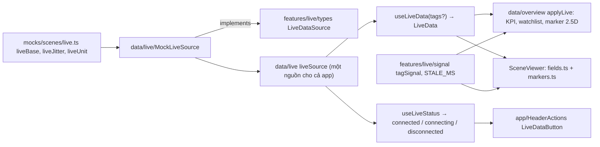

# Số liệu trực tiếp (live)

Một luồng live chung cho KPI, theo dõi thiết bị, bản đồ, cảnh 3D, header; nối nguồn thật; thêm tag.

Tách nguyên văn từ `GUIDE.md` (28/10/2026) – số mục giữ như cũ (4m, 7b…) để tham chiếu cũ vẫn tìm được. Mục lục: [GUIDE.md](../../GUIDE.md).

**Số liệu trực tiếp (live) – một luồng chung cho KPI, danh sách theo dõi, bản đồ 2.5D, cảnh 3D và header:**

- Kiểu: `TagValue = { value: number | string; unit?; ts; quality: 'good' | 'uncertain' | 'bad' }`, `LiveData = Record<tag, TagValue>` (`src/features/live/types.ts`, thuần).
- Nguồn: interface `LiveDataSource { subscribe(tags, cb) → huỷ; getSnapshot(tags); status; onStatusChange(cb) }`. Bản hiện tại `MockLiveSource` (đổi số mỗi 2 s, kết nối khi có người nghe; tag không dao động – chuỗi trạng thái như `HD-02.ALARM` – lấy theo giá trị nền `setBase` ở bước kế tiếp). **Nối WebSocket/SCADA = viết class mới cùng interface và đổi `liveSource` trong `src/data/live/index.ts`** – UI không sửa.
- Quy tắc hiển thị (`src/features/live/signal.ts`): **mất tín hiệu** = quality `bad`, hoặc ≥ 10 s (`STALE_MS`) không cập nhật, hoặc không có tag → "Mất tín hiệu" (xám + `SignalLostIcon`), KHÔNG hiện số cũ; `uncertain` vẫn hiện số. `useLiveData` tự hẹn giờ vẽ lại đúng mốc 10 s (`nextExpiry`) kể cả khi nguồn im lặng. Chưa nhận ảnh chụp đầu → "—" (không báo mất tín hiệu).
- Áp dụng: KPI (`signalLost` → "—" + "Mất tín hiệu"), dòng theo dõi (`signalLost`, tone offline), marker 2.5D (tone neutral + icon), nhãn 3D (`objectMarker`), màu thiết bị 3D (`objectStatus`: một binding mất tín hiệu → offline nếu không có cảnh báo/sự cố nào khác), tooltip 3D, vệt chảy ống (mất tín hiệu → không chảy).
- Header "Dữ liệu trực tiếp" (`LiveDataButton`, mọi trang): connected = chấm live · connecting = "Đang kết nối lại…" vàng nhấp nháy · disconnected = "Mất kết nối" đỏ.
- Trình đọc màn hình: `src/app/LiveAnnouncer.tsx` (một vùng `aria-live="polite"` trong `Page`) đọc khi đổi trạng thái nguồn, khi số cảnh báo chưa xác nhận tăng, và mọi `announce()` (`src/lib/announce.ts`; Tổng quan dùng `useAnnounceChange` báo số điểm đo mất tín hiệu).
- Giả lập sự cố (**chỉ dev** – `src/data/live/devScenarios.ts` nạp động khi `import.meta.env.DEV`; bản build production không có mã này và bỏ qua `?live=`): `?live=disconnect`, `?live=bad:LT-101,TT-201`, `?live=stale:FT-101`, `?live=gas-rise` / `?live=gas-clear` (ghép bằng `;`), thanh "Giả lập nguồn dữ liệu" ở `/playground#scene`, hoặc `window.__liveSimulator` (dev).
- Mức bồn: tag `LT-xxx` = mức theo **chiều cao** (% đường kính); KPI "Mức bồn V-101" = **% thể tích** quy đổi bằng `levelPercentToVolumePercent` (`src/features/tank/volume.ts`, bồn trụ nằm, bỏ qua đáy elip; test `npm test`). TODO: bảng dung tích thật từ khách → `strappingVolume`.

| Muốn sửa | Sửa ở |
|---|---|
| Gắn KPI với tag | `live: { tag, digits?, transform? }` trong `overviewKpis` (`src/mocks/overview.ts`) |
| Gắn dòng theo dõi / marker 2.5D với tag | `live: { tag, field }` trong `watchlist` / `mapMarkers` |
| Thời gian coi là mất tín hiệu | `STALE_MS` (`src/features/live/signal.ts`) |
| Nối nguồn thật | `liveSource` trong `src/data/live/index.ts` (+ class mới implements `LiveDataSource`) |

## 5. Cách làm các việc hay gặp (phần của luồng này)

**Nối nguồn dữ liệu trực tiếp thật (WebSocket/SCADA)**
1. Tạo file mới `WebSocketLiveSource.ts` trong `src/data/live/` (`implements LiveDataSource`) (`src/features/live/types.ts`): mở socket khi có người nghe (`subscribe`/`onStatusChange`), gửi danh sách tag cần nghe, đổi `status` + gọi listener khi kết nối/mất/thử lại.
2. Mỗi bản tin → `TagValue` (`value`, `unit`, `ts` = thời điểm đo từ SCADA, `quality` map từ OPC: Good/Uncertain/Bad) → gọi `cb(snapshot)` với ảnh chụp mới (đối tượng mới).
3. `getSnapshot(tags)` → REST đọc giá trị hiện tại (nạp ban đầu/xuất báo cáo).
4. Đổi `export const liveSource = new WebSocketLiveSource(url)` trong `src/data/live/index.ts`; giữ `MockLiveSource` cho demo/test (giả lập sự cố chỉ có ở mock).
5. Kiểm tra: header đổi trạng thái khi rút mạng; tag không cập nhật 10 s → "Mất tín hiệu".

**Đổi cách quy đổi mức bồn → thể tích**
1. Hàm ở `src/features/tank/volume.ts` (thuần); KPI dùng qua `transform: 'tank-volume'` trong `applyLive` (`src/data/overview.ts`).
2. Có bảng dung tích của khách: thêm dữ liệu bảng (vd file mới `tanks.ts` trong `src/mocks/`), dùng `strappingVolume(table, chiều cao)`, thêm transform mới.
3. Chạy `npm test` (node:test, `*.test.ts` cạnh module).

**Thêm tag cảm biến**
1. Thêm giá trị nền vào `liveBase` trong `src/mocks/scenes/live.ts` (số hoặc chuỗi trạng thái như `running`, `fault`); đơn vị theo tiền tố tag trong `liveUnit` (thêm nhánh nếu tiền tố mới).
2. Muốn giá trị dao động: thêm biên độ vào `liveJitter` (cùng file).
3. Tag tự có trong `SENSOR_TAGS` (`src/data/live/index.ts`) → Editor cho chọn trong ô binding.
4. Gắn vào object: `bindings` trong JSON cảnh (vd `"level": "LT-401"` hoặc `{ "tag": "PT-401", "warn": 5, "danger": 6 }`) hoặc qua Properties của `/editor`.
5. Trường mới (ngoài level/pressure/temperature/flow/position/state): thêm vào `FIELD_META` (`src/features/scene/fields.ts`) và `dataFields` của asset trong `specs.ts`.

---
