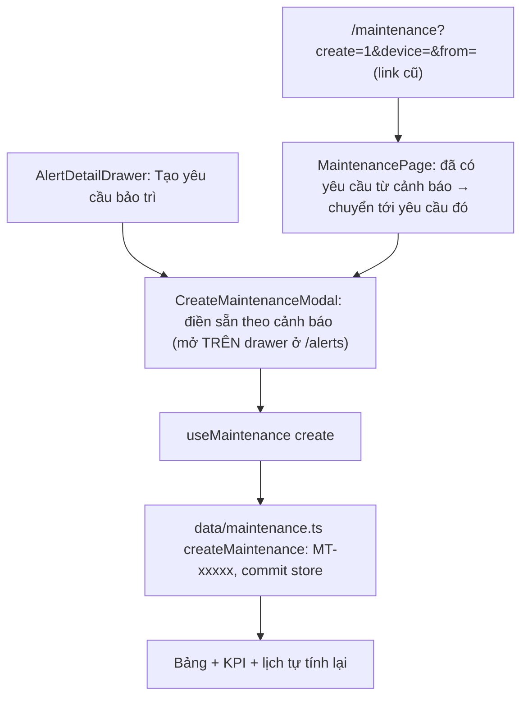

# Bảo trì

Model, quá hạn, modal tạo, chi tiết yêu cầu, tiến độ, nghiệm thu, phân công; kèm bảng mã mock để thử.

Tách nguyên văn từ `GUIDE.md` (28/10/2026) – số mục giữ như cũ (4m, 7b…) để tham chiếu cũ vẫn tìm được. Mục lục: [GUIDE.md](../../GUIDE.md).

### 4d. Bảo trì: model, quá hạn, modal tạo, liên kết từ cảnh báo



**Ngày và quá hạn:** "hôm nay" tính theo giờ nhà máy `Asia/Bangkok` (`src/lib/plantTime.ts`: `plantDayKey`, `daysFromToday`, `plantMonthKey`, `plantDateTimeKey`, `parsePlantDateTime`), không theo múi giờ máy người xem. Mọi hàm ngày trong `src/data/maintenance.ts` (`isOverdue`, `dueLabel`, `matchMaintenance`, `derive*`) nhận `now` từ nơi gọi (trang dùng `useNow(60_000)`), không tự gọi `Date.now()` – test được bằng `now` cố định.

**Quá hạn theo GIỜ (một quy tắc cho danh sách, KPI, thẻ ưu tiên, lịch, trang chi tiết, tóm tắt ở trang tài sản):** còn mở (không `done`/`cancelled`) và `now ≥ giờ hạn` (`isPastDue` trong `src/features/maintenance/deadline.ts`). Hạn chỉ có ngày = cờ `dueHasTime: false` (vẫn lưu `…T23:59` cho khớp hợp đồng) → quá hạn tại 23:59:59, hiển thị "Cuối ngày"; hạn thật 23:59 vẫn là 23:59:00 – phân biệt bằng cờ, không so chuỗi. Nhãn: "Quá hạn N ngày" · "Quá hạn từ 16:00" · "Hết hạn hôm nay" (chưa tới giờ).

**Dời giờ để thử (`?now=`, `src/lib/demoNow.ts`):** chỉ ở dev hoặc `VITE_DEMO=true`; `?now=2026-10-26T11:45` (giờ nhà máy) hoặc ISO có `Z`. Đọc một lần lúc nạp app; dùng cho `useNow` và ngày tương đối của mock. Không ảnh hưởng quy tắc mất tín hiệu.

**Ghim giờ lúc build (`VITE_FIXED_NOW`, demo nội bộ):** `VITE_FIXED_NOW=2026-10-26T11:45 npm run build` → app khởi động ở mốc đó (đồng hồ vẫn chạy tiếp), KPI "Quá hạn"/đồng hồ hạn ổn định khi trình bày. Không đọc từ URL, mặc định tắt; `?now=` (khi được phép) thắng. ⚠ Không đặt trên bản công khai (Vercel) trừ khi thật sự cần – người dùng thật sẽ thấy giờ, hạn và KPI sai.

| Thứ tự đọc | File | Vai trò |
|---|---|---|
| 1 | `src/mocks/maintenance.ts` | `MaintenanceRecord` (gồm trường của form), `maintenanceRecords`, danh mục `PEOPLE`, `DEPARTMENTS`, `SHIFTS`, `CHECKLIST_TEMPLATES` |
| 2 | `src/data/maintenance.ts` | `daysUntilDue`, `isOverdue`, `dueLabel`; `MAINTENANCE_PARAMS`, `matchMaintenance`, `sortMaintenance`; `derive*`; `createMaintenance`, `advanceMaintenance`; `useMaintenance()`; gợi ý AI mock `suggestForRequest`; nháp form |
| 3 | `src/pages/maintenance/MaintenancePage.tsx` | KPI, việc ưu tiên, bảng 7 tab (gồm "Quá hạn"), lịch, mở modal theo URL; mã/nút "Xem chi tiết"/dòng/thẻ ưu tiên/lịch → `/maintenance/:id` (mục 4i). `?open=<id>` cũ → chuyển hướng (drawer đã bỏ). Khối ở `list/`: `MaintenanceSections` (KPI, ưu tiên, lịch), `MaintenanceListSection` (tab, lọc, hàng loạt, bảng), `maintenanceColumns`, `MaintenanceModals`; modal theo URL = `useMaintenanceModals`; CSV = `exportMaintenanceCsv` |
| 4 | `src/pages/maintenance/CreateMaintenanceModal.tsx` + `create/` | Form tạo yêu cầu: hàm thuần `create/createForm.ts` (`blankForm` / `formFromAlert` khởi tạo, `validateCreate`, `toCreateInput`, reducer), state = `useCreateMaintenanceForm`, khối `CreateBanners` / `CreateInfoColumns` / `CreateSections`; lưu nháp |
| 5 | `src/features/maintenance/*` | Thuần, có test: `workflow.ts` (bước, không nhảy bước, hủy, phân công, ghi chú, lịch sử) · `checklist.ts` (tiến độ bỏ mục N/A, khoá theo trạng thái) · `deadline.ts` (giờ hạn, đếm ngược) · `progress.ts` (modal cập nhật tiến độ – mục 4j) · `review.ts` (gửi nghiệm thu + nghiệm thu – mục 4k) |

Quá hạn **không lưu** – tính mỗi lần:

```ts
export const isOverdue = (r: MaintenanceRecord, now = new Date()) =>
  r.status !== 'done' && daysUntilDue(r, now) < 0;
```

| Muốn sửa | Sửa ở |
|---|---|
| Quy tắc quá hạn / nhãn hạn | `isOverdue`, `dueLabel` (`src/data/maintenance.ts`) |
| Các bước trạng thái | `NEXT_STATUS`, `NEXT_ACTION_LABEL`, `advanceRecord`, `cancelRecord` (`src/features/maintenance/workflow.ts`); nhãn `STATUS_LABEL` (`src/data/maintenance.ts`) |
| Cập nhật tiến độ / tạm dừng / sự cố | `src/features/maintenance/progress.ts` (mục 4j) |
| Gửi nghiệm thu / nghiệm thu (Đạt · Cần bổ sung · Không đạt) | `src/features/maintenance/review.ts` (mục 4k) |
| Quy tắc quá hạn / giờ hạn | `isPastDue`, `dueInstant`, `deadlineCountdown` (`src/features/maintenance/deadline.ts`); `isOverdue`, `dueLabel` (`src/data/maintenance.ts`) |
| Trường của form tạo | `MaintenanceRecord` (`src/mocks/maintenance.ts`), `NewMaintenanceInput` + `createMaintenance` (`src/data/maintenance.ts`), `CreateMaintenanceModal.tsx` |
| Liên kết từ cảnh báo | Modal mở ở `AlertsPage.tsx` (`createFor`); liên kết = `sourceAlertId` của yêu cầu (`linkedMaintenance` – một cảnh báo chỉ một yêu cầu chưa hủy, `createMaintenance` ném `DuplicateFromAlertError`); `?create=1&from=` ở `list/useMaintenanceModals.ts` |

### 4i. Chi tiết yêu cầu bảo trì `/maintenance/:id`

Theo ảnh `scratch/figma-ref/mt-detail-design.png` (MT-00128, chưa có node Figma; số đo là **ước lượng**, gom ở `src/styles/tokens.css` khối "Layout chi tiết yêu cầu bảo trì" – sửa một chỗ).

| URL | Kết quả |
|---|---|
| `/maintenance/MT-00128` | Trang chi tiết (chờ danh sách tải xong rồi mới chuẩn hoá mã) |
| `/maintenance/mt-00128?…` | → mã chuẩn (giữ query + state) – `resolveMaintenanceId` |
| `/maintenance/MT-99999` | "Không tìm thấy yêu cầu" (`NotFoundPage`), URL giữ nguyên, nút "Về danh sách bảo trì" |
| `/maintenance?…&open=<id>` | Link cũ (drawer) → `/maintenance/<id>`, `state.from` = danh sách bỏ `open` |

```
URL /maintenance/:id
  → MaintenanceDetailRoute (src/pages/maintenance/MaintenanceDetailPage.tsx – tải / không tìm thấy / chuẩn hoá mã)
  → MaintenanceDetail (src/pages/maintenance/detail/): DetailHeader + DetailStepper · GeneralInfoCard · WorkCards
    (nội dung, checklist, ghi chú, tệp, lịch sử, kết quả) · DetailAside · LiveCards (hạn chót, thiết bị liên quan) ·
    DetailActionBar · DetailModals; useDetailDialog (?submit= / ?review= / ?assign= mở sẵn rồi bỏ khỏi URL) + useChecklistFocus
      useMaintenance()                    src/data/maintenance.ts  (store chung với danh sách)
        ├─ advance(id, actor)  → advanceRecord   (pending → assigned → in-progress → review → done, một bước, + lịch sử)
        ├─ cancel(id, reason)  → cancelRecord    (khi chưa xong; cancelledFrom = bước đã tới)
        ├─ assign(ids, {assignee, department, shift}) → assignRecord
        ├─ toggleChecklist(id, item) → toggleChecklistItem + progress = checklistProgress (bỏ N/A)
        └─ addNote(id, text, actor) → addNoteRecord
      useAlerts → cảnh báo gốc (sourceAlertId) → AlertCard compact ("Lúc cảnh báo" = giá trị lúc phát sinh)
      useRelatedDevice(device)            src/data/maintenanceDetail.ts → useAssetDetail → useLiveData (Mất tín hiệu khi stale)
      LiveDeadline: useNow(1000) chỉ trong ô hạn chót (không vẽ lại cả trang mỗi giây)
```

| Vùng | Component | Ghi chú |
|---|---|---|
| Header | `PageHeader` (breadcrumb "Bảo trì / Quản lý bảo trì / MT-…", nút "← Quay lại danh sách" – thêm ngoài Figma), `Badge` severity `chip` + icon · status md · tag md "Bảo trì khẩn cấp" (= ưu tiên Nghiêm trọng) – cùng cỡ 14px thường | "Quản lý bảo trì" và nút quay lại → URL danh sách cũ: `location.state.from` → `sessionStorage` (`rememberListSearch`, bỏ `open/create/device/from`) → `/maintenance` |
| Dưới header | `WorkflowStepper` | Bước xong = ✓ + primary; `aria-current="step"` ở bước đang chờ; hủy → dừng ở bước đã tới, không còn bước chờ; tạm dừng / gặp sự cố → vẫn bước 3, nhãn phụ dưới "Đang thực hiện" (`note`) |
| Trái (7fr) | `InfoGrid` · mô tả + mục tiêu · `Checklist` · `NotesThread` · `AttachmentCard` · `EventTimeline variant="history"` · kết quả | Checklist chỉ tick khi assigned/in-progress; pending khoá + gợi ý "Tiếp nhận yêu cầu trước…"; review/done/cancelled chỉ đọc; N/A luôn khoá. Xem tệp = modal giữ chỗ "Dữ liệu mẫu"; Tải xuống = Blob `<tên>-mau.txt` (revokeObjectURL) |
| Phải (3fr; ≥ wide = `--mt-aside-width`) | `DeadlineCountdownCard` · `AssigneeCard` (+ modal "Phân công người xử lý" – mục 4l) · `AlertCard variant="compact"` · `KpiCard size="sm"` | Đồng hồ: số lớn `aria-hidden`, câu theo phút trong `role="timer"`, báo một lần khi chuyển quá hạn. Thiết bị: chấm theo tag xấu nhất |
| Đáy | `StickyActionBar` | "Hủy yêu cầu" (hộp xác nhận + lý do, ghi lịch sử) · theo trạng thái: Chờ tiếp nhận → "Tiếp nhận ngay"; Đã phân công / Đang thực hiện → **"Cập nhật tiến độ"** (modal – mục 4j), Đang thực hiện thêm nút phụ **"Gửi nghiệm thu"** (mục 4k); Chờ nghiệm thu → MỘT nút **"Nghiệm thu"** (chỉ `maintenance:review`). Ẩn khi done/cancelled hoặc không có quyền `maintenance:write`. Chèn đệm + `scroll-padding-bottom` → Tab không bị che |

- Dưới `xl` (1280): xếp một cột theo thứ tự **Hạn chót → cột trái → Phân công/Cảnh báo/Thiết bị**. Làm bằng thứ tự DOM + đặt ô lưới ở ≥ xl (Hạn chót cột phải hàng 1, cột trái trải 2 hàng), KHÔNG dùng CSS `order` → thứ tự Tab luôn khớp thứ tự nhìn thấy (ô hạn chót không có phần tử nhận focus).
- Người thao tác (`actor`) = `useAuth().user.name`, không có → `'Admin'`. Quyền chi tiết theo vai trò: TODO khi có backend.
- Thêm loại lịch sử: `MaintenanceHistoryKind` (`src/mocks/maintenance.ts`) + màu `HISTORY_TONE` (`src/data/maintenanceDetail.ts`).
- Khối "Kết quả bảo trì": sau nghiệm thu Đạt = `MaintenanceResult` (`src/pages/maintenance/MaintenanceResult.tsx`, InfoGrid – mục 4k); done cũ (không có `review`) = một dòng ngày hoàn thành.
- InfoGrid thêm "Tiến độ báo cáo", "Checklist x/y" và (khi có cờ) "Lý do tạm dừng" / "Sự cố đang gặp". Khối Checklist có `id="checklist"` (`tabIndex=-1`): URL `#checklist` → cuộn + focus.

### 4j. Cập nhật tiến độ + nghiệm thu (modal "Cập nhật tiến độ bảo trì")

Theo ảnh `scratch/figma-ref/mt-progress-modal-design.png` (chưa có node; số đo ước lượng, lệch ghi `docs/figma-diffs.md`).

```
Danh sách: badge trạng thái (Đã phân công / Đang thực hiện) → ?progress=<id>      ┐
Chi tiết: thanh dính đáy "Cập nhật tiến độ" → state dialog='progress'              ┘→ ProgressUpdateModal (src/pages/maintenance)
  ├─ nháp: loadProgressDraft(id) (sessionStorage, try/catch) – khởi tạo state
  ├─ Cập nhật tiến độ → validateProgressUpdate → onSubmit(input) → useMaintenance().updateProgress
  │                       → applyProgressUpdate (features/maintenance/progress.ts) → clearProgressDraft
  ├─ Lưu nháp → saveProgressDraft (KHÔNG đổi bản ghi) → đóng
  ├─ Hủy / Esc → đã sửa hoặc có nháp: hỏi ở chân modal → "Bỏ thay đổi" xoá nháp
  └─ Mở checklist → (đang sửa: lưu nháp) → /maintenance/:id#checklist
  └─ Chọn "Hoàn thành" → nút chính "Tiếp tục gửi nghiệm thu": KHÔNG ghi bản ghi → onContinueToSubmit({ text, files })
                          → modal "Gửi yêu cầu nghiệm thu" (mục 4k), nội dung điền sẵn vào Tóm tắt
(Không còn "Chuyển nghiệm thu" hàng loạt và hộp "Nghiệm thu đạt"/"Yêu cầu làm lại" – thay bằng mục 4k.)
```

| Ô trong modal | Bản ghi | Bắt buộc nội dung | Lịch sử (`kind`) |
|---|---|---|---|
| Đang thực hiện | `in-progress`, bỏ `hold` | không | `start` (từ Đã phân công) · `resume` (đang tạm dừng/sự cố) · `progress` |
| Tạm dừng | `in-progress` + `hold { kind: 'paused', reason, at }` | lý do | `pause` |
| Gặp sự cố | `in-progress` + `hold { kind: 'blocked', … }` | mô tả | `block` |
| Hoàn thành | KHÔNG ghi – chuyển sang modal Gửi nghiệm thu (khoá khi còn Đã phân công) | không (Tóm tắt bắt buộc ở modal Gửi) | – (`submit` khi Gửi) |

- **Tiến độ báo cáo** `reportedProgress` (0–100, bước 5, được giảm) tách khỏi `progress` (= checklist, bỏ N/A). Thiếu → `reportedProgressOf` lấy tiến độ checklist / `progress`. Thanh trượt mặc định = giá trị đó làm tròn bước 5 (checklist 33 % → 35 %, không tính là thay đổi).
- **Một lần cập nhật = một dòng lịch sử** (vd "Tạm dừng – lý do: Chờ vật tư · 30% → 45% · đính kèm 1 tệp") + nội dung thành một ghi chú kỹ thuật. Không đổi gì → lỗi "Chưa có thay đổi nào để cập nhật".
- **Tệp tải lên** (`UploadTile`, luật `UPLOAD_RULES`: jpg/jpeg/png/webp/pdf/docx/xlsx/txt, ≤ 10 MB, ≤ 5 tệp mỗi lần): object URL CHỈ để xem trước trong modal, revoke khi bỏ tệp / đóng modal. Bản ghi chỉ giữ `{ name, size, kind, isTemp: true }` → trang chi tiết hiện nhãn "Chưa tải lên máy chủ", "Xem" = modal giữ chỗ, không tải xuống. TODO(backend): upload thật.
- **Hạn chót** đỏ khi quá hạn hoặc còn ≤ `NEAR_DUE_MS` (2 giờ) – `isNearOrPastDue` dùng `deadline.ts`.
- **Quyền** (UX, backend kiểm lại): cập nhật tiến độ = `maintenance:write` (TODO: chỉ người được phân công); nghiệm thu = `maintenance:review` (kỹ sư/quản trị).
- `advanceRecord` (workflow.ts) nay chỉ còn Tiếp nhận / Bắt đầu; in-progress → review và review → done/in-progress CHỈ qua `review.ts`.
- **Danh sách**: cờ dưới badge ("Tạm dừng" warning, "⚠ Gặp sự cố" danger, "Không đạt nghiệm thu" danger); tab "Đang thực hiện" vẫn đếm cả hai (status không đổi). Cột "Tiến độ" = tiến độ báo cáo + "Checklist x/y". CSV thêm cột "Tiến độ báo cáo (%)", "Checklist".

| Muốn sửa | Sửa ở |
|---|---|
| Ánh xạ ô → trạng thái, bắt buộc nội dung, câu lịch sử | `applyProgressUpdate`, `validateProgressUpdate`, `historyLine` (`progress.ts`) |
| Ngưỡng "gần hạn" / bước thanh trượt / luật tệp | `NEAR_DUE_MS`, `PROGRESS_STEP`, `UPLOAD_RULES` (`progress.ts`) |
| Giao diện modal | `src/pages/maintenance/ProgressUpdateModal.tsx` + `progress/` (`ProgressSections` = nháp / 5 ô / trạng thái / tiến độ / nội dung, `ProgressFilesSection` = tệp + xem trước, `useProgressUpdateForm` + `progressFormReducer` = state + kiểm tra) |
| Nháp | `saveProgressDraft` / `loadProgressDraft` / `clearProgressDraft` (`src/data/maintenanceDetail.ts`, key `demo-lpg:mt-progress-draft:<id>`) |
| Gửi nghiệm thu / nghiệm thu | mục 4k |
| Phân công / đổi người | mục 4l |

### 4k. Gửi nghiệm thu + nghiệm thu (2 modal theo ảnh)

Ảnh: `scratch/figma-ref/mt-submit-review-modal-design.png` ("Gửi yêu cầu nghiệm thu") và `scratch/figma-ref/mt-review-modal-design.png` ("Nghiệm thu yêu cầu bảo trì") – **chỉ ở máy dev** (`scratch/` gitignore; KHÔNG đặt trong `public/` vì `public/` được deploy công khai), playground chỉ hiện khi `import.meta.env.DEV`; chưa có node; thu nhỏ ×1/3 từ ảnh 3× (modal ≈ 1080 px → `Modal size="xl"` 1072). Lệch ảnh: `docs/figma-diffs.md`.

```
Kỹ thuật viên (in-progress)
  Chi tiết: nút phụ "Gửi nghiệm thu" · Modal tiến độ: "Hoàn thành" → "Tiếp tục gửi nghiệm thu" (?submit=<id> ở danh sách)
  → SubmitReviewModal (src/pages/maintenance)
      ├─ submitMissing(r, form) → badge "Đủ điều kiện gửi nghiệm thu" / "Chưa đủ điều kiện" + danh sách thiếu
      │    (checklist xong trừ N/A · tóm tắt · nguyên nhân · biện pháp · người nghiệm thu ≠ người thực hiện)
      │    thiếu → nút "Gửi nghiệm thu" aria-disabled (vẫn focus được) + aria-describedby = danh sách thiếu
      │    (Button aria-disabled chặn THẬT: click, Enter/Space, gửi form ngầm – test Button.test.tsx)
      ├─ "Chưa khắc phục": vẫn gửi được, câu cảnh báo nối aria-describedby của radiogroup
      ├─ Áp suất / Nhiệt độ: useRelatedDevice (live) – lúc bấm Gửi: snapshotReading (mất tín hiệu → null) + tag + ngưỡng warn từ mocks/assets.ts
      ├─ "Thời gian đề nghị" mặc định = defaultProposedAt(appNow()) – lúc mở + 30 phút, làm tròn LÊN mốc 15 phút; sửa được
      ├─ Lưu nháp → saveSubmitDraft (sessionStorage `demo-lpg:mt-submit-draft:<id>`, không đổi trạng thái)
      └─ Gửi → useMaintenance().submitForReview → submitForReview (review.ts)
             → review, reportedProgress = 100, bỏ hold + cờ Không đạt, lưu `submission`, tóm tắt → ghi chú, MỘT dòng lịch sử `submit`
Người nghiệm thu (review, quyền maintenance:review)
  Chi tiết: MỘT nút "Nghiệm thu" (?review=1 mở sẵn) · Danh sách: badge "Chờ nghiệm thu" → ?review=<id>
  → ReviewModal
      ├─ Người nghiệm thu chỉ đọc = resolveReviewer: người đăng nhập; VITE_AUTH=off → người được chọn khi gửi
      ├─ trùng người thực hiện → nút xác nhận aria-disabled + lý do (validateReview) – chặn tự nghiệm thu
      ├─ Thông số = số CHỤP lúc gửi + "Ngưỡng: x" (không dấu chấm thừa) + "Hiện tại: y" (live, chữ nhỏ)
      └─ reviewRecord: Đạt → done (+ theo dõi N giờ, followUpUntil) · Cần bổ sung → in-progress giữ 100 %
                       · Không đạt → in-progress + reviewFailed + reportedProgress = tiến độ checklist
                       Cần bổ sung / Không đạt: ý kiến bắt buộc → ghi chú (tác giả = người nghiệm thu, "Nghiệm thu: Cần bổ sung – …"),
                       lịch sử chỉ ghi "Nghiệm thu: … – xem ghi chú kỹ thuật"
  Sau Đạt: khối "Kết quả bảo trì" (MaintenanceResult). TODO(backend): cảnh báo tự động khi hết thời gian theo dõi.
```

| Dữ liệu (chỉ FE, `FE_ONLY_FIELDS`) | Kiểu (`src/mocks/maintenance.ts`) |
|---|---|
| `submission` | `{ summary, cause, remedy, deviceCondition: normal\|monitor\|unresolved, readings: { pressure?, temperature?: { tag?, value: number\|null, warn? }, at }, sensorStatus: normal\|monitor\|fault, valveStatus: stable\|leak\|stuck, reviewer, proposedAt?, submittedBy, submittedAt }` |
| `review` | `{ result: pass\|needs-info\|fail, reviewer, comment?, followUpHours?, followUpUntil?, at }` |
| `reviewFailed` | cờ "Không đạt nghiệm thu" (bỏ khi gửi lại) |
| Lịch sử | `submit`, `review-pass`, `review-needs-info`, `review-fail` (màu ở `HISTORY_TONE`) |
| Người nghiệm thu | `REVIEWERS` (mock, tên + chức danh) – TODO: user vai trò engineer/admin |

| Muốn sửa | Sửa ở |
|---|---|
| Điều kiện gửi, câu thiếu | `submitMissing` (`review.ts`) |
| Kết quả nghiệm thu, ý kiến bắt buộc, chặn tự nghiệm thu | `validateReview`, `reviewRecord` (`review.ts`) |
| Tuỳ chọn tình trạng / cảm biến / van / theo dõi | `DEVICE_CONDITION_OPTIONS`, `SENSOR_STATUS_OPTIONS`, `VALVE_STATUS_OPTIONS`, `FOLLOW_UP_OPTIONS` (`review.ts`) |
| Giao diện | `SubmitReviewModal.tsx`, `ReviewModal.tsx`, `MaintenanceResult.tsx` |
| Ngưỡng áp suất / nhiệt độ | `alarms` trong `src/mocks/assets.ts` (qua `useRelatedDevice().limits`) |

**Mã mock để thử luồng** (`src/mocks/maintenance.ts`; dữ liệu trong bộ nhớ – F5 là về lại như cũ; chạy `VITE_AUTH=off npx vite` = phiên giả admin, có cả quyền gửi lẫn nghiệm thu):

| Mã | Trạng thái ban đầu | Dùng để thử |
|---|---|---|
| **MT-00109** | Đang thực hiện · V-101 · Nguyễn Văn A · checklist 7/7 (tên mục như ảnh) · tiến độ báo cáo 80 % | Luồng đầy đủ: "Gửi nghiệm thu" → badge chuyển "Chưa đủ điều kiện" → "Đủ điều kiện" khi điền Tóm tắt/Nguyên nhân/Biện pháp/người nghiệm thu; áp suất/nhiệt độ **trực tiếp** (PT-101/TT-101) được chụp lúc gửi; lịch sử "80% → 100%"; rồi "Nghiệm thu": số chụp + "Hiện tại" live, 3 kết quả, Đạt → khối "Kết quả bảo trì". `/maintenance/MT-00109?submit=1` mở thẳng modal |
| **MT-00117** | Đang thực hiện · V-102 · checklist 2/4 (+1 mục Không áp dụng) | Chưa đủ điều kiện vì checklist: danh sách thiếu "Checklist chưa hoàn thành (2/4)", nút gửi khoá có lý do; thiết bị không có số liệu trực tiếp ("Không có số liệu trực tiếp"). Từ danh sách: `?progress=MT-00117` → "Hoàn thành" → "Tiếp tục gửi nghiệm thu" (`?submit=`, Tóm tắt điền sẵn) |
| **MT-00115** | Chờ nghiệm thu · E-101B · Lê Thị C · đã có hồ sơ gửi (người nghiệm thu Trần Hoàng Nam) | Modal Nghiệm thu có hồ sơ nhưng không có thông số (thiết bị không có live); chặn tự nghiệm thu: đăng nhập tên "Lê Thị C" → nút khoá + lý do; `?review=1` |
| **MT-00114** | Chờ nghiệm thu · GS-03 · KHÔNG có hồ sơ (dữ liệu trước khi có modal Gửi) | Modal Nghiệm thu với hồ sơ cũ: thông báo "chuyển nghiệm thu trước khi có biểu mẫu…", vẫn kết luận được; badge "Chờ nghiệm thu" ở danh sách → `?review=MT-00114` |

Playground mục 13 (`#review`): hai modal với dữ liệu mẫu theo ảnh (không ghi store); ảnh thiết kế chỉ hiện ở dev nếu có file trong `scratch/figma-ref/`.

### 4l. Phân công người xử lý (modal theo ảnh)

Ảnh: `scratch/figma-ref/mt-assign-modal-design.png` (trang 1565 px, chỉ ở máy dev; chưa có node). Lệch ảnh: `docs/figma-diffs.md`.

```
Mở: chi tiết – nút ở AssigneeCard ("Phân công người xử lý" khi Chờ tiếp nhận · "Đổi người xử lý" khi Đã phân công/Đang thực hiện;
      Chờ nghiệm thu/Hoàn thành/Đã hủy: không có nút) · `?assign=1`
    danh sách – badge "Chờ tiếp nhận" là nút (tên "Phân công MT-… – trạng thái: Chờ tiếp nhận") → `?assign=<id>`
    "Tiếp nhận ngay" giữ nguyên (người đăng nhập tự nhận, không mở modal)
  → AssignModal (src/pages/maintenance)
      ├─ Trái: SearchInput + lọc phòng ban / ca + StaffList (radiogroup, KHÔNG chọn sẵn) – nguồn ASSIGNABLE_STAFF
      │    tải việc = computeWorkloads(danh sách yêu cầu, now): đang làm = Đã phân công + Đang thực hiện (người chính),
      │    quá hạn = isPastDue, Bận khi đang làm ≥ BUSY_THRESHOLD (3); tooltip + đọc kèm WORKLOAD_HINT
      ├─ Phải: người chính (Combobox, đồng bộ thẻ trái, nút "Bỏ chọn …"), người phối hợp (nhiều, bỏ người chính),
      │    bắt đầu dự kiến, hạn chót *, ca (chọn người → ca mặc định nếu bản ghi chưa có ca và chưa sửa), ghi chú,
      │    Switch "Gửi thông báo đẩy và SMS" (CHỈ giao diện – TODO backend), [đổi người: Lý do đổi *]
      ├─ validateAssign → chặn: thiếu người chính / hạn, hạn < bắt đầu, đổi người thiếu lý do
      │    → nút xác nhận aria-disabled + aria-describedby = khối lý do (dưới cột phải, trên footer)
      ├─ assignWarnings → KHÔNG chặn: người Bận, có việc quá hạn, ca không khớp giờ bắt đầu, hạn đã qua
      │    (vùng aria-live polite ẩn chỉ chứa chữ; khối nhìn thấy có nút). Modal GIỮ ca của bản ghi; lệch ca + ca mặc định của
      │    người được chọn khác ca đang chọn → nút "Đổi sang Ca N" (`suggestShift`) đổi ngay
      ├─ Lưu tạm → saveAssignDraft (sessionStorage `demo-lpg:mt-assign-draft:<id>`, try/catch; không đổi trạng thái)
      └─ Xác nhận → useMaintenance().assign(id, form) → applyAssignment (features/maintenance/assign.ts)
           phân công: assignRecord (pending → assigned) + phối hợp/bắt đầu/hạn (dueHasTime=true)/ca, phòng ban theo người chính,
                      một dòng lịch sử `assign` ("Phân công: A · phối hợp: … · hạn …"), ghi chú → "Phân công: …"
           đổi người: giữ trạng thái/tiến độ/cờ; lịch sử `reassign` "Đổi người xử lý: A → B – lý do: …";
                      trang chi tiết xoá nháp tiến độ + nháp gửi nghiệm thu của người cũ (sessionStorage)
Hàng loạt (danh sách): chọn người → bulkAssign → planBulkAssign: CHỈ dòng Chờ tiếp nhận qua validateAssign (hạn sẵn có),
  không đổi người hàng loạt; dòng thiếu hạn bỏ qua; thông báo tách lý do (`bulkAssignMessage`):
  "Đã phân công X · bỏ qua N (a không ở Chờ tiếp nhận, b thiếu hạn)" + cảnh báo gộp khi người đó sẽ Bận sau cả lô.
```

| Nhân sự (`src/mocks/maintenance.ts`) | Ý nghĩa |
|---|---|
| `STAFF` `{ id, name, title, department, specialty, defaultShift, role }` | MỘT nguồn. `role`: technician (nhận việc) · engineer (nhận việc + nghiệm thu) · manager (chỉ nghiệm thu) |
| `ASSIGNABLE_STAFF` | technician + engineer – modal phân công, form tạo yêu cầu (`PEOPLE`), hàng loạt (`MAINTENANCE_ASSIGNEES`) |
| `REVIEWER_STAFF` / `REVIEWERS` | manager + engineer – modal Gửi nghiệm thu / Nghiệm thu (danh sách giữ như cũ) |
| `staffByName` | Tra TOÀN BỘ STAFF – bản ghi giao cho người không còn chọn được (vd Hoàng Minh E – trưởng ca) vẫn hiện đúng; `countUnassignableOwners` đếm số bản ghi như vậy (mock hiện tại: 0) |

| Muốn sửa | Sửa ở |
|---|---|
| Ngưỡng Bận, cách tính đang làm/quá hạn | `BUSY_THRESHOLD`, `computeWorkloads` (`assign.ts`) |
| Lỗi chặn / cảnh báo | `validateAssign`, `assignWarnings`, `inShift` (`assign.ts`) |
| Ghi bản ghi, câu lịch sử | `applyAssignment`, `planBulkAssign` (`assign.ts`) |
| Danh mục nhân sự, vai trò | `STAFF` (`mocks/maintenance.ts`) |
| Giao diện | `AssignModal.tsx` + `assign/` (`AssignSections` = dải yêu cầu / cột chọn nhân sự / chi tiết phân công, `useAssignForm` + `assignFormReducer` = state + kiểm tra); thẻ/danh sách `components/StaffPicker` (+ `AssignNotices` – khối cảnh báo/lý do chặn dùng chung); `Switch`; `Avatar` |
| Ngưỡng Bận, `inShift`, nhãn Sẵn sàng/Bận | DÙNG CHUNG với phân công cảnh báo: `features/staff/availability.ts` (`assign.ts` export lại). Modal bảo trì KHÔNG hiện "Ngoài ca" theo giờ hiện tại (việc xếp cho ca sau) – chỉ Sẵn sàng/Bận + cảnh báo ca lệch giờ bắt đầu |
| Nháp | `lib/sessionDraft.ts` (`createSessionDraft`) – khoá giữ `demo-lpg:mt-assign-draft:<id>` |

**Mã mock để thử phân công** (dữ liệu trong bộ nhớ – F5 về như cũ; `VITE_AUTH=off npx vite` = phiên giả admin):

| Mã | Trạng thái ban đầu | Dùng để thử |
|---|---|---|
| **MT-00128** | Chờ tiếp nhận · V-101 · ca 1 trên bản ghi | Modal như ảnh (từ badge danh sách `?assign=MT-00128` hoặc nút ở trang chi tiết); chọn Nguyễn Văn A (đang Bận – 3 việc, 1 quá hạn) → 2 cảnh báo; bắt đầu 14:00 + ca 1 → cảnh báo ca |
| **MT-00122**, **MT-00121** | Chờ tiếp nhận, hạn chỉ có ngày | Phân công từ danh sách; hàng loạt (chọn cùng một dòng Đang thực hiện → "bỏ qua 1") |
| **MT-00127** | Chờ tiếp nhận nhưng đã ghi sẵn tên Trần Bình | Nút vẫn là "Phân công người xử lý", modal không chọn sẵn ai |
| **MT-00124**, **MT-00126** | Đã phân công | "Đổi người xử lý" – lý do bắt buộc; `/maintenance/MT-00124?assign=1` mở thẳng |
| **MT-00119** | Đang thực hiện + cờ Gặp sự cố | Đổi người giữ tiến độ, cờ và trạng thái |
| **MT-00114** | Chờ nghiệm thu | Không có nút phân công / đổi người |

Playground mục 14 (`#assign`): modal (phân công / đổi người, dữ liệu mẫu theo ảnh, không ghi store), StaffList, Switch, Avatar.
