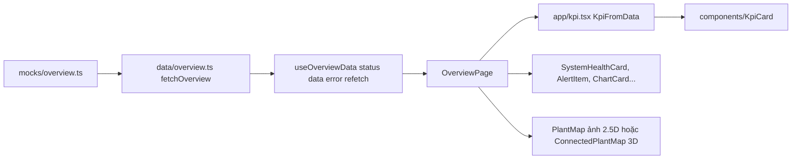
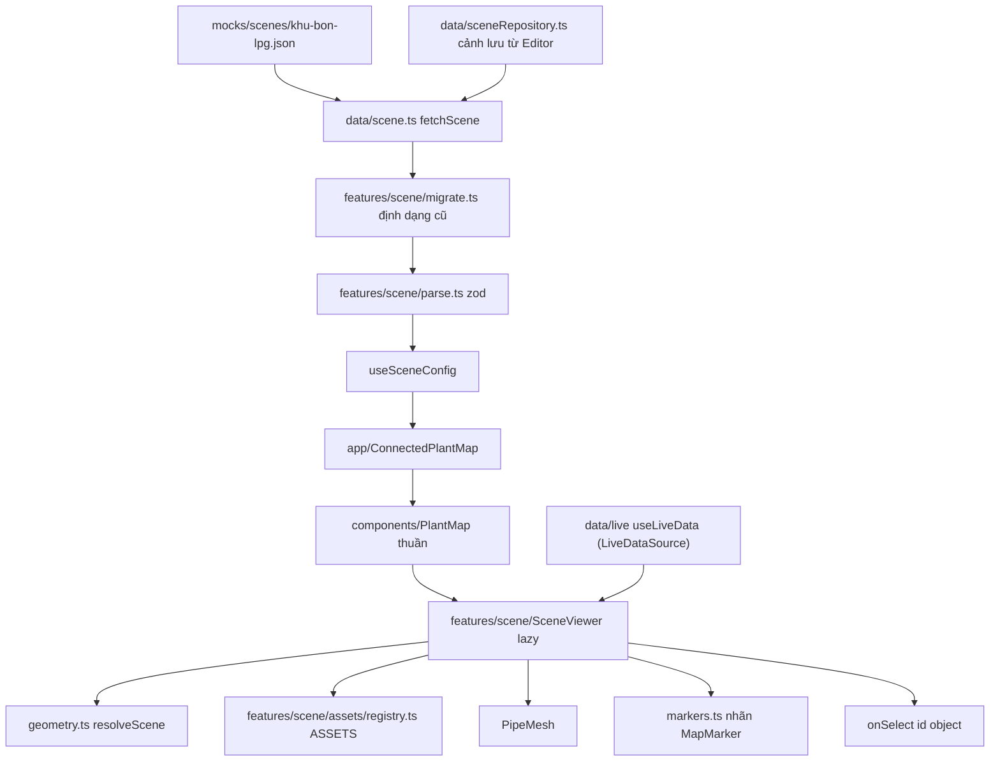
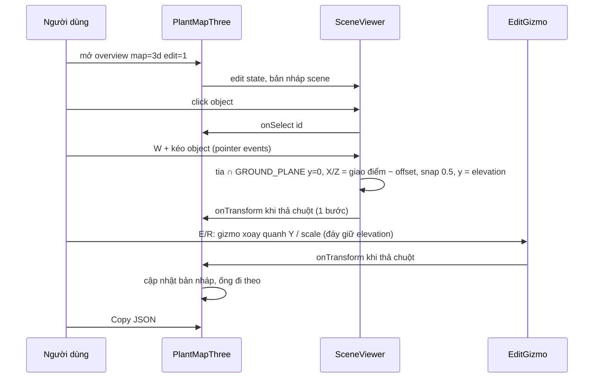
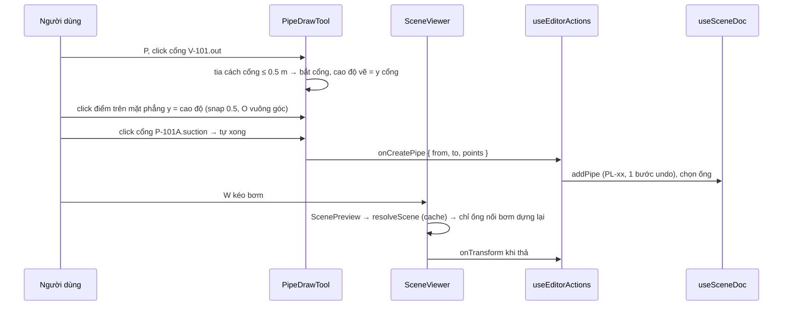

# Tổng quan, bản đồ 3D, Scene Editor, chi tiết tài sản

Luồng dữ liệu Tổng quan, bản đồ 2.5D/3D, chế độ sửa + Scene Editor, trang /map/:assetId; việc hay gặp (KPI, asset 3D, ống, cổng, độ cao, scene).

Tách nguyên văn từ `GUIDE.md` (28/10/2026) – số mục giữ như cũ (4m, 7b…) để tham chiếu cũ vẫn tìm được. Mục lục: [GUIDE.md](../../GUIDE.md).

### 4b. Dữ liệu chảy thế nào (ví dụ: Tổng quan)



| Thứ tự đọc | File | Vai trò |
|---|---|---|
| 1 | `src/mocks/overview.ts` | Mock nguyên văn Figma: `overviewKpis`, `priorityAlarms`, `watchlist`, chart… |
| 2 | `src/mocks/types.ts` | `KpiMock` – dạng KPI thuần (icon là tên, không phải ReactNode) |
| 3 | `src/data/overview.ts` | `OverviewData` (hợp đồng UI–dữ liệu), `fetchOverview()` (chỗ thay API), `useOverviewData()` |
| 4 | `src/pages/overview/OverviewPage.tsx` | 3 trạng thái; KPI → bản đồ → 4 chart; sidebar 4 card |
| 5 | `src/app/kpi.tsx` | `KpiFromData`: `KpiMock` → `<KpiCard>` (tên icon → `<Icon>`) |

Đoạn chính của hook (mọi hook dữ liệu đều theo mẫu này):

```ts
export async function fetchOverview(): Promise<OverviewData> {
  return { systemStatus: mock.systemStatus, kpis: mock.overviewKpis, /* … */ };
}
export function useOverviewData() { /* → { status, data, error, refetch } */ }
```

| Muốn sửa | Sửa ở |
|---|---|
| Nối API thật cho Tổng quan | Thân `fetchOverview()` trong `src/data/overview.ts` |
| Nội dung KPI/thẻ/chart | `src/mocks/overview.ts` |
| Thứ tự/bố cục khối | `src/pages/overview/OverviewPage.tsx` |

### 4e. Bản đồ 3D



**Quy ước mặt sàn:** mọi asset có gốc tại **tâm đáy** (y = 0 cục bộ là sàn, không phần nào dưới 0). Độ cao của object = `elevation` (mặc định 0, `position[1]` luôn bằng nó). Chỉ asset lắp trên ống (`inline`: van, đồng hồ) mới nên nâng; Editor cảnh báo phần còn lại.

**Ranh giới quan trọng:** `src/components/PlantMap/PlantMap.tsx` là component **thuần** – nhận `scene` đã nạp, không gọi hook dữ liệu.
Nạp cảnh nằm ở `src/app/ConnectedPlantMap.tsx` (`useSceneConfig(sceneId)` + 3 trạng thái). Trang Tổng quan truyền `liveData` từ `useLiveData()`.

| Thứ tự đọc | File | Vai trò |
|---|---|---|
| 1 | `src/features/scene/types.ts` | Hợp đồng dữ liệu `SceneConfig`, `SceneObject` (gồm `elevation`), `Pipe`, `ASSET_TYPES`, `LiveData`, `SCENE_SCHEMA_VERSION` (không phụ thuộc three) |
| 2 | `src/mocks/scenes/khu-bon-lpg.json` | Ví dụ cảnh thật: camera, views, thresholds, objects, pipes |
| 3 | `src/data/scene.ts` + `src/data/live/` | `fetchScene` (mock → kho), `useSceneConfig`, `SCENE_IDS`; số liệu: `useLiveData`, `useLiveStatus`, `SENSOR_TAGS` (xem 4b) |
| 4 | `src/features/scene/migrate.ts` → `parse.ts` | `migrateScene` (v1 → v2: position[1] → `elevation`, van/đồng hồ dời pivot, version + 1) rồi validate zod: cấu trúc + tham chiếu (asset, id trùng, cổng ống, params, position[1] = elevation…) |
| 5 | `src/app/ConnectedPlantMap.tsx` | Nạp theo `sceneId` → `PlantMap renderer="three"` |
| 6 | `src/components/PlantMap/PlantMap.tsx` | Khung chung (nút view, zoom, toàn màn hình, 2.5D/3D); lazy-load SceneViewer |
| 7 | `src/features/scene/SceneViewer.tsx` | Canvas R3F: camera, đèn, sàn, object, ống, nhãn, tooltip, preset chất lượng |
| 8 | `src/features/scene/geometry.ts` | `resolveScene`: đặt object (X/Z + `elevation` = đáy), dựng đường cong ống (cổng theo transform thế giới, gồm elevation), object gắn ống (`attach`, đáy = tâm ống − `inline.axisY`) |
| 8b | `src/features/scene/ground.ts` | Thuần: độ cao đáy thế giới (`worldBaseY`, hộp bao spec sau xoay + scale), `mayFloat` (asset lắp trên ống) – dùng cho cảnh báo mặt sàn, Properties, vạch chân |
| 9 | `src/features/scene/assets/specs.ts` → `registry.ts` → `tanks.tsx`/`equipment.tsx`/`structures.tsx` | Spec thuần (tham số, cổng, hộp bao) + component hình học |
| 10 | `src/features/scene/PipeMesh.tsx` | Ống: lõi sáng, vỏ trong mờ, vệt chảy theo `flowTag` (`selected` → vỏ màu primary trong Editor) |
| 10b | `src/features/scene/pipes.ts` | Thuần: cổng thế giới (`portWorld`, bí danh), đường đi ống (`pipePath`), điểm gần nhất/`pointAtT`, vuông góc (`orthoSegment`), `nextPipeId`, va chạm đoạn–hộp bao |
| 11 | `src/features/scene/fields.ts` + `markers.ts` | Bindings → trạng thái (ngưỡng) → nhãn tự sinh `MapMarker` |
| 12 | `src/features/scene/look.ts`, `quality.ts`, `PostEffects.tsx` | Ánh sáng/exposure, preset high/medium/low, bloom + outline |
| 12b | `src/features/scene/sceneReady.tsx`, `src/components/SceneLoading` | Chống nháy khi tải: mọi giai đoạn (dữ liệu cảnh → chunk three → canvas) cùng một `SceneLoading`; `ReadySignal` (cuối `<Canvas>`) báo sẵn sàng sau 3 khung đã vẽ (camera canh khung, nhãn đã đặt; tối đa 5 s) rồi lớp chờ mờ đi; `QualityMonitor` (PerformanceMonitor) chỉ gắn sau khi hiện cảnh 1,5 s – khung đầu chậm do biên dịch shader không làm hạ preset (đổi preset = composer dựng lại = tắt đen một nhịp). Chunk 3D tải song song dữ liệu cảnh (`preloadSceneViewer`) |
| 12c | `src/features/scene/sceneSnapshot.ts` | Mở lại cảnh trong phiên (rời trang rồi quay lại): `ReadySignal` chụp canvas (`toBlob`, microtask sau khung vẽ) theo mã cảnh; lớp chờ (`SceneLoading snapshot`) hiện ảnh đó thay vòng xoay rồi mờ sang canvas mới. Chỉ cảnh xem, camera mặc định (không Editor / `view`). ⚠ Còn lỗi (11/11): ảnh đôi khi chụp lúc camera chưa canh khung xong → ảnh to hơn cảnh thật, chồng hình khi mờ; khung đầu khi quay lại vẫn tối 1 nhịp (ảnh blob chưa kịp vẽ) |

| Muốn sửa | Sửa ở |
|---|---|
| Vị trí/nhãn/binding của object | `src/mocks/scenes/<id>.json` (hoặc dùng `/editor`) – độ cao đặt bằng `elevation` và giữ `position[1]` bằng nó |
| Gốc/đáy của asset (lún, lơ lửng) | Component trong `src/features/scene/assets/*.tsx` (bọc `<group position-y>`) + `bounds` trong `specs.ts`; đo bằng `diagnose.mjs` |
| Ngưỡng cảnh báo | `thresholds` trong JSON cảnh, hoặc ngưỡng riêng trong binding |
| Ống (đường đi, cổng nối, tag lưu lượng) | `/editor` (công cụ Vẽ ống P + Thuộc tính ống) hoặc `pipes` trong JSON (`from/to` = `"objectId.port"`) |
| Cổng nối của asset | `layout().ports` + `portAliases` trong `specs.ts` (kèm họng/bích trong component) |
| Hình dáng thiết bị | `src/features/scene/assets/*.tsx` |
| Ánh sáng, màu nét viền, bloom | `src/features/scene/look.ts` |
| Nhãn hiển thị thế nào | `src/features/scene/markers.ts`, `src/components/PlantMap/MapMarker.tsx` |
| Xử lý khi bấm object | Prop `onSelect` của `PlantMap` (Tổng quan hiện chưa truyền; ví dụ có ở `src/pages/playground/SceneSection.tsx`) |

### 4f. Chế độ sửa nhanh (`?edit=1` trên bản đồ) và Scene Editor



| File | Vai trò |
|---|---|
| `src/pages/overview/OverviewPage.tsx` | Đọc `?edit=1` → `editable` |
| `src/components/PlantMap/PlantMap.tsx` | `PlantMapThree`: bản nháp, thanh sửa (Di chuyển/Xoay), `copyJson` |
| `src/features/scene/EditTools.tsx` | `SceneEditState`, `GROUND_PLANE` + `groundHit` (bỏ tia gần song song/quá xa), `startGroundDrag` (kéo trên sàn: X/Z, giữ elevation, snap 0.5 m, Alt tắt snap, Esc huỷ, nhóm cùng delta, tắt OrbitControls), `EditGizmo` (chỉ xoay quanh Y / scale giữ đáy), `SelectionFootprints` (vạch chân + "đáy ±x m"), chọn bằng tia/vùng, viền sàn |
| `src/features/scene/editConstants.ts` | Hằng thuần: snap (0.5 m, 15°, 0.1, độ cao 0.25 m), vùng sàn ±60 m, ngưỡng tia sàn (`GROUND_GRAZING_DOT` 0.05, `GROUND_WORK_LIMIT` 120 m), MIME kéo thả |
| `src/features/scene/SceneViewer.tsx` | `onPointerDownCapture`: chế độ Di chuyển → nắm object dưới con trỏ → `startGroundDrag`; Shift+kéo → chọn vùng; `onDrop` → `groundHit` + snap |

Scene Editor đầy đủ (`/editor?edit=1`) dùng cùng SceneViewer:

| File | Vai trò |
|---|---|
| `src/pages/editor/EditorPage.tsx` | Bố cục 3 cột, ghép các khối + hook bên dưới |
| `src/pages/editor/EditorFileBar.tsx` · `EditorStatusBar.tsx` · `EditorSidePanel.tsx` · `EditorDialogs.tsx` | Thanh tệp · thanh trạng thái · tab Thuộc tính/Góc nhìn/Kiểm tra · mọi hộp thoại (kiểu `EditorDialog`) |
| `src/pages/editor/useSceneFile.ts` | Mở lần đầu, cảnh mới/mở/lưu/lưu bản mới, import/export JSON, khôi phục/bỏ nháp, `?scene=` |
| `src/pages/editor/useEditorShortcuts.ts` · `useEditorSession.ts` | Phím tắt · thông báo, tự lưu nháp, chặn rời trang, dọn selection |
| `src/pages/editor/useEditorActions.ts` | Thêm/xoá/nhân bản/copy/dán/đổi id |
| `src/features/scene-editor/store.ts` | `useSceneDoc` (zustand + zundo, undo/redo) và `useEditorUi` (chọn, công cụ, ẩn/khoá) |
| `src/features/scene-editor/ops.ts` | Biến đổi thuần trên `SceneConfig`, sinh id theo `idPrefix`; `setElevation`, `alignObjects`, `cleanObject` (giữ position[1] = elevation) |
| `src/features/scene-editor/validate.ts` | Lỗi zod + cảnh báo (tag lạ, ngoài sàn, lún dưới sàn, đáy ≠ elevation, lơ lửng) |
| `src/data/sceneRepository.ts` | `SceneRepository` + `LocalStorageRepository` |
| `src/pages/editor/PropertiesPanel.tsx` | Vị trí X/Z, `ElevationField` (snap 0.25 + "Đặt xuống sàn"), góc quanh Y, `GroupPlacement` (Căn hàng X/Z, elevation nhóm) |
| `Outliner.tsx`, `AssetLibrary.tsx`, `ViewsPanel.tsx`, `ValidationPanel.tsx`, `dialogs.tsx` | Các bảng của Editor |

Vẽ và sửa ống trong Editor (3D-4):



| File | Vai trò |
|---|---|
| `src/features/scene/pipes.ts` | Hình học ống thuần dùng chung (Editor, validate, ops) |
| `src/features/scene/PipeTools.tsx` | `PipeDrawTool` (vẽ), `PortMarkers`, `PipeHandles` + `startPointDrag` (kéo điểm gập) |
| `src/features/scene/EditTools.tsx` | `planeHit` (mặt phẳng ngang bất kỳ), `startAttachDrag` (kéo van/đồng hồ dọc ống), callback ống trong `SceneEditState` |
| `src/features/scene/geometry.ts` | `CurveCache`, `ScenePreview` + `applyPreview` |
| `src/features/scene/SceneViewer.tsx` | Chọn ống, click đoạn = thêm điểm, Delete điểm, bắt tay nắm trong `onPointerDownCapture` |
| `src/features/scene-editor/ops.ts` | `addPipe`, `updatePipe`, `removePipes`, `renamePipe`, `insertPipePoint`, `reversePipe`, `attachToPipe`, `detachFromPipe`, `removeObjects(…, 'keep' \| 'delete')` |
| `src/pages/editor/PropertiesPanel.tsx` | `PipeProperties`, "Gắn lên ống" / "Tháo khỏi ống" |
| `src/pages/editor/useEditorShortcuts.ts` · `EditorDialogs.tsx` | Phím P/O, hộp "Xoá – còn ống liên quan" |

Phím tắt Editor: xem bảng trong `docs/decisions.md` mục Scene Editor. Đặc biệt: **W** rồi kéo thẳng object (không còn gizmo trục, không có trục Y), giữ **Alt** để tắt snap, **Esc** huỷ khi đang kéo; **G** bật/tắt lưới + vạch chân và nhãn khoảng cách đáy–sàn của object đang chọn.

Vì sao không dùng TransformControls để di chuyển: gizmo kéo theo mặt phẳng hướng về camera (tay nắm giữa/mặt XY, YZ) nên khi đổi góc nhìn trục Y bị lẫn vào → object lơ lửng/lún. Kéo bằng tia ∩ mặt sàn y = 0 cố định không phụ thuộc camera; frame có tia gần song song sàn (|dot| < 0.05) bị bỏ để object không vọt ra xa.

### 4h. Chi tiết tài sản `/map/:assetId` (GĐ 5D)

Theo ảnh người dùng gửi `scratch/figma-ref/asset-v101-design.png` (chưa có node Figma). Menu "Bản đồ nội khu" (`path: '/map'`) sáng cho mọi đường dẫn bắt đầu bằng `/map` (`navIdFromPath` so tiền tố).

| URL | Kết quả |
|---|---|
| `/map` | `<Navigate>` → `/map/V-101` (`DEFAULT_ASSET_ID` trong `src/app/assetRoutes.ts`) – chưa có bản đồ toàn nhà máy |
| `/map/V-101` | Trang chi tiết |
| `/map/v-101?…` | → `/map/V-101?…` (`resolveAssetId` không phân biệt hoa thường, giữ query) |
| `/map/XYZ` | "Không tìm thấy tài sản" (`NotFoundPage`), URL giữ nguyên, tab vẫn sáng, nút "Mở V-101" |
| `/operations/:id` | Link cũ → `/map/:id` (giữ query) |
| route lạ (`*`) | "Không tìm thấy trang" (`src/pages/NotFoundPage.tsx`), không tự về Tổng quan |

Link tới trang chi tiết: dùng `assetPath(id)` (`src/app/assetRoutes.ts`, file nhẹ để router trong bundle chính import không kéo mock); kiểm tra có trang bằng `resolveAssetId` (`src/data/assetDetail.ts`). Đang có: Tổng quan – click object trên bản đồ 3D (`PlantMap onSelect`) và dòng "Theo dõi thiết bị" (`AssetWatchlist onAssetClick` + `canOpen`: chỉ dòng có trang mới là nút).

```
URL /map/V-101
  → AssetDetailRoute (src/pages/asset/AssetDetailPage.tsx – chuẩn hoá mã / không tìm thấy) → AssetDetail (src/pages/asset/detail/:
    AssetKpiSection · StorageCard · AssetAside · AssetEventsCard · assetView (hàm hiển thị, tankLayerItems) · useAssetCreateRequest)
      useAssetDetail('V-101')            src/data/assetDetail.ts
        ├─ fetchAssetDetail → mocks/assets.ts (kích thước bồn, định mức, ngưỡng, tag, số tạm) + sự kiện
        ├─ useLiveData(4 tag của V-101)  → TagValue
        └─ deriveAssetLive(detail, live, now)   thuần, có test
             ├─ reading(): pending / lost (Mất tín hiệu) / ok + trạng thái theo ngưỡng
             └─ tankLayers(LT-101, LT-101W, kích thước)  features/tank/layers.ts
                  → % + m³ của LPG lỏng / pha hơi / nước đáy (làm tròn sao cho tổng = 100.0)
      useAlerts → deriveRelatedAlerts (thiết bị liên quan: V-101, PSV-101, các tag của bồn)
      useMaintenance → deriveMaintenanceSummary (việc chưa xong hạn sớm nhất · hoàn thành gần nhất, `now`)
      useTableFilters(EVENT_PARAMS) → bảng sự kiện, `?hide=` = loại đang ẩn (chú thích là nút bật/tắt)
```

| Vùng | Component | Ghi chú |
|---|---|---|
| Trái | `AssetModelPanel` (src/app) | Cảnh riêng `mocks/scenes/v-101.json`; nhãn "V-101 DOME / Temp" từ TT-101; nút toàn màn hình (`useFullscreen`); WebGL lỗi / cảnh lỗi → `assetV101Image` (WebP chụp từ chính cảnh) |
| Giữa | 6 `KpiCard dense` + Card "Trạng thái tồn chứa" (`TankCutawayDiagram`, `TankLayerList`) | "Mức bồn" = % thể tích toàn bộ chất lỏng (LPG + nước) – có tooltip ⓘ; khác dòng "LPG lỏng" |
| Phải | `DonutGauge center`, `AlertItem layout="inline"`, `MaintenanceSummaryCard` | "Xem tất cả" / "Lịch sử cảnh báo" → `/alerts?q=V-101&range=30d` |
| Dưới | `DataTable` 5 dòng + chú thích lọc | "Xem toàn bộ nhật ký" tắt (chưa có trang) |

- **Một nguồn thông số**: tên tag giả định ở `src/features/live/tags.ts` (`SYSTEM_TAGS`, `V101_TAGS`, `VAPORIZER_TAGS`); kích thước bồn, áp suất **định mức thiết kế** (12.0 bar – thông số chế tạo) và **ngưỡng cảnh báo** (áp suất 10.5 / 12, nhiệt độ 40 / 50, mức 85/95/15/5, nước đáy 3 / 5 %) ở `src/mocks/assets.ts`. Cảnh 3D là JSON nên vẫn ghi chuỗi tag/ngưỡng → `src/mocks/assets.test.ts` so JSON với hai file trên (đổi một bên mà quên bên kia → test đỏ).
- **Số tạm** (`placeholders` trong `mocks/assets.ts`, mỗi mục `{ value, isPlaceholder: true, note }`): xu hướng thể tích 1 h, tồn kho Nm³, số ngày dự kiến, sức khỏe thiết bị, tình trạng hồ sơ. UI hiện như ảnh, ghi chú nằm ở tooltip/aria của thẻ.
- **Tạo yêu cầu bảo trì**: `?create=1` → `CreateMaintenanceModal` (dùng lại của /maintenance), thiết bị = tài sản; tạo xong: thông báo + link "Xem trong Bảo trì" (`/maintenance/<id>`), `announce()`.
- **Thêm tài sản khác**: thêm mục vào `assetMocks` (+ tag vào `tags.ts`, cảnh `mocks/scenes/<id>.json`, ảnh dự phòng trong `FALLBACK_IMAGE` của trang). Mã lạ → Card lỗi liệt kê mã có.
- Chụp lại ảnh dự phòng khi đổi cảnh: script `e2e/fallback.mjs` trong scratchpad (vùng 3D ở dpr 2 → PIL WebP q78, ~17 KB).

## 5. Cách làm các việc hay gặp (phần của luồng này)

**Thêm KPI vào Tổng quan**
1. Thêm phần tử `KpiMock` vào `overviewKpis` trong `src/mocks/overview.ts` (`id`, `label`, `value`, `unit`, `icon` là tên trong `src/assets/digital-twin/index.ts`).
2. Nếu cần biến thể (danger, with-progress, compact): xem `KpiCardProps` trong `src/components/KpiCard/KpiCard.tsx`.
3. Lưới đang 6 cột (`grid-cols-3 … min-[1520px]:grid-cols-6`) trong `src/pages/overview/OverviewPage.tsx` – chỉnh nếu số KPI đổi.
4. KPI của Cảnh báo/Bảo trì **không** sửa mock: sửa `deriveAlertKpis` (`src/data/alerts.ts`) hoặc `deriveMaintenanceKpis` (`src/data/maintenance.ts`).

**Thêm loại asset 3D**
1. Thêm tên vào `ASSET_TYPES` trong `src/features/scene/types.ts` (đúng nhóm equipment/environment).
2. Thêm spec vào `ASSET_SPECS` trong `src/features/scene/assets/specs.ts`: `label`, `category`, `idPrefix` (tiền tố id khi Editor tự sinh), `paramsSchema`, `dataFields` (trường cho bindings, nhãn/đơn vị lấy từ `FIELD_META`), `layout(params)` trả `{ ports, bounds, labelAnchor? }`.
   - `ports`: tên cổng → toạ độ cục bộ; ống nối bằng `"id.tênCổng"` (`from`/`to`), zod báo lỗi nếu sai tên.
   - `bounds`: hộp bao cục bộ (dùng helper `box(min, max)` có sẵn trong file) – quyết định khung camera khi bay tới và vị trí nhãn (đỉnh hộp nếu không có `labelAnchor`).
   - Tham số đọc trong `layout` bằng `params.ten!` (đã gộp mặc định).
3. Viết component trong `src/features/scene/assets/` (vd `equipment.tsx`): nhận `AssetComponentProps` (`{ params, path }`), lấy vật liệu bằng `useAssetMaterials()`, chi tiết dùng lại từ `parts.tsx` (`Flange`, `Ladder`, `Railing`…).
   - **Gốc toạ độ tại tâm đáy, Y lên, không phần nào dưới y = 0** (`bounds.min[1] = 0`). Hình dựng quanh tâm (vd van quanh trục ống) → bọc trong `<group position-y={…}>` dịch lên; asset lắp trên ống khai báo `inline: { axisY }` trong spec.
   - Kiểm tra: đo hộp bao three (script `diagnose.mjs` trong scratchpad e2e, dùng `window.__sceneThree` ở dev) – min.y phải = 0.
4. Trong `src/features/scene/assets/registry.ts`: import component ở đầu file, rồi thêm `'ten-asset': TenComponent` vào `COMPONENTS`.
5. Thêm hình vẽ vào `PATHS` trong `src/pages/editor/AssetGlyph.tsx` (TypeScript báo lỗi nếu thiếu). Thư viện asset của Editor tự liệt kê theo `ASSET_TYPES`.
6. Kiểm tra: `npm run typecheck`, rồi thêm object vào cảnh (JSON trong `src/mocks/scenes/` hoặc `/editor`) và mở `/overview?scene=<id>`. Validate zod tự nhận loại mới (params ngoài min–max, cổng sai… hiện thành Card lỗi).

**Vẽ một ống nối 2 thiết bị (Editor)**
1. `/editor?edit=1` → **P** (Vẽ ống). Chấm xám = cổng của các object.
2. Click gần cổng đầu (≤ 0.5 m, chấm sáng lên) → cao độ vẽ lấy theo cổng; ô "Cao độ vẽ" / PageUp/PageDown để đổi.
3. Click các điểm gập (snap 0.5 m; **O** bật vuông góc tự chèn góc; giữ **Alt** để đặt tự do, không bắt cổng).
4. Click cổng cuối → ống tự xong (hoặc Enter/double-click để kết thúc ở điểm tự do). Esc huỷ, Backspace xoá điểm cuối.
5. Thuộc tính ống: đặt flowTag, bán kính, đổi id. Kéo chấm để dời điểm, click vào đoạn để thêm điểm, chọn chấm + Delete để xoá.
6. Van/đồng hồ trên ống: thêm asset → Thuộc tính "Gắn lên ống" → W kéo dọc ống.
7. Bảng Kiểm tra: đầu hở, xuyên thiết bị, điểm trùng.

**Thêm cổng cho asset**
1. Thêm tên → toạ độ cục bộ vào `ports` trong `layout()` của asset (`src/features/scene/assets/specs.ts`); mở rộng `bounds` nếu cổng nằm ngoài.
2. Vẽ họng + `Flange` tại đúng toạ độ trong component (`tanks.tsx`/`equipment.tsx`/`structures.tsx`).
3. Muốn tên chung (in/out) mà giữ tên cũ trong dữ liệu: thêm `portAliases: { in: 'tênCũ' }` – zod và `resolveScene` nhận cả hai, Editor lưu tên thật.
4. Kiểm tra: script `ports.mjs` (scratchpad) in bảng cổng; công cụ P hiển thị chấm cổng mới.

**Nâng object khỏi sàn / hạ xuống sàn**
1. `/editor`: chọn object → Thuộc tính → ô **Elevation** (snap 0.25 m) hoặc **Đặt xuống sàn**; nhiều object: mục "Căn chỉnh".
2. JSON: thêm `"elevation": 1.2` và sửa `position[1]` = 1.2 (zod báo lỗi nếu hai số khác nhau).
3. Chỉ van/đồng hồ (`inline` trong spec) nên nâng; loại khác bảng Kiểm tra báo "lơ lửng". Bật G để xem vạch chân và khoảng cách đáy.

**Đổi định dạng cảnh (migration)**
1. Tăng `SCENE_SCHEMA_VERSION` (`src/features/scene/types.ts`) và mô tả khác biệt trong JSDoc.
2. Thêm bước chuyển trong `migrateScene` (`src/features/scene/migrate.ts`, thuần, không zod) – giữ nguyên hình ảnh của cảnh cũ, tăng `version`.
3. Sửa schema zod (`parse.ts`): `schemaVersion: z.literal(SCENE_SCHEMA_VERSION)` + trường mới.
4. Chuyển các file `src/mocks/scenes/*.json` (version + 1); `compare.mjs` (scratchpad) so trước/sau.
5. Mọi đường nạp đã gọi `migrateScene`: `parseSceneConfig`/`validateSceneConfig` (mock, kho, API), Import JSON (`useSceneFile`), bản nháp (`draft.ts`).

**Thêm scene mới**
1. Cách nhanh: `/editor?edit=1` → dựng → "Lưu thành bản mới" (lưu localStorage) → mở `/overview?scene=<id>`.
2. Cách cố định (cảnh mẫu): tạo `src/mocks/scenes/<id>.json` theo `SceneConfig` (`src/features/scene/types.ts`, có `"schemaVersion": 2`; thiếu thì được coi là định dạng cũ và migrate); `import.meta.glob` trong `src/data/scene.ts` tự nhận, `SCENE_IDS` tự thêm.
3. Mở `/overview?scene=<id>`; JSON sai → Card lỗi liệt kê từng lỗi zod.
4. Đổi cảnh mặc định của Tổng quan: `DEFAULT_SCENE_ID` trong `src/pages/overview/OverviewPage.tsx`.
